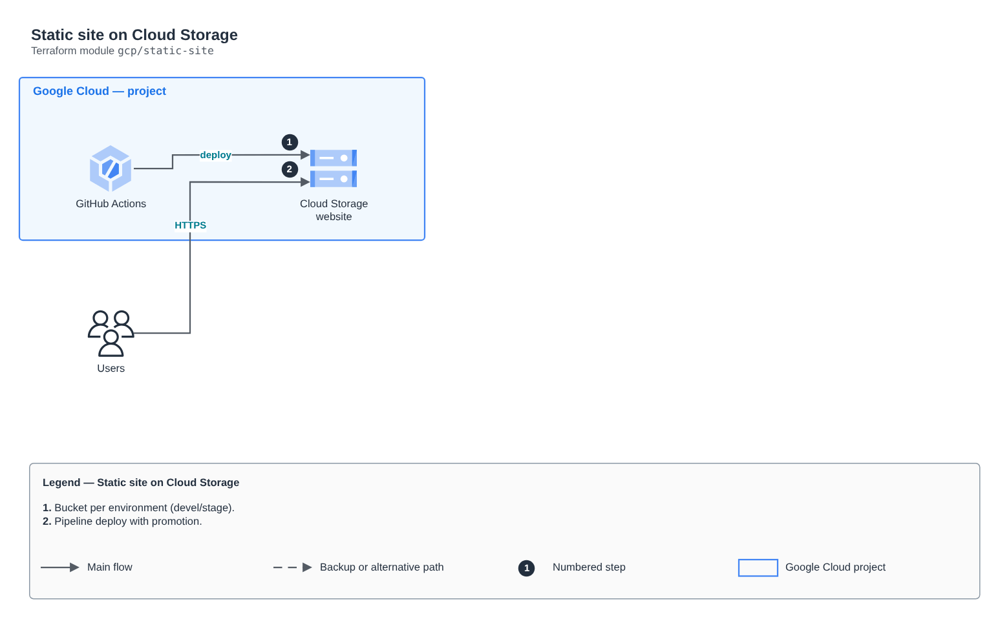

# Static site on Cloud Storage

[Português](README.md) · **English**

> `gcp/static-site` · category **borda** · origin: Architecture case studies (2026)

> Designed in October 2026 and published now.

Static site on Cloud Storage per environment, with an access log bucket, versioning for rollback and public access controlled by a variable.

## Architecture



Editable source: [`diagram.drawio`](diagram.drawio) (open it in draw.io / diagrams.net), with Portuguese and English pages.

1. Bucket per environment (devel/stage).
2. Pipeline deploy with promotion.

## Usage

```hcl
module "static_site" {
  source = "git::https://github.com/raphaelfcs/automacao_terraform.git//gcp/static-site?ref=v1.0.0"

  project_id  = "demo-plataforma-dev"
  environment = "devel"
  app_name    = "site"
}
```

## Examples

| Example | Files |
|---|---|
| [`devel`](examples/devel) | `main.tf`, `locals.tf`, `backend.tf` |

Each example has its own backend (state isolated per module and example). Different environments only use another `backend.tf`/`*.tfvars`, without duplicating code.

## Inputs

| Name | Type | Default | Required | Description |
|---|---|---|---|---|
| `project_id` | `string` | - | **yes** | GCP project ID where the buckets are created. |
| `environment` | `string` | - | **yes** | Environment name (devel or stage). |
| `app_name` | `string` | - | **yes** | Short app name, used in bucket names (lowercase letters, numbers and hyphens). |
| `location` | `string` | `"US"` | no | Bucket region/multi-region (e.g. US, SOUTHAMERICA-EAST1). |
| `public_access_enabled` | `bool` | `false` | no | true = site open to the Internet (test window). false = closed (public access prevention enforced). |
| `site_source_dir` | `string` | `null` | no | Local directory with the build files. null = no upload. |
| `main_page_suffix` | `string` | `"index.html"` | no | Site main page. |
| `not_found_page` | `string` | `"404.html"` | no | 404 error page. |
| `enable_versioning` | `bool` | `true` | no | Enables object versioning in the site bucket (rollback). |
| `log_retention_days` | `number` | `30` | no | Access log retention days in the audit bucket. |
| `force_destroy` | `bool` | `false` | no | Allows destroying buckets with objects (true in labs; false in production). |
| `labels` | `map(string)` | `{}` | no | Additional labels applied to the buckets. |

## Outputs

| Name | Description |
|---|---|
| `site_bucket_name` | Site bucket name. |
| `logs_bucket_name` | Access log bucket name (audit). |
| `site_url` | Public site URL (returns 200 only when public_access_enabled = true). |
| `public_access_enabled` | Current public access state. |
| `uploaded_files` | Files published to the bucket. |

## Files

- `iam.tf`: policies, roles and permissions
- `locals.tf`: derived values
- `main.tf`: main resources
- `outputs.tf`: outputs
- `variables.tf`: inputs and validations
- `versions.tf`: Terraform and provider versions
- `examples/`: ready-to-use compositions
- `tests/`: `terraform test` with mocked providers

## Well-Architected

- Security: private origin, WAF and modern TLS at the edge.
- Performance: edge caching and compression.

## Tests

```bash
cd gcp/static-site
terraform init -backend=false
terraform test
```
