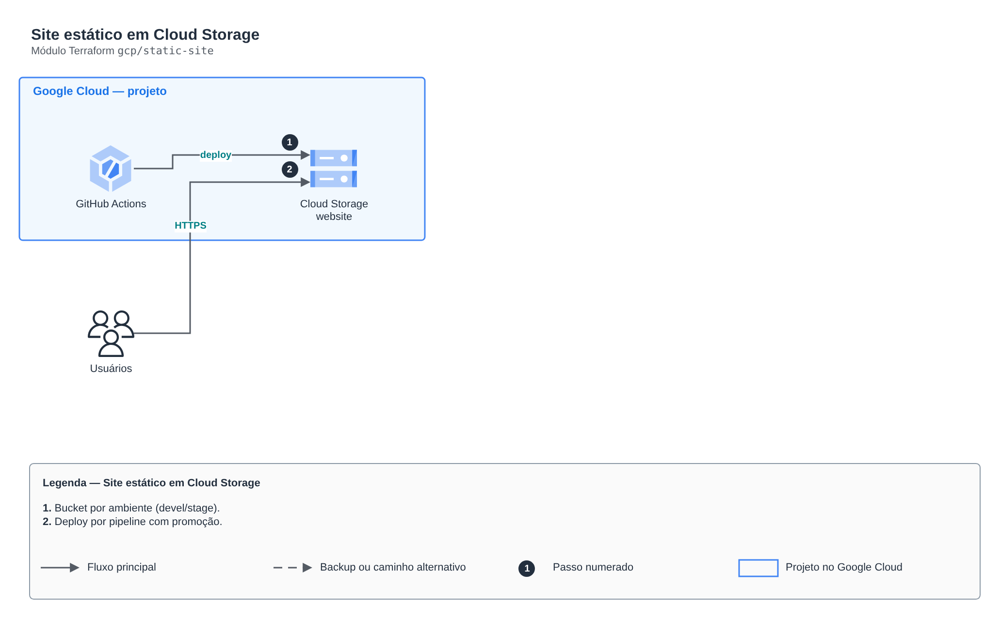

# Site estático em Cloud Storage

**Português** · [English](README.en.md)

> `gcp/static-site` · categoria **borda** · origem: Estudos de caso de arquitetura (2026)

> Idealizado em outubro de 2026 e publicado agora.

Site estático no Cloud Storage por ambiente, com bucket de logs de acesso, versionamento para rollback e acesso público controlado por variável.

## Arquitetura



Fonte editável: [`diagram.drawio`](diagram.drawio) (abra no draw.io / diagrams.net), com páginas em português e inglês.

1. Bucket por ambiente (devel/stage).
2. Deploy por pipeline com promoção.

## Uso

```hcl
module "static_site" {
  source = "git::https://github.com/raphaelfcs/automacao_terraform.git//gcp/static-site?ref=v1.0.0"

  project_id  = "demo-plataforma-dev"
  environment = "devel"
  app_name    = "site"
}
```

## Exemplos

| Exemplo | Arquivos |
|---|---|
| [`devel`](examples/devel) | `main.tf`, `locals.tf`, `backend.tf` |

Cada exemplo tem seu próprio backend (state isolado por módulo e exemplo). Ambientes diferentes usam apenas outro `backend.tf`/`*.tfvars`, sem duplicar código.

## Entradas

| Nome | Tipo | Padrão | Obrigatória | Descrição |
|---|---|---|---|---|
| `project_id` | `string` | - | **sim** | ID do projeto GCP onde os buckets serão criados. |
| `environment` | `string` | - | **sim** | Nome do ambiente (devel ou stage). |
| `app_name` | `string` | - | **sim** | Nome curto da aplicação, usado no nome dos buckets (minúsculas, números e hífen). |
| `location` | `string` | `"US"` | não | Região/multirregião dos buckets (ex.: US, SOUTHAMERICA-EAST1). |
| `public_access_enabled` | `bool` | `false` | não | true = site aberto à Internet (janela de teste). false = fechado (public access prevention enforced). |
| `site_source_dir` | `string` | `null` | não | Diretório local com os arquivos do build. null = não faz upload. |
| `main_page_suffix` | `string` | `"index.html"` | não | Página principal do site. |
| `not_found_page` | `string` | `"404.html"` | não | Página de erro 404. |
| `enable_versioning` | `bool` | `true` | não | Habilita versionamento de objetos no bucket do site (rollback). |
| `log_retention_days` | `number` | `30` | não | Dias de retenção dos logs de acesso no bucket de auditoria. |
| `force_destroy` | `bool` | `false` | não | Permite destruir buckets com objetos (true em laboratório; false em produção). |
| `labels` | `map(string)` | `{}` | não | Labels adicionais aplicadas aos buckets. |
| `assets_cache_control` | `string` | `"public, max-age=3600"` | não | Cache-Control dos arquivos que não são HTML/JSON. |
| `extra_objects` | `map(string)` | `{}` | não | Objetos gerados pela IaC: caminho -> conteúdo (ex.: { "config.json" = jsonencode(...) }), publicados sem cache. |

## Saídas

| Nome | Descrição |
|---|---|
| `site_bucket_name` | Nome do bucket do site. |
| `logs_bucket_name` | Nome do bucket de logs de acesso (auditoria). |
| `site_url` | URL pública do site (responde 200 só quando public_access_enabled = true). |
| `public_access_enabled` | Estado atual do acesso público. |
| `uploaded_files` | Arquivos publicados no bucket. |

## Arquivos

- `iam.tf`: políticas, papéis e permissões
- `locals.tf`: valores derivados
- `main.tf`: recursos principais
- `outputs.tf`: saídas
- `variables.tf`: entradas e validações
- `versions.tf`: versões do Terraform e providers
- `examples/`: composições prontas para uso
- `tests/`: `terraform test` com providers simulados

## Well-Architected

- Segurança: origem privada, WAF e TLS moderno na borda.
- Performance: cache na borda e compressão.

## Testes

```bash
cd gcp/static-site
terraform init -backend=false
terraform test
```
