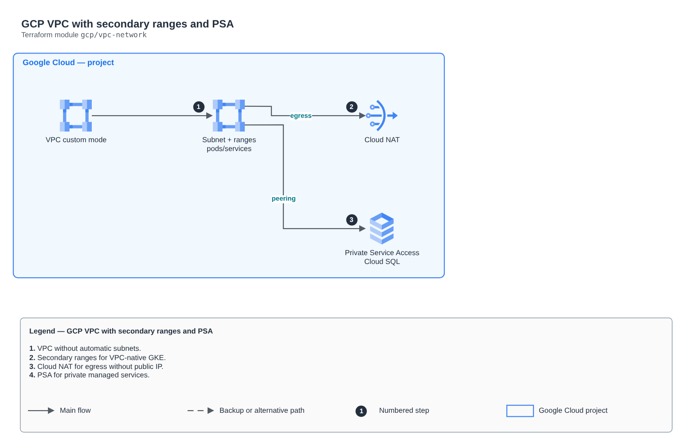

# GCP VPC with secondary ranges and PSA

[Português](README.md) · **English**

> `gcp/vpc-network` · category **rede** · origin: Architecture case studies (2026)

> Designed in October 2026 and published now.

Custom-mode VPC with a subnet and secondary ranges for GKE, Cloud NAT for egress without public IP and Private Service Access for managed services.

## Architecture



Editable source: [`diagram.drawio`](diagram.drawio) (open it in draw.io / diagrams.net), with Portuguese and English pages.

1. VPC without automatic subnets.
2. Secondary ranges for VPC-native GKE.
3. Cloud NAT for egress without public IP.
4. PSA for private managed services.

## Usage

```hcl
module "vpc_network" {
  source = "git::https://github.com/raphaelfcs/automacao_terraform.git//gcp/vpc-network?ref=v1.0.0"

  project_id = "demo-plataforma-dev"
  region     = local.region
  subnet     = { name = "sn-gke-sp", cidr = "10.10.0.0/20", pods_cidr = "10.20.0.0/16", services_cidr = "10.30.0.0/20" }
  psa_range  = { address = "10.40.0.0", prefix_length = 16 }
}
```

## Examples

| Example | Files |
|---|---|
| [`gke`](examples/gke) | `main.tf`, `locals.tf`, `backend.tf` |

Each example has its own backend (state isolated per module and example). Different environments only use another `backend.tf`/`*.tfvars`, without duplicating code.

## Inputs

| Name | Type | Default | Required | Description |
|---|---|---|---|---|
| `project_id` | `string` | - | **yes** |  |
| `region` | `string` | - | **yes** |  |
| `network_name` | `string` | `"vpc-lab"` | no |  |
| `subnet` | `object(...)` | - | **yes** | GKE subnet with secondary ranges for pods and services. |
| `psa_range` | `object(...)` | - | **yes** | Range reserved for managed services with private IP (Cloud SQL). |

## Outputs

| Name | Description |
|---|---|
| `network_id` |  |
| `network_self_link` |  |
| `subnet_self_link` |  |
| `pods_range_name` |  |
| `services_range_name` |  |
| `psa_connection` |  |

## Files

- `locals.tf`: derived values
- `main.tf`: main resources
- `outputs.tf`: outputs
- `variables.tf`: inputs and validations
- `versions.tf`: Terraform and provider versions
- `examples/`: ready-to-use compositions
- `tests/`: `terraform test` with mocked providers

## Well-Architected

- Reliability: resources spread across availability zones and no single point of failure for egress.
- Security: isolated subnet tiers, source-based rules and flow logs enabled.

## Tests

```bash
cd gcp/vpc-network
terraform init -backend=false
terraform test
```
