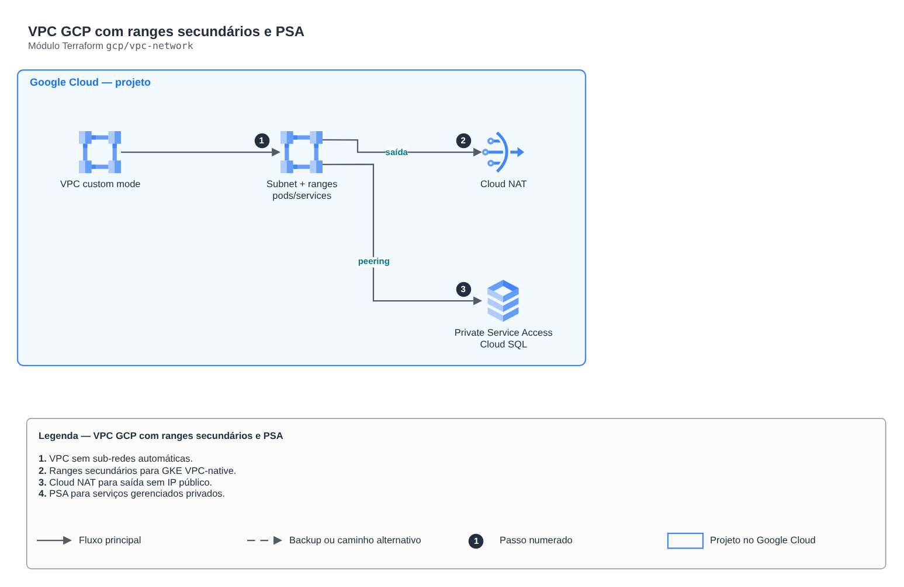

# VPC GCP com ranges secundários e PSA

**Português** · [English](README.en.md)

> `gcp/vpc-network` · categoria **rede** · origem: Estudos de caso de arquitetura (2026)

> Idealizado em outubro de 2026 e publicado agora.

VPC em modo custom com sub-rede e faixas secundárias para GKE, Cloud NAT para saída sem IP público e Private Service Access para serviços gerenciados.

## Arquitetura



Fonte editável: [`diagram.drawio`](diagram.drawio) (abra no draw.io / diagrams.net), com páginas em português e inglês.

1. VPC sem sub-redes automáticas.
2. Ranges secundários para GKE VPC-native.
3. Cloud NAT para saída sem IP público.
4. PSA para serviços gerenciados privados.

## Uso

```hcl
module "vpc_network" {
  source = "git::https://github.com/raphaelfcs/automacao_terraform.git//gcp/vpc-network?ref=v1.0.0"

  project_id = "demo-plataforma-dev"
  region     = local.region
  subnet     = { name = "sn-gke-sp", cidr = "10.10.0.0/20", pods_cidr = "10.20.0.0/16", services_cidr = "10.30.0.0/20" }
  psa_range  = { address = "10.40.0.0", prefix_length = 16 }
}
```

## Exemplos

| Exemplo | Arquivos |
|---|---|
| [`gke`](examples/gke) | `main.tf`, `locals.tf`, `backend.tf` |

Cada exemplo tem seu próprio backend (state isolado por módulo e exemplo). Ambientes diferentes usam apenas outro `backend.tf`/`*.tfvars`, sem duplicar código.

## Entradas

| Nome | Tipo | Padrão | Obrigatória | Descrição |
|---|---|---|---|---|
| `project_id` | `string` | - | **sim** |  |
| `region` | `string` | - | **sim** |  |
| `network_name` | `string` | `"vpc-lab"` | não |  |
| `subnet` | `object(...)` | - | **sim** | Sub-rede do GKE com as faixas secundárias de pods e serviços. |
| `psa_range` | `object(...)` | - | **sim** | Faixa reservada para serviços gerenciados com IP privado (Cloud SQL). |

## Saídas

| Nome | Descrição |
|---|---|
| `network_id` |  |
| `network_self_link` |  |
| `subnet_self_link` |  |
| `pods_range_name` |  |
| `services_range_name` |  |
| `psa_connection` |  |

## Arquivos

- `locals.tf`: valores derivados
- `main.tf`: recursos principais
- `outputs.tf`: saídas
- `variables.tf`: entradas e validações
- `versions.tf`: versões do Terraform e providers
- `examples/`: composições prontas para uso
- `tests/`: `terraform test` com providers simulados

## Well-Architected

- Confiabilidade: recursos distribuídos por zonas de disponibilidade e sem ponto único de falha na saída.
- Segurança: camadas de sub-rede isoladas, regras por origem e logs de fluxo habilitados.

## Testes

```bash
cd gcp/vpc-network
terraform init -backend=false
terraform test
```
