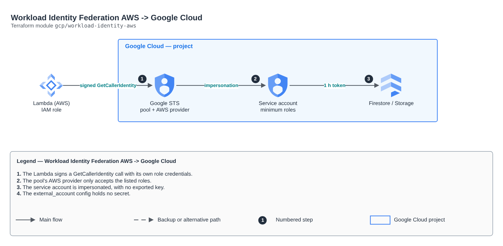

# Workload Identity Federation AWS -> Google Cloud

[Português](README.md) · **English**

> `gcp/workload-identity-aws` · category **seguranca** · origin: Health records platform (2026)

> Designed in November 2026 and published now.

Workload Identity Federation from AWS to Google Cloud, with no service account key: AWS IAM roles (Lambda, ECS, EC2) exchange their own temporary credentials for a GCP token and impersonate a service account with minimum roles. Only the listed roles get in (provider condition). The credential_config output is the "external_account" JSON that google-auth reads (it holds no secret).

## Architecture



Editable source: [`diagram.drawio`](diagram.drawio) (open it in draw.io / diagrams.net), with Portuguese and English pages.

1. The Lambda signs a GetCallerIdentity call with its own role credentials.
2. The pool's AWS provider only accepts the listed roles.
3. The service account is impersonated, with no exported key.
4. The external_account config holds no secret.

## Usage

```hcl
module "workload_identity_aws" {
  source = "git::https://github.com/raphaelfcs/automacao_terraform.git//gcp/workload-identity-aws?ref=v1.0.0"

  project_id         = local.project_id
  pool_id            = "aws-dev"
  aws_account_id     = "123456789012"
  aws_role_names     = ["demo-dev-replicador"]
  service_account_id = "demo-dev-aws"
  project_roles      = ["roles/datastore.user"]
}
```

## Examples

| Example | Files |
|---|---|
| [`lambdas`](examples/lambdas) | `main.tf`, `locals.tf`, `backend.tf` |

Each example has its own backend (state isolated per module and example). Different environments only use another `backend.tf`/`*.tfvars`, without duplicating code.

## Inputs

| Name | Type | Default | Required | Description |
|---|---|---|---|---|
| `project_id` | `string` | - | **yes** | GCP project. |
| `pool_id` | `string` | - | **yes** | Workload identity pool ID (4 to 32 characters). |
| `aws_account_id` | `string` | - | **yes** | AWS account the workloads come from. |
| `aws_role_names` | `list(string)` | - | **yes** | IAM role names (not ARNs) that may assume the service account. Predictable names avoid a circular dependency between states. |
| `service_account_id` | `string` | - | **yes** | ID of the service account the AWS workloads assume. |
| `project_roles` | `list(string)` | `[]` | no | Project roles of the service account (minimum required). |
| `allow_self_sign` | `bool` | `false` | no | Lets the account sign with its own identity (Cloud Storage signed URLs). |

## Outputs

| Name | Description |
|---|---|
| `credential_config` | external_account JSON for google-auth (no secret). Pass it to the workload in an environment variable. |
| `service_account_email` | Service account assumed by the AWS workloads. |
| `provider_name` | Full provider name (audience). |

## Files

- `locals.tf`: derived values
- `main.tf`: main resources
- `outputs.tf`: outputs
- `variables.tf`: inputs and validations
- `versions.tf`: Terraform and provider versions
- `examples/`: ready-to-use compositions
- `tests/`: `terraform test` with mocked providers

## Well-Architected

- Security: least privilege in policies, customer-managed key encryption and an audit trail.
- Operational excellence: everything declared in code, reviewed in PRs and tested with `terraform test`.

## Tests

```bash
cd gcp/workload-identity-aws
terraform init -backend=false
terraform test
```
