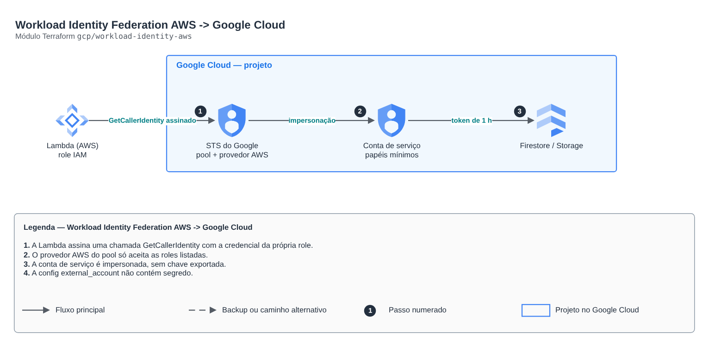

# Workload Identity Federation AWS -> Google Cloud

**Português** · [English](README.en.md)

> `gcp/workload-identity-aws` · categoria **seguranca** · origem: Plataforma de documentos de saúde (2026)

> Idealizado em novembro de 2026 e publicado agora.

Workload Identity Federation AWS -> Google Cloud, sem chave de conta de serviço: roles IAM da AWS (Lambda, ECS, EC2) trocam a própria credencial temporária por um token do GCP e assumem uma conta de serviço com papéis mínimos. Só as roles listadas entram (condição no provedor). A saída credential_config é o JSON "external_account" que a google-auth lê (não contém segredo).

## Arquitetura



Fonte editável: [`diagram.drawio`](diagram.drawio) (abra no draw.io / diagrams.net), com páginas em português e inglês.

1. A Lambda assina uma chamada GetCallerIdentity com a credencial da própria role.
2. O provedor AWS do pool só aceita as roles listadas.
3. A conta de serviço é impersonada, sem chave exportada.
4. A config external_account não contém segredo.

## Uso

```hcl
module "workload_identity_aws" {
  source = "git::https://github.com/raphaelfcs/automacao_terraform.git//gcp/workload-identity-aws?ref=v1.0.0"

  project_id         = local.project_id
  pool_id            = "aws-dev"
  aws_account_id     = "123456789012"
  aws_role_names     = ["demo-dev-replicador"]
  service_account_id = "demo-dev-aws"
  project_roles      = ["roles/datastore.user"]
}
```

## Exemplos

| Exemplo | Arquivos |
|---|---|
| [`lambdas`](examples/lambdas) | `main.tf`, `locals.tf`, `backend.tf` |

Cada exemplo tem seu próprio backend (state isolado por módulo e exemplo). Ambientes diferentes usam apenas outro `backend.tf`/`*.tfvars`, sem duplicar código.

## Entradas

| Nome | Tipo | Padrão | Obrigatória | Descrição |
|---|---|---|---|---|
| `project_id` | `string` | - | **sim** | Projeto do GCP. |
| `pool_id` | `string` | - | **sim** | ID do workload identity pool (4 a 32 caracteres). |
| `aws_account_id` | `string` | - | **sim** | Conta AWS de onde vêm os workloads. |
| `aws_role_names` | `list(string)` | - | **sim** | Nomes das roles IAM (não ARNs) que podem assumir a conta de serviço. Nomes previsíveis evitam dependência circular entre os estados. |
| `service_account_id` | `string` | - | **sim** | ID da conta de serviço que os workloads da AWS assumem. |
| `project_roles` | `list(string)` | `[]` | não | Papéis de projeto da conta de serviço (mínimo necessário). |
| `allow_self_sign` | `bool` | `false` | não | Permite à conta assinar com a própria identidade (URLs assinadas do Cloud Storage). |

## Saídas

| Nome | Descrição |
|---|---|
| `credential_config` | JSON external_account para a google-auth (sem segredo). Passe ao workload por variável de ambiente. |
| `service_account_email` | Conta de serviço assumida pelos workloads da AWS. |
| `provider_name` | Nome completo do provedor (audience). |

## Arquivos

- `locals.tf`: valores derivados
- `main.tf`: recursos principais
- `outputs.tf`: saídas
- `variables.tf`: entradas e validações
- `versions.tf`: versões do Terraform e providers
- `examples/`: composições prontas para uso
- `tests/`: `terraform test` com providers simulados

## Well-Architected

- Segurança: privilégio mínimo nas políticas, criptografia com chave gerenciada pelo cliente e trilha de auditoria.
- Excelência operacional: tudo declarado em código, revisado em PR e testado com `terraform test`.

## Testes

```bash
cd gcp/workload-identity-aws
terraform init -backend=false
terraform test
```
