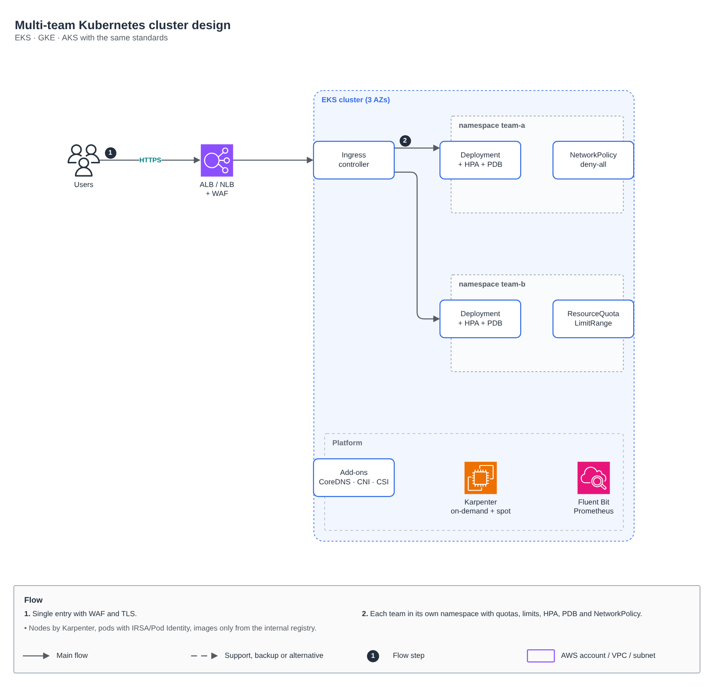
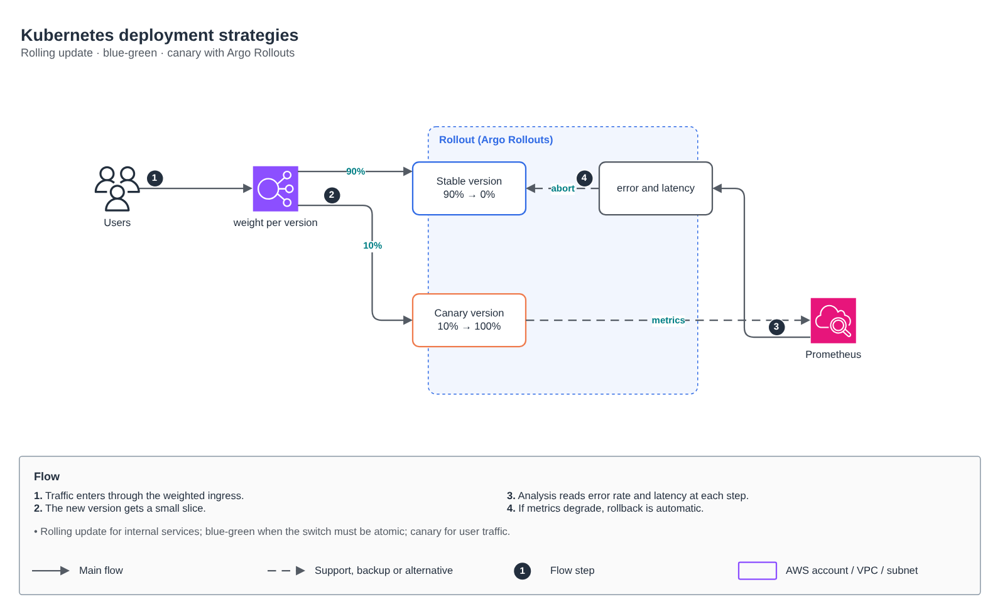
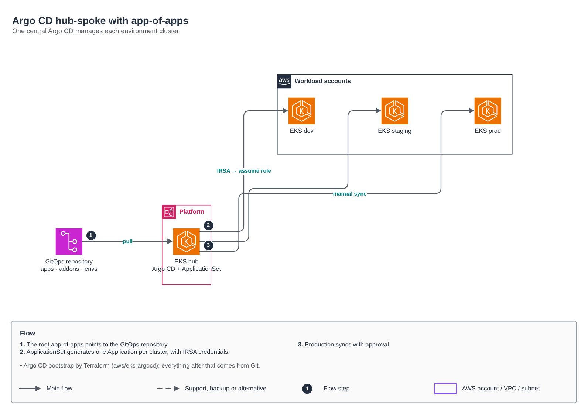
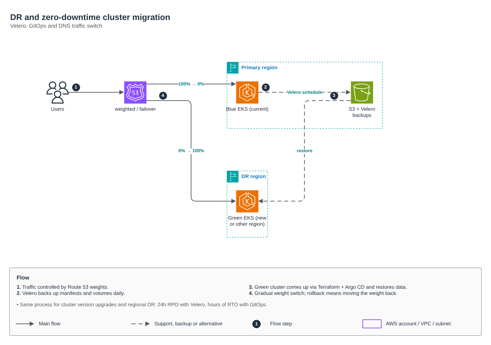

# Kubernetes: design, delivery and DR

🇺🇸 English · 🇧🇷 [Português](README.md)

Patterns I use on EKS and GKE in production. Each folder has the editable diagram (`desenho.drawio`, PT and EN pages) and a PNG per language (`desenho-1.png` PT, `desenho-2.png` EN).

| Topic | What it shows |
|---|---|
| [design](design) | Multi-team cluster: single entry with WAF, one namespace per team with ResourceQuota, LimitRange, HPA, PDB and deny-all NetworkPolicy; Karpenter (on-demand + spot), IRSA/Pod Identity and images only from the internal registry. |
| [estrategias-de-deploy](estrategias-de-deploy) | Rolling update, blue-green and canary with Argo Rollouts: weighted traffic, an AnalysisTemplate reading error rate and latency from Prometheus, and automatic rollback. |
| [argocd](argocd) | Hub-spoke Argo CD: app-of-apps, an ApplicationSet generating one Application per cluster (dev, staging, prod) with IRSA credentials; production syncs with approval. Bootstrapped by the [aws/eks-argocd](../aws/eks-argocd) module. |
| [dr](dr) | DR and zero-downtime cluster migration: Velero with daily backups to S3, a green cluster built by Terraform + Argo CD, gradual weight shift in Route 53. The same process covers version upgrades and regional DR (24h RPO, RTO in hours). |

Related modules: [aws/eks-cluster](../aws/eks-cluster), [aws/eks-node-group](../aws/eks-node-group), [aws/eks-addons](../aws/eks-addons), [aws/eks-argocd](../aws/eks-argocd), [aws/eks-fluent-bit](../aws/eks-fluent-bit), [gcp/gke-private](../gcp/gke-private). Pipelines delivering to these clusters: [pipelines](../pipelines).
