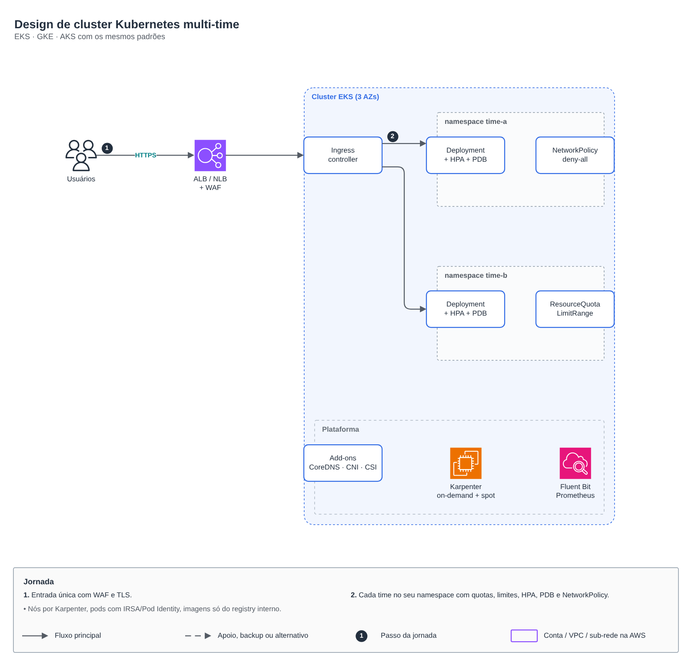
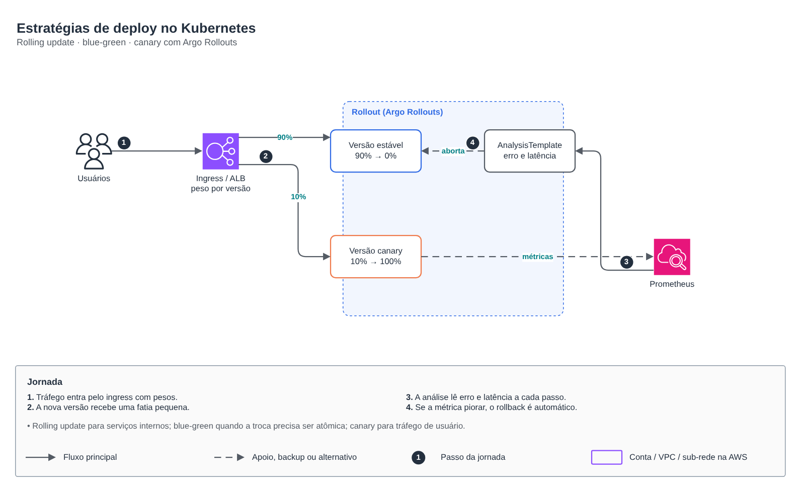
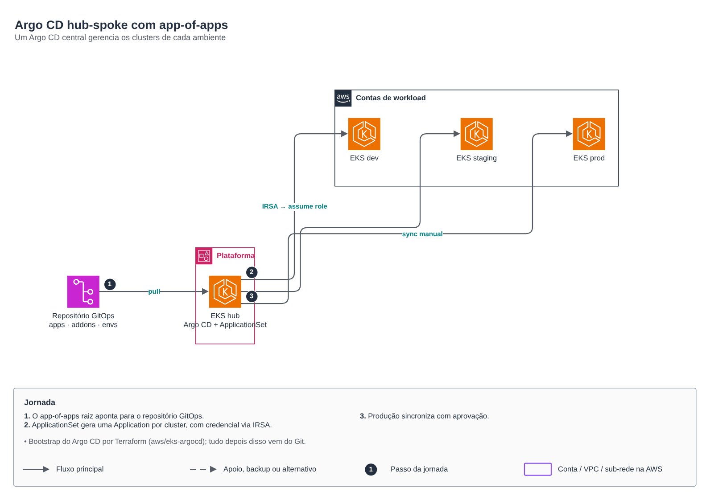
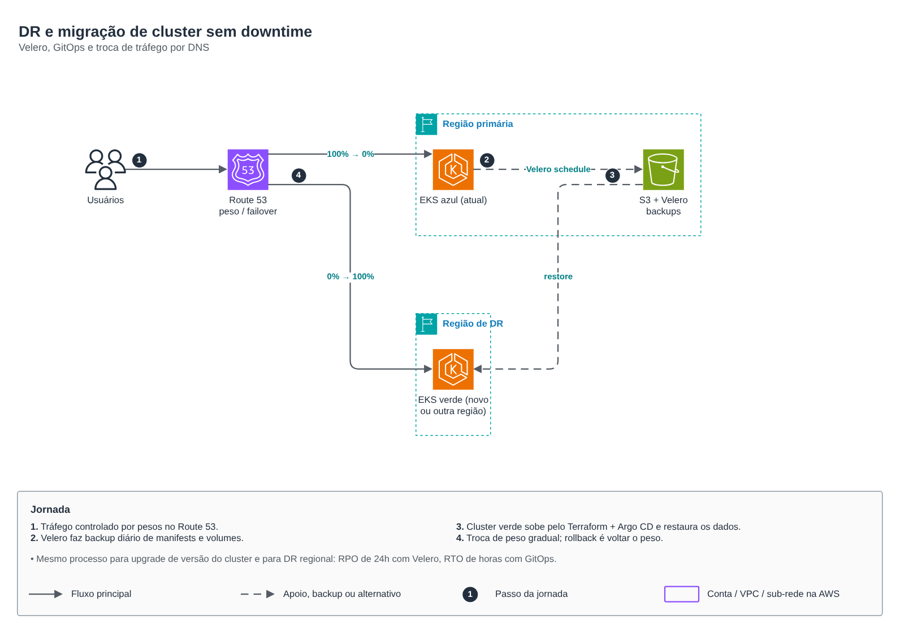

# Kubernetes: design, entrega e DR

🇧🇷 Português · 🇺🇸 [English](README.en.md)

Padrões que uso em EKS e GKE em produção. Cada pasta tem o desenho editável (`desenho.drawio`, páginas PT e EN) e o PNG de cada idioma (`desenho-1.png` PT, `desenho-2.png` EN).

| Tema | O que mostra |
|---|---|
| [design](design) | Cluster multi-time: entrada única com WAF, namespace por time com ResourceQuota, LimitRange, HPA, PDB e NetworkPolicy deny-all; Karpenter (on-demand + spot), IRSA/Pod Identity e imagens só do registry interno. |
| [estrategias-de-deploy](estrategias-de-deploy) | Rolling update, blue-green e canary com Argo Rollouts: tráfego por pesos, AnalysisTemplate lendo erro e latência no Prometheus e rollback automático. |
| [argocd](argocd) | Argo CD hub-spoke: app-of-apps, ApplicationSet gerando uma Application por cluster (dev, staging, prod) com credencial via IRSA; produção sincroniza com aprovação. Bootstrap pelo módulo [aws/eks-argocd](../aws/eks-argocd). |
| [dr](dr) | DR e migração de cluster sem downtime: Velero com backup diário em S3, cluster verde criado por Terraform + Argo CD, troca gradual de peso no Route 53. O mesmo processo serve para upgrade de versão e para DR regional (RPO 24h, RTO de horas). |

Módulos relacionados: [aws/eks-cluster](../aws/eks-cluster), [aws/eks-node-group](../aws/eks-node-group), [aws/eks-addons](../aws/eks-addons), [aws/eks-argocd](../aws/eks-argocd), [aws/eks-fluent-bit](../aws/eks-fluent-bit), [gcp/gke-private](../gcp/gke-private). Pipelines que entregam nesses clusters: [pipelines](../pipelines).
