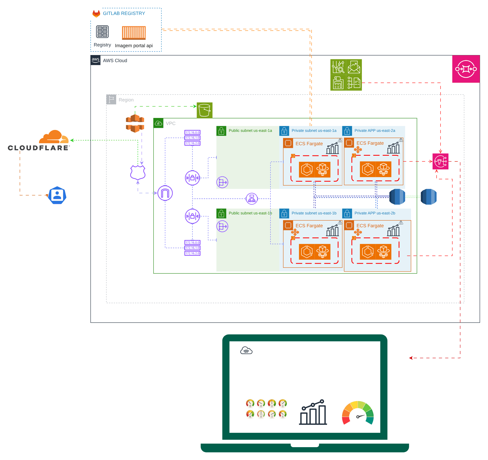
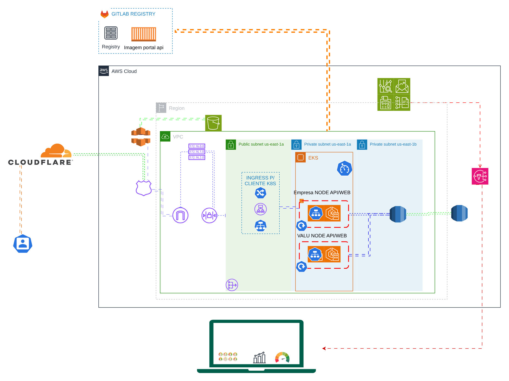
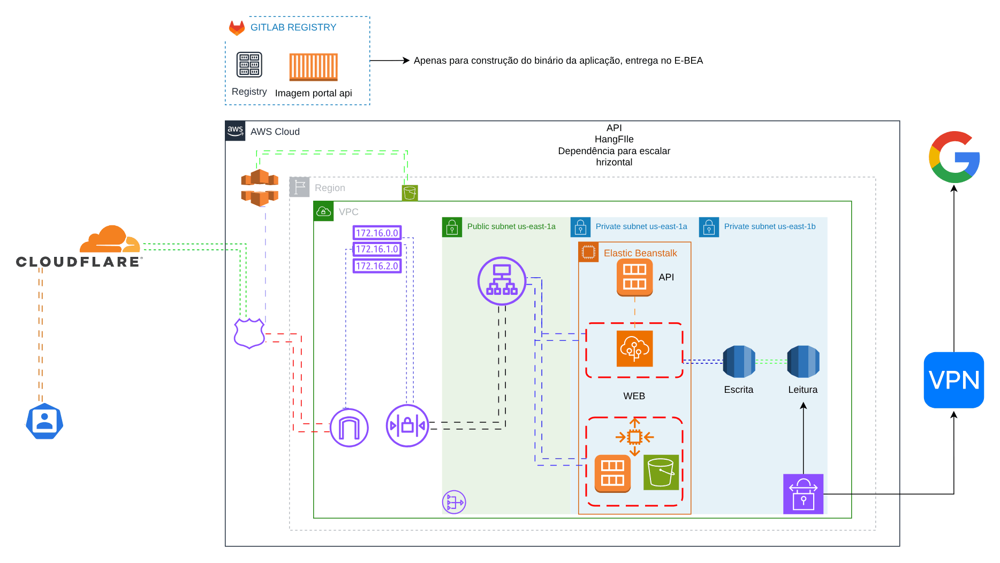
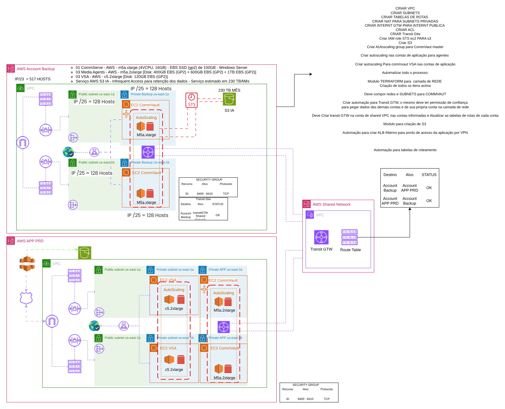

# Opções de computação: ECS Fargate, EKS e Beanstalk

> Plataforma de benefícios em AWS (2023)

Mesma aplicação de benefícios desenhada em ECS Fargate, EKS e Elastic Beanstalk, com borda CDN/WAF, registry e backlog de atividades da migração.

## Desenho

Fonte editável: [`desenho.drawio`](desenho.drawio). Abra no draw.io para navegar pelas páginas.

### 1. ECS-FARGATE



### 2. eks



### 3. Beanstalk



### 4. COnVoult



## Componentes identificados no desenho

- Amazon EKS → módulo [`aws/eks-cluster`](../../../../aws/eks-cluster)
- Amazon ECS/Fargate: serviços em ECS/Fargate ficam no repositório da aplicação (task definition + service); a rede, o ECR e o banco vêm daqui
- Amazon S3 → módulo [`aws/s3-bucket`](../../../../aws/s3-bucket)
- Amazon SQS → módulo [`aws/sqs-queue`](../../../../aws/sqs-queue)
- Amazon SNS → módulo [`aws/sns-topic`](../../../../aws/sns-topic)
- Amazon VPC → módulo [`aws/vpc`](../../../../aws/vpc)
- Transit Gateway → módulo [`aws/transit-gateway-attachment`](../../../../aws/transit-gateway-attachment)
- VPN Site-to-Site → módulo [`aws/vpn-site-to-site`](../../../../aws/vpn-site-to-site)
- Amazon ECR → módulo [`aws/ecr`](../../../../aws/ecr)

## Automação pronta

A pasta [`terraform/`](terraform) compõe estes módulos do catálogo, na ordem de dependência:

1. [`aws/kms-key`](../../../../aws/kms-key): Chave KMS (CMK) da plataforma
1. [`aws/vpc`](../../../../aws/vpc): VPC em três camadas
1. [`aws/ecr`](../../../../aws/ecr): Repositórios ECR com scan, KMS e retenção
1. [`aws/eks-cluster`](../../../../aws/eks-cluster): Cluster EKS privado
1. [`aws/rds-instance`](../../../../aws/rds-instance): RDS MySQL/PostgreSQL privado
1. [`aws/elasticache-redis`](../../../../aws/elasticache-redis): ElastiCache Valkey/Redis cifrado
1. [`aws/cloudfront-spa`](../../../../aws/cloudfront-spa): SPA em S3 + CloudFront

As saídas de um módulo alimentam o próximo (por exemplo, `module.vpc.private_subnet_ids` e `module.kms_key.key_arn`),
então não há IDs fixos entre camadas.

### Como executar

```bash
cd labs/arquiteturas/beneficios/opcoes-de-computacao/terraform
# ajuste locals.tf (prefixo, região, tags) e backend.tf (bucket/conta de state)
terraform init
terraform plan -out tfplan
terraform apply tfplan
```

Valores de exemplo (contas, IDs, domínios) são fictícios; troque pelos do seu ambiente antes do apply.

## FinOps desta arquitetura

O que mais pesa na conta desta solução e a alavanca para cada item:

| Componente | O que pesa | Alavanca |
|---|---|---|
| [`aws/eks-cluster`](../../../../aws/eks-cluster) | nós do EKS (EC2) e o control plane por cluster | autoscaling de nós (Karpenter/Cluster Autoscaler), Spot para cargas tolerantes e Savings Plans para a base |
| [`aws/rds-instance`](../../../../aws/rds-instance) | classe da instância e Multi-AZ do RDS | dimensionar pela métrica real, reserva para PRD e parar HML/DEV fora do horário |
| [`aws/vpc`](../../../../aws/vpc) | NAT Gateway por AZ e tráfego que passa por ele | um NAT só em DEV e VPC endpoints para S3/ECR tirarem tráfego do NAT |
| [`aws/elasticache-redis`](../../../../aws/elasticache-redis) | nós do ElastiCache ligados 24h | tipo de nó menor com Graviton e reserva para PRD |
| [`aws/cloudfront-spa`](../../../../aws/cloudfront-spa) | transferência de dados da CDN | cache bem configurado e compressão; a CDN costuma reduzir o custo de saída da origem |
| [`aws/ecr`](../../../../aws/ecr) | imagens antigas acumuladas no ECR | lifecycle policy mantendo só as últimas N imagens por repositório |
| [`aws/kms-key`](../../../../aws/kms-key) | chaves KMS por mês e chamadas de API | bucket keys no S3 reduzem chamadas ao KMS |

O ciclo de FinOps (informar, otimizar, operar) está no lab [Processo de FinOps](../../telecom/processo-finops).
Para fechar o ciclo nesta solução, aplique também: [`aws/tag-compliance`](../../../../aws/tag-compliance), [`aws/finops-cost-report`](../../../../aws/finops-cost-report), [`aws/cur-focus-export`](../../../../aws/cur-focus-export), [`aws/instance-scheduler`](../../../../aws/instance-scheduler).
