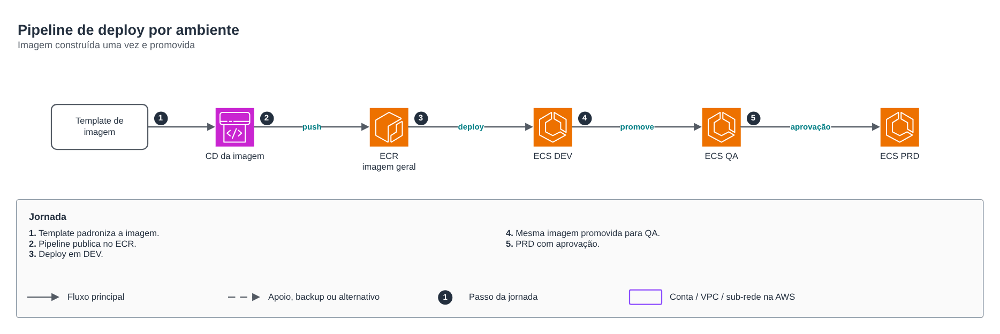

# Pipeline de deploy por ambiente

**Português** · [English](README.en.md)

> Plataforma de benefícios em AWS (2023)

Imagem construída uma vez a partir de template e promovida de DEV a PRD.

## Desenho

Fonte editável: [`desenho.drawio`](desenho.drawio), com páginas em português e em inglês. Abra no draw.io para navegar.

O desenho original, anonimizado, está em [`original/`](original) como referência.

### Pipeline de deploy por ambiente



## Componentes identificados no desenho

- Amazon ECS/Fargate: serviços em ECS/Fargate ficam no repositório da aplicação (task definition + service); a rede, o ECR e o banco vêm daqui
- Amazon VPC → módulo [`aws/vpc`](../../../../aws/vpc)
- Amazon ECR → módulo [`aws/ecr`](../../../../aws/ecr)

## Automação pronta

A pasta [`terraform/`](terraform) compõe estes módulos do catálogo, na ordem de dependência:

1. [`aws/iam-github-oidc`](../../../../aws/iam-github-oidc): GitHub Actions -> AWS por OIDC
1. [`aws/ecr`](../../../../aws/ecr): Repositórios ECR com scan, KMS e retenção

As saídas de um módulo alimentam o próximo (por exemplo, `module.vpc.private_subnet_ids` e `module.kms_key.key_arn`), então não há IDs fixos entre camadas.

### Como executar

```bash
cd labs/arquiteturas/beneficios/pipeline-de-deploy/terraform
# ajuste locals.tf (prefixo, região, tags) e backend.tf (bucket/conta de state)
terraform init
terraform plan -out tfplan
terraform apply tfplan
```

Valores de exemplo (contas, IDs, domínios) são fictícios; troque pelos do seu ambiente antes do apply.

## FinOps desta arquitetura

O que mais pesa na conta desta solução e a alavanca para cada item:

| Componente | O que pesa | Alavanca |
|---|---|---|
| [`aws/ecr`](../../../../aws/ecr) | imagens antigas acumuladas no ECR | lifecycle policy mantendo só as últimas N imagens por repositório |

O ciclo de FinOps (informar, otimizar, operar) está no lab [Processo de FinOps](../../telecom/processo-finops).
Para fechar o ciclo nesta solução, aplique também: [`aws/tag-compliance`](../../../../aws/tag-compliance), [`aws/finops-cost-report`](../../../../aws/finops-cost-report), [`aws/cur-focus-export`](../../../../aws/cur-focus-export), [`aws/instance-scheduler`](../../../../aws/instance-scheduler).
