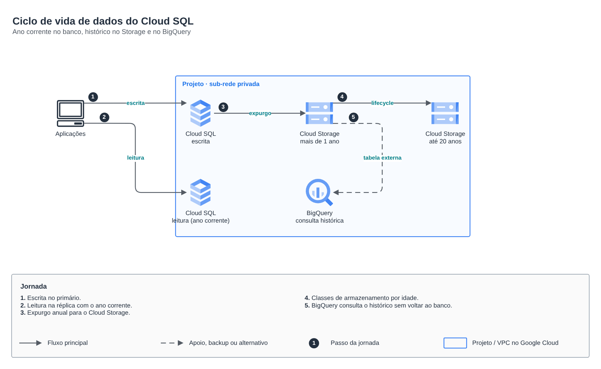

# Ciclo de vida de dados do Cloud SQL

**Português** · [English](README.en.md)

> Rede, gateways e dados no Google Cloud (2024)

Leitura e escrita separadas, expurgo para Cloud Storage por idade e consulta histórica no BigQuery.

## Desenho

Fonte editável: [`desenho.drawio`](desenho.drawio), com páginas em português e em inglês. Abra no draw.io para navegar.

O desenho original, anonimizado, está em [`original/`](original) como referência.

### Ciclo de vida de dados do Cloud SQL



## Componentes identificados no desenho

- Cloud SQL → módulo [`gcp/cloud-sql`](../../../../gcp/cloud-sql)
- VPC do Google Cloud → módulo [`gcp/vpc-network`](../../../../gcp/vpc-network)
- Cloud Storage → módulo [`gcp/static-site`](../../../../gcp/static-site)

## Automação pronta

A pasta [`terraform/`](terraform) compõe estes módulos do catálogo, na ordem de dependência:

1. [`gcp/project-foundation`](../../../../gcp/project-foundation): Projeto GCP com APIs e org policies
1. [`gcp/vpc-network`](../../../../gcp/vpc-network): VPC GCP com ranges secundários e PSA
1. [`gcp/cloud-sql`](../../../../gcp/cloud-sql): Cloud SQL privado

As saídas de um módulo alimentam o próximo (por exemplo, `module.vpc.private_subnet_ids` e `module.kms_key.key_arn`), então não há IDs fixos entre camadas.

### Como executar

```bash
cd labs/arquiteturas/consultoria-gcp/ciclo-de-vida-cloud-sql/terraform
# ajuste locals.tf (prefixo, região, tags) e backend.tf (bucket/conta de state)
terraform init
terraform plan -out tfplan
terraform apply tfplan
```

Valores de exemplo (contas, IDs, domínios) são fictícios; troque pelos do seu ambiente antes do apply.

## FinOps desta arquitetura

O que mais pesa na conta desta solução e a alavanca para cada item:

| Componente | O que pesa | Alavanca |
|---|---|---|
| [`gcp/cloud-sql`](../../../../gcp/cloud-sql) | vCPU/memória e HA do Cloud SQL | dimensionar pela métrica, CUD para PRD e parar não produtivos |
| [`gcp/vpc-network`](../../../../gcp/vpc-network) | Cloud NAT e tráfego entre zonas/regiões | Private Google Access e manter tráfego na mesma região |
| [`gcp/project-foundation`](../../../../gcp/project-foundation) | custo nasce em projetos sem dono | labels em todo projeto (o módulo já aplica) e orçamento com alerta no Billing |

O ciclo de FinOps (informar, otimizar, operar) está no lab [Processo de FinOps](../../telecom/processo-finops).
