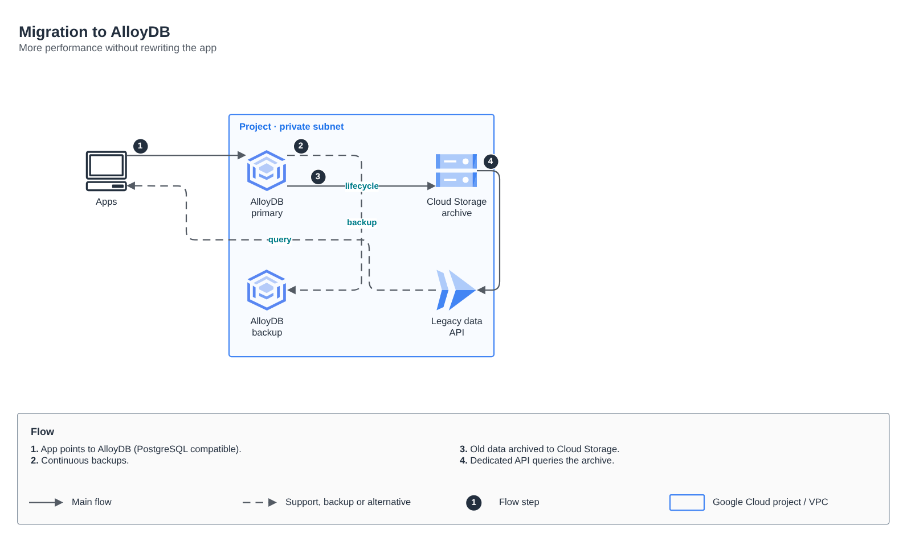

# Migration to AlloyDB

[Português](README.md) · **English**

> Network, gateways and data on Google Cloud (2024)

AlloyDB with backup, archiving to Cloud Storage and an API for legacy data.

## Diagram

Editable source: [`desenho.drawio`](desenho.drawio), with pages in Portuguese and English. Open it in draw.io to browse.

The original drawing, anonymized, is kept in [`original/`](original) for reference.

### Migration to AlloyDB



## Components found in the diagram

- VPC do Google Cloud → module [`gcp/vpc-network`](../../../../gcp/vpc-network)
- Cloud Storage → module [`gcp/static-site`](../../../../gcp/static-site)

## Ready-made automation

The [`terraform/`](terraform) folder composes these catalog modules, in dependency order:

1. [`gcp/project-foundation`](../../../../gcp/project-foundation): Projeto GCP com APIs e org policies
1. [`gcp/vpc-network`](../../../../gcp/vpc-network): VPC GCP com ranges secundários e PSA

One module's outputs feed the next (for example `module.vpc.private_subnet_ids` and `module.kms_key.key_arn`), so there are no hard-coded IDs between layers.

### How to run

```bash
cd labs/arquiteturas/consultoria-gcp/migracao-alloydb/terraform
# adjust locals.tf (prefix, region, tags) and backend.tf (state bucket/account)
terraform init
terraform plan -out tfplan
terraform apply tfplan
```

Sample values (accounts, IDs, domains) are fictitious; replace them with your own before applying.

## FinOps for this architecture

What weighs most on the bill for this solution and the lever for each item:

| Component | Cost driver | Lever |
|---|---|---|
| [`gcp/vpc-network`](../../../../gcp/vpc-network) | Cloud NAT and cross-zone/region traffic | Private Google Access and keep traffic in the same region |
| [`gcp/project-foundation`](../../../../gcp/project-foundation) | cost starts in projects without an owner | labels on every project (the module already applies them) and a budget alert in Billing |

The FinOps cycle (inform, optimize, operate) is in the [FinOps process](../../telecom/processo-finops) lab.
