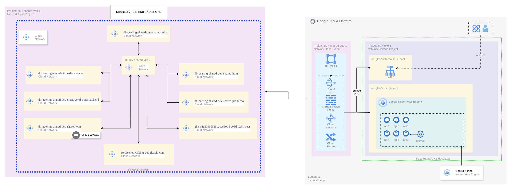

# Rede compartilhada para GKE e bancos

> Rede, gateways e dados no Google Cloud (2024)

Shared VPC com peerings para bancos gerenciados e clusters GKE em projetos de serviço.

## Desenho

Fonte editável: [`desenho.drawio`](desenho.drawio). Abra no draw.io para navegar pelas páginas.

### 1. Page-1



## Componentes identificados no desenho

- GKE → módulo [`gcp/gke-private`](../../../../gcp/gke-private)
- VPC do Google Cloud → módulo [`gcp/vpc-network`](../../../../gcp/vpc-network)

## Automação pronta

A pasta [`terraform/`](terraform) compõe estes módulos do catálogo, na ordem de dependência:

1. [`gcp/project-foundation`](../../../../gcp/project-foundation): Projeto GCP com APIs e org policies
1. [`gcp/vpc-network`](../../../../gcp/vpc-network): VPC GCP com ranges secundários e PSA
1. [`gcp/gke-private`](../../../../gcp/gke-private): GKE privado com Workload Identity
1. [`gcp/cloud-sql`](../../../../gcp/cloud-sql): Cloud SQL privado

As saídas de um módulo alimentam o próximo (por exemplo, `module.vpc.private_subnet_ids` e `module.kms_key.key_arn`),
então não há IDs fixos entre camadas.

### Como executar

```bash
cd labs/arquiteturas/consultoria-gcp/rede-gke-compartilhada/terraform
# ajuste locals.tf (prefixo, região, tags) e backend.tf (bucket/conta de state)
terraform init
terraform plan -out tfplan
terraform apply tfplan
```

Valores de exemplo (contas, IDs, domínios) são fictícios; troque pelos do seu ambiente antes do apply.
