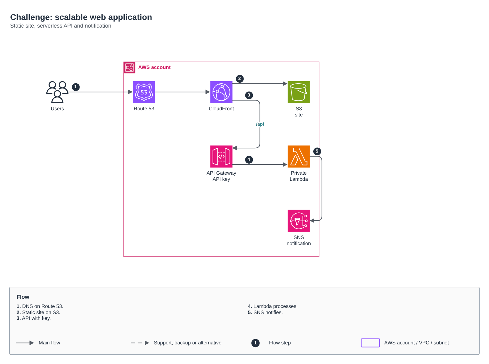

# Challenge: scalable web application

[Português](README.md) · **English**

> Architecture technical challenges

Static site, key-protected serverless API and SNS notification.

## Diagram

Editable source: [`desenho.drawio`](desenho.drawio), with pages in Portuguese and English. Open it in draw.io to browse.

The original drawing, anonymized, is kept in [`original/`](original) for reference.

### Challenge: scalable web application



## Components found in the diagram

- Amazon S3 → module [`aws/s3-bucket`](../../../../aws/s3-bucket)
- Amazon SNS → module [`aws/sns-topic`](../../../../aws/sns-topic)
- AWS Lambda → module [`aws/lambda-function`](../../../../aws/lambda-function)
- API Gateway → module [`aws/api-gateway-lambda`](../../../../aws/api-gateway-lambda)
- Amazon CloudFront → module [`aws/cloudfront-spa`](../../../../aws/cloudfront-spa)
- Amazon VPC → module [`aws/vpc`](../../../../aws/vpc)
- Route 53 → module [`aws/route53-private-zone`](../../../../aws/route53-private-zone)

## Ready-made automation

The [`terraform/`](terraform) folder composes these catalog modules, in dependency order:

1. [`aws/s3-bucket`](../../../../aws/s3-bucket): Bucket S3 seguro por padrão
1. [`aws/lambda-function`](../../../../aws/lambda-function): Função Lambda empacotada
1. [`aws/api-gateway-lambda`](../../../../aws/api-gateway-lambda): HTTP API -> Lambda
1. [`aws/sns-topic`](../../../../aws/sns-topic): Tópicos SNS com assinaturas
1. [`aws/cloudfront-spa`](../../../../aws/cloudfront-spa): SPA em S3 + CloudFront

One module's outputs feed the next (for example `module.vpc.private_subnet_ids` and `module.kms_key.key_arn`), so there are no hard-coded IDs between layers.

### How to run

```bash
cd labs/arquiteturas/desafios/desafio-aplicacao-web/terraform
# adjust locals.tf (prefix, region, tags) and backend.tf (state bucket/account)
terraform init
terraform plan -out tfplan
terraform apply tfplan
```

Sample values (accounts, IDs, domains) are fictitious; replace them with your own before applying.

## FinOps for this architecture

What weighs most on the bill for this solution and the lever for each item:

| Component | Cost driver | Lever |
|---|---|---|
| [`aws/cloudfront-spa`](../../../../aws/cloudfront-spa) | CDN data transfer | good caching and compression; the CDN usually lowers origin egress cost |
| [`aws/s3-bucket`](../../../../aws/s3-bucket) | S3 storage and old object versions | lifecycle to IA/Glacier and expiration of noncurrent versions |
| [`aws/lambda-function`](../../../../aws/lambda-function) | function duration × memory | tune memory with Power Tuning and use arm64 |
| [`aws/api-gateway-lambda`](../../../../aws/api-gateway-lambda) | API Gateway requests | HTTP API instead of REST API when the extra features are not needed, plus edge caching |
| [`aws/sns-topic`](../../../../aws/sns-topic) | messages and deliveries per protocol | subscription filters so consumers do not receive what they discard |

The FinOps cycle (inform, optimize, operate) is in the [FinOps process](../../telecom/processo-finops) lab.
To close the loop for this solution, also apply: [`aws/tag-compliance`](../../../../aws/tag-compliance), [`aws/finops-cost-report`](../../../../aws/finops-cost-report), [`aws/cur-focus-export`](../../../../aws/cur-focus-export), [`aws/instance-scheduler`](../../../../aws/instance-scheduler).
