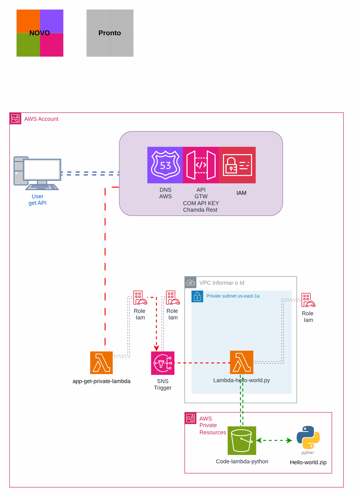
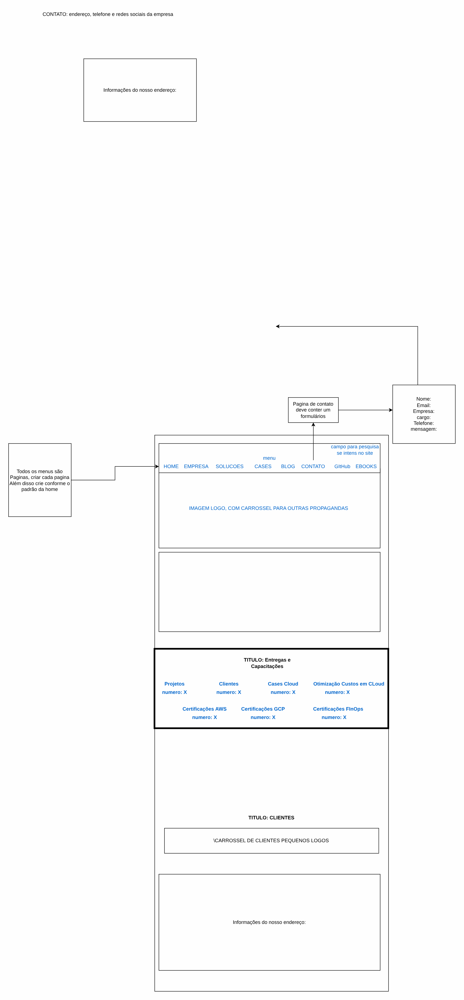

# Desafio: aplicação web escalável

> Desafios técnicos de arquitetura

Desafio técnico: aplicação web com alta disponibilidade.

## Desenho

Fonte editável: [`desenho.drawio`](desenho.drawio). Abra no draw.io para navegar pelas páginas.

### 1. Página-1



### 2. Página-2



## Componentes identificados no desenho

- Amazon S3 → módulo [`aws/s3-bucket`](../../../../aws/s3-bucket)
- Amazon SNS → módulo [`aws/sns-topic`](../../../../aws/sns-topic)
- AWS Lambda → módulo [`aws/lambda-function`](../../../../aws/lambda-function)
- API Gateway → módulo [`aws/api-gateway-lambda`](../../../../aws/api-gateway-lambda)
- Amazon VPC → módulo [`aws/vpc`](../../../../aws/vpc)
- Route 53 → módulo [`aws/route53-private-zone`](../../../../aws/route53-private-zone)

## Automação pronta

A pasta [`terraform/`](terraform) compõe estes módulos do catálogo, na ordem de dependência:

1. [`aws/s3-bucket`](../../../../aws/s3-bucket): Bucket S3 seguro por padrão
1. [`aws/lambda-function`](../../../../aws/lambda-function): Função Lambda empacotada
1. [`aws/api-gateway-lambda`](../../../../aws/api-gateway-lambda): HTTP API -> Lambda
1. [`aws/sns-topic`](../../../../aws/sns-topic): Tópicos SNS com assinaturas
1. [`aws/cloudfront-spa`](../../../../aws/cloudfront-spa): SPA em S3 + CloudFront

As saídas de um módulo alimentam o próximo (por exemplo, `module.vpc.private_subnet_ids` e `module.kms_key.key_arn`),
então não há IDs fixos entre camadas.

### Como executar

```bash
cd labs/arquiteturas/desafios/desafio-aplicacao-web/terraform
# ajuste locals.tf (prefixo, região, tags) e backend.tf (bucket/conta de state)
terraform init
terraform plan -out tfplan
terraform apply tfplan
```

Valores de exemplo (contas, IDs, domínios) são fictícios; troque pelos do seu ambiente antes do apply.

## FinOps desta arquitetura

O que mais pesa na conta desta solução e a alavanca para cada item:

| Componente | O que pesa | Alavanca |
|---|---|---|
| [`aws/cloudfront-spa`](../../../../aws/cloudfront-spa) | transferência de dados da CDN | cache bem configurado e compressão; a CDN costuma reduzir o custo de saída da origem |
| [`aws/s3-bucket`](../../../../aws/s3-bucket) | armazenamento e versões antigas no S3 | lifecycle para IA/Glacier e expiração de versões não atuais |
| [`aws/lambda-function`](../../../../aws/lambda-function) | duração x memória das funções | ajustar memória com Power Tuning e usar arm64 |
| [`aws/api-gateway-lambda`](../../../../aws/api-gateway-lambda) | requisições no API Gateway | HTTP API em vez de REST API quando não precisa dos recursos extras, e cache na borda |
| [`aws/sns-topic`](../../../../aws/sns-topic) | mensagens e entregas por protocolo | filtros de assinatura para não entregar o que o consumidor descarta |

O ciclo de FinOps (informar, otimizar, operar) está no lab [Processo de FinOps](../../telecom/processo-finops).
Para fechar o ciclo nesta solução, aplique também: [`aws/tag-compliance`](../../../../aws/tag-compliance), [`aws/finops-cost-report`](../../../../aws/finops-cost-report), [`aws/cur-focus-export`](../../../../aws/cur-focus-export), [`aws/instance-scheduler`](../../../../aws/instance-scheduler).
