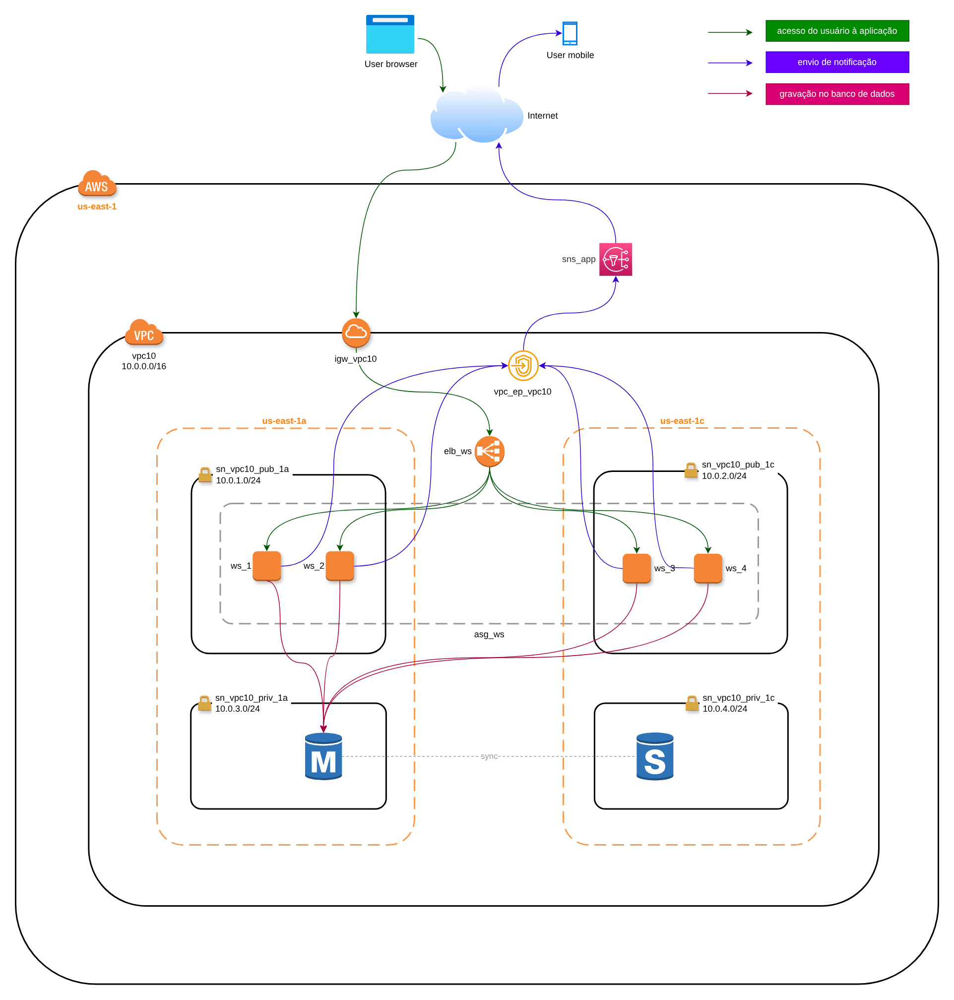

# Notificações em arquitetura multi-AZ

> Desafios técnicos de arquitetura

Trabalho de IaC: aplicação em duas AZs com balanceador, banco e envio de notificações.

## Desenho

Fonte editável: [`desenho.drawio`](desenho.drawio). Abra no draw.io para navegar pelas páginas.

### 1. Page-1



## Componentes identificados no desenho

- Amazon SNS → módulo [`aws/sns-topic`](../../../../aws/sns-topic)
- VPC Endpoints → módulo [`aws/vpc-endpoints`](../../../../aws/vpc-endpoints)

## Automação pronta

A pasta [`terraform/`](terraform) compõe estes módulos do catálogo, na ordem de dependência:

1. [`aws/kms-key`](../../../../aws/kms-key): Chave KMS (CMK) da plataforma
1. [`aws/vpc`](../../../../aws/vpc): VPC em três camadas
1. [`aws/rds-instance`](../../../../aws/rds-instance): RDS MySQL/PostgreSQL privado
1. [`aws/sns-topic`](../../../../aws/sns-topic): Tópicos SNS com assinaturas

As saídas de um módulo alimentam o próximo (por exemplo, `module.vpc.private_subnet_ids` e `module.kms_key.key_arn`),
então não há IDs fixos entre camadas.

### Como executar

```bash
cd labs/arquiteturas/desafios/notificacao-serverless/terraform
# ajuste locals.tf (prefixo, região, tags) e backend.tf (bucket/conta de state)
terraform init
terraform plan -out tfplan
terraform apply tfplan
```

Valores de exemplo (contas, IDs, domínios) são fictícios; troque pelos do seu ambiente antes do apply.
