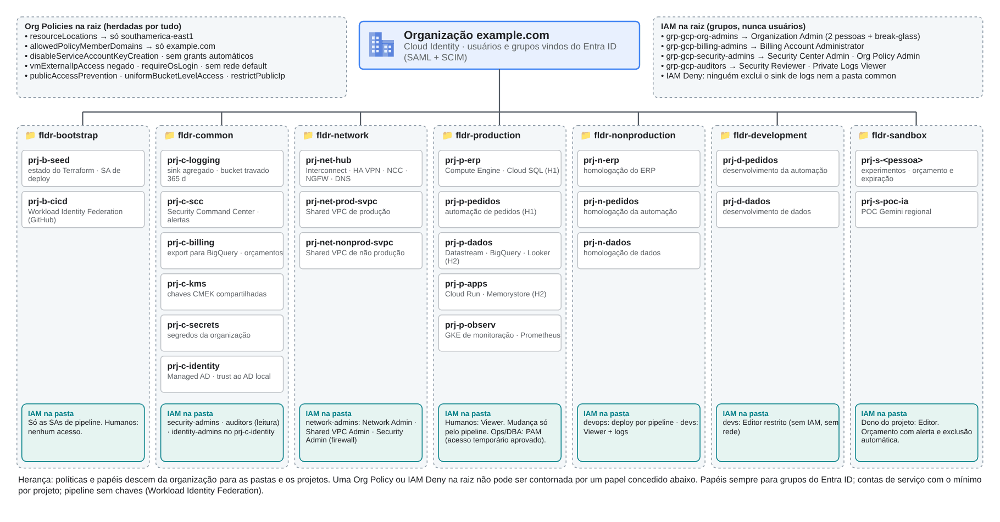

# Árvore de recursos e permissões no Google Cloud

**Português** · [English](README.en.md)

> Estudos de caso de arquitetura (2026)

Organização, pastas por ambiente, projetos e grupos com papéis atribuídos no nível certo da hierarquia.

## Desenho

Fonte editável: [`desenho.drawio`](desenho.drawio), com páginas em português e em inglês. Abra no draw.io para navegar.

### Google Cloud — árvore de recursos e permissões



## Componentes identificados no desenho

- GKE → módulo [`gcp/gke-private`](../../../../gcp/gke-private)
- Cloud SQL → módulo [`gcp/cloud-sql`](../../../../gcp/cloud-sql)
- VPC do Google Cloud → módulo [`gcp/vpc-network`](../../../../gcp/vpc-network)
- Projetos e org policies → módulo [`gcp/project-foundation`](../../../../gcp/project-foundation)

## Automação pronta

A pasta [`terraform/`](terraform) compõe estes módulos do catálogo, na ordem de dependência:

1. [`gcp/project-foundation`](../../../../gcp/project-foundation): Projeto GCP com APIs e org policies

As saídas de um módulo alimentam o próximo (por exemplo, `module.vpc.private_subnet_ids` e `module.kms_key.key_arn`), então não há IDs fixos entre camadas.

### Como executar

```bash
cd labs/arquiteturas/estudos-de-caso/arvore-iam-google-cloud/terraform
# ajuste locals.tf (prefixo, região, tags) e backend.tf (bucket/conta de state)
terraform init
terraform plan -out tfplan
terraform apply tfplan
```

Valores de exemplo (contas, IDs, domínios) são fictícios; troque pelos do seu ambiente antes do apply.

## FinOps desta arquitetura

O que mais pesa na conta desta solução e a alavanca para cada item:

| Componente | O que pesa | Alavanca |
|---|---|---|
| [`gcp/project-foundation`](../../../../gcp/project-foundation) | custo nasce em projetos sem dono | labels em todo projeto (o módulo já aplica) e orçamento com alerta no Billing |

O ciclo de FinOps (informar, otimizar, operar) está no lab [Processo de FinOps](../../telecom/processo-finops).
