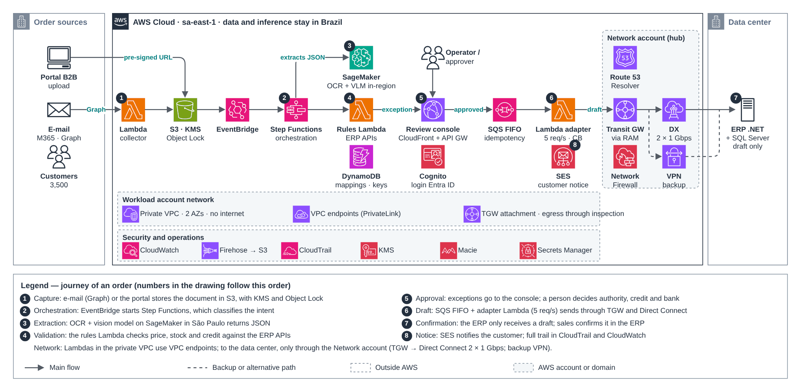

# AI process automation MVP

[Português](README.md) · **English**

> Architecture case studies (2026)

MVP that receives documents, extracts data with managed AI and returns the result to the source system with full traceability.

## Diagram

Editable source: [`desenho.drawio`](desenho.drawio), with pages in Portuguese and English. Open it in draw.io to browse.

### Case 2 — MVP architecture



## Components found in the diagram

- Amazon S3 → module [`aws/s3-bucket`](../../../../aws/s3-bucket)
- Amazon SQS → module [`aws/sqs-queue`](../../../../aws/sqs-queue)
- AWS Lambda → module [`aws/lambda-function`](../../../../aws/lambda-function)
- Amazon Cognito → module [`aws/cognito-user-pool`](../../../../aws/cognito-user-pool)
- Amazon CloudFront → module [`aws/cloudfront-spa`](../../../../aws/cloudfront-spa)
- AWS KMS → module [`aws/kms-key`](../../../../aws/kms-key)
- Amazon VPC → module [`aws/vpc`](../../../../aws/vpc)
- Transit Gateway → module [`aws/transit-gateway-attachment`](../../../../aws/transit-gateway-attachment)
- VPN Site-to-Site → module [`aws/vpn-site-to-site`](../../../../aws/vpn-site-to-site)
- Route 53 → module [`aws/route53-private-zone`](../../../../aws/route53-private-zone)
- Amazon EventBridge → module [`aws/eventbridge-bus-sqs`](../../../../aws/eventbridge-bus-sqs)
- VPC Endpoints → module [`aws/vpc-endpoints`](../../../../aws/vpc-endpoints)
- AWS Secrets Manager: the RDS master password is already managed by RDS in Secrets Manager; application secrets come in through External Secrets
- Amazon DynamoDB: control tables live with the service that uses them
- Amazon CloudWatch → module [`aws/cloudwatch-logs`](../../../../aws/cloudwatch-logs)

## Ready-made automation

The [`terraform/`](terraform) folder composes these catalog modules, in dependency order:

1. [`aws/kms-key`](../../../../aws/kms-key): Chave KMS (CMK) da plataforma
1. [`aws/textract-pipeline`](../../../../aws/textract-pipeline): Pipeline de extração com Textract
1. [`aws/eventbridge-bus-sqs`](../../../../aws/eventbridge-bus-sqs): Barramento de eventos entre contas -> SQS
1. [`aws/cognito-user-pool`](../../../../aws/cognito-user-pool): Cognito como IdP OAuth2/OIDC
1. [`aws/cloudfront-spa`](../../../../aws/cloudfront-spa): SPA em S3 + CloudFront

One module's outputs feed the next (for example `module.vpc.private_subnet_ids` and `module.kms_key.key_arn`), so there are no hard-coded IDs between layers.

### How to run

```bash
cd labs/arquiteturas/estudos-de-caso/automacao-com-ia-mvp/terraform
# adjust locals.tf (prefix, region, tags) and backend.tf (state bucket/account)
terraform init
terraform plan -out tfplan
terraform apply tfplan
```

Sample values (accounts, IDs, domains) are fictitious; replace them with your own before applying.

## FinOps for this architecture

What weighs most on the bill for this solution and the lever for each item:

| Component | Cost driver | Lever |
|---|---|---|
| [`aws/textract-pipeline`](../../../../aws/textract-pipeline) | Textract cost per processed page | filter and classify before extracting and use only the needed features (text vs forms vs tables) |
| [`aws/cloudfront-spa`](../../../../aws/cloudfront-spa) | CDN data transfer | good caching and compression; the CDN usually lowers origin egress cost |
| [`aws/cognito-user-pool`](../../../../aws/cognito-user-pool) | Cognito monthly active users (MAU) | pick the right tier and clean up inactive accounts |
| [`aws/kms-key`](../../../../aws/kms-key) | KMS keys per month and API calls | S3 bucket keys reduce KMS calls |
| [`aws/eventbridge-bus-sqs`](../../../../aws/eventbridge-bus-sqs) | published custom events | group events and filter in the rule |

The FinOps cycle (inform, optimize, operate) is in the [FinOps process](../../telecom/processo-finops) lab.
To close the loop for this solution, also apply: [`aws/tag-compliance`](../../../../aws/tag-compliance), [`aws/finops-cost-report`](../../../../aws/finops-cost-report), [`aws/cur-focus-export`](../../../../aws/cur-focus-export), [`aws/instance-scheduler`](../../../../aws/instance-scheduler).
