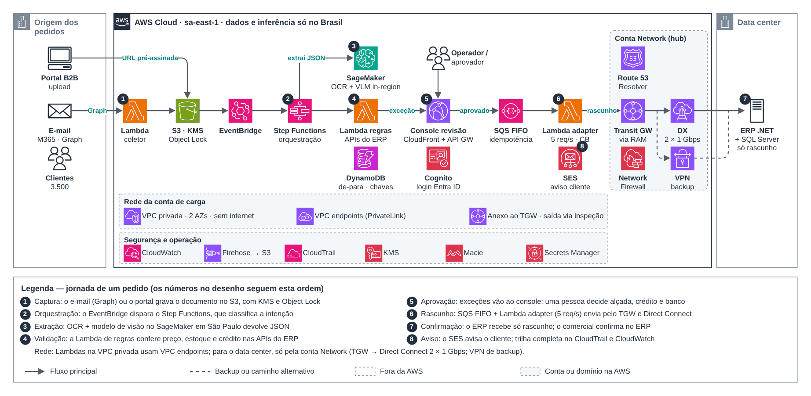

# MVP de automação de processos com IA

**Português** · [English](README.en.md)

> Estudos de caso de arquitetura (2026)

MVP que recebe documentos, extrai dados com IA gerenciada e devolve o resultado para o sistema de origem com rastreabilidade.

## Desenho

Fonte editável: [`desenho.drawio`](desenho.drawio), com páginas em português e em inglês. Abra no draw.io para navegar.

### Case 2 — Arquitetura do MVP



## Componentes identificados no desenho

- Amazon S3 → módulo [`aws/s3-bucket`](../../../../aws/s3-bucket)
- Amazon SQS → módulo [`aws/sqs-queue`](../../../../aws/sqs-queue)
- AWS Lambda → módulo [`aws/lambda-function`](../../../../aws/lambda-function)
- Amazon Cognito → módulo [`aws/cognito-user-pool`](../../../../aws/cognito-user-pool)
- Amazon CloudFront → módulo [`aws/cloudfront-spa`](../../../../aws/cloudfront-spa)
- AWS KMS → módulo [`aws/kms-key`](../../../../aws/kms-key)
- Amazon VPC → módulo [`aws/vpc`](../../../../aws/vpc)
- Transit Gateway → módulo [`aws/transit-gateway-attachment`](../../../../aws/transit-gateway-attachment)
- VPN Site-to-Site → módulo [`aws/vpn-site-to-site`](../../../../aws/vpn-site-to-site)
- Route 53 → módulo [`aws/route53-private-zone`](../../../../aws/route53-private-zone)
- Amazon EventBridge → módulo [`aws/eventbridge-bus-sqs`](../../../../aws/eventbridge-bus-sqs)
- VPC Endpoints → módulo [`aws/vpc-endpoints`](../../../../aws/vpc-endpoints)
- AWS Secrets Manager: a senha master do RDS já é gerenciada pelo próprio RDS no Secrets Manager; segredos de aplicação entram via External Secrets
- Amazon DynamoDB: tabelas de controle ficam junto do serviço que as usa
- Amazon CloudWatch → módulo [`aws/cloudwatch-logs`](../../../../aws/cloudwatch-logs)

## Automação pronta

A pasta [`terraform/`](terraform) compõe estes módulos do catálogo, na ordem de dependência:

1. [`aws/kms-key`](../../../../aws/kms-key): Chave KMS (CMK) da plataforma
1. [`aws/textract-pipeline`](../../../../aws/textract-pipeline): Pipeline de extração com Textract
1. [`aws/eventbridge-bus-sqs`](../../../../aws/eventbridge-bus-sqs): Barramento de eventos entre contas -> SQS
1. [`aws/cognito-user-pool`](../../../../aws/cognito-user-pool): Cognito como IdP OAuth2/OIDC
1. [`aws/cloudfront-spa`](../../../../aws/cloudfront-spa): SPA em S3 + CloudFront

As saídas de um módulo alimentam o próximo (por exemplo, `module.vpc.private_subnet_ids` e `module.kms_key.key_arn`), então não há IDs fixos entre camadas.

### Como executar

```bash
cd labs/arquiteturas/estudos-de-caso/automacao-com-ia-mvp/terraform
# ajuste locals.tf (prefixo, região, tags) e backend.tf (bucket/conta de state)
terraform init
terraform plan -out tfplan
terraform apply tfplan
```

Valores de exemplo (contas, IDs, domínios) são fictícios; troque pelos do seu ambiente antes do apply.

## FinOps desta arquitetura

O que mais pesa na conta desta solução e a alavanca para cada item:

| Componente | O que pesa | Alavanca |
|---|---|---|
| [`aws/textract-pipeline`](../../../../aws/textract-pipeline) | custo por página processada no Textract | filtrar e classificar antes de extrair e usar só as features necessárias (texto x formulário x tabela) |
| [`aws/cloudfront-spa`](../../../../aws/cloudfront-spa) | transferência de dados da CDN | cache bem configurado e compressão; a CDN costuma reduzir o custo de saída da origem |
| [`aws/cognito-user-pool`](../../../../aws/cognito-user-pool) | usuários ativos por mês (MAU) no Cognito | escolher o tier certo e limpar contas inativas |
| [`aws/kms-key`](../../../../aws/kms-key) | chaves KMS por mês e chamadas de API | bucket keys no S3 reduzem chamadas ao KMS |
| [`aws/eventbridge-bus-sqs`](../../../../aws/eventbridge-bus-sqs) | eventos customizados publicados | agrupar eventos e filtrar na regra |

O ciclo de FinOps (informar, otimizar, operar) está no lab [Processo de FinOps](../../telecom/processo-finops).
Para fechar o ciclo nesta solução, aplique também: [`aws/tag-compliance`](../../../../aws/tag-compliance), [`aws/finops-cost-report`](../../../../aws/finops-cost-report), [`aws/cur-focus-export`](../../../../aws/cur-focus-export), [`aws/instance-scheduler`](../../../../aws/instance-scheduler).
