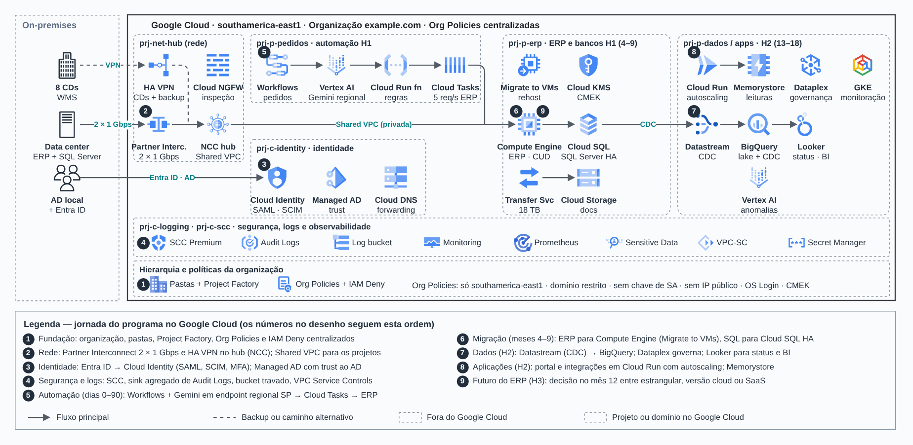

# Fundação no Google Cloud em três horizontes

> Estudos de caso de arquitetura (2026)

O mesmo roteiro de modernização desenhado no Google Cloud: organização, rede compartilhada, GKE e dados.

## Desenho

Fonte editável: [`desenho.drawio`](desenho.drawio). Abra no draw.io para navegar pelas páginas.

### 1. Case 1 no Google Cloud — Arquitetura de fundação (H1, H2, H3)



## Componentes identificados no desenho

- GKE → módulo [`gcp/gke-private`](../../../../gcp/gke-private)
- Cloud SQL → módulo [`gcp/cloud-sql`](../../../../gcp/cloud-sql)
- VPC do Google Cloud → módulo [`gcp/vpc-network`](../../../../gcp/vpc-network)
- Projetos e org policies → módulo [`gcp/project-foundation`](../../../../gcp/project-foundation)
- Cloud Storage → módulo [`gcp/static-site`](../../../../gcp/static-site)

## Automação pronta

A pasta [`terraform/`](terraform) compõe estes módulos do catálogo, na ordem de dependência:

1. [`gcp/project-foundation`](../../../../gcp/project-foundation): Projeto GCP com APIs e org policies
1. [`gcp/vpc-network`](../../../../gcp/vpc-network): VPC GCP com ranges secundários e PSA
1. [`gcp/gke-private`](../../../../gcp/gke-private): GKE privado com Workload Identity
1. [`gcp/cloud-sql`](../../../../gcp/cloud-sql): Cloud SQL privado
1. [`gcp/static-site`](../../../../gcp/static-site): Site estático em Cloud Storage

As saídas de um módulo alimentam o próximo (por exemplo, `module.vpc.private_subnet_ids` e `module.kms_key.key_arn`),
então não há IDs fixos entre camadas.

### Como executar

```bash
cd labs/arquiteturas/estudos-de-caso/fundacao-google-cloud/terraform
# ajuste locals.tf (prefixo, região, tags) e backend.tf (bucket/conta de state)
terraform init
terraform plan -out tfplan
terraform apply tfplan
```

Valores de exemplo (contas, IDs, domínios) são fictícios; troque pelos do seu ambiente antes do apply.
