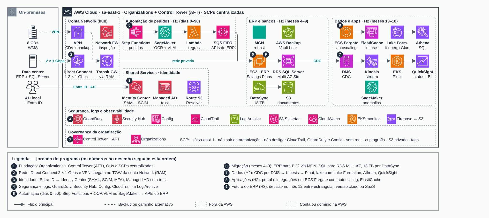

# Evolução de arquitetura em três horizontes

> Estudos de caso de arquitetura (2026)

Roteiro de modernização em três horizontes (estabilizar, integrar, inovar) para uma empresa de médio porte com sistemas legados.

## Desenho

Fonte editável: [`desenho.drawio`](desenho.drawio). Abra no draw.io para navegar pelas páginas.

### 1. Case 1 — Arquitetura de evolução (H1, H2, H3)



## Componentes identificados no desenho

- Amazon EKS → módulo [`aws/eks-cluster`](../../../../aws/eks-cluster)
- Amazon ECS/Fargate: serviços em ECS/Fargate ficam no repositório da aplicação (task definition + service); a rede, o ECR e o banco vêm daqui
- Amazon RDS → módulo [`aws/rds-instance`](../../../../aws/rds-instance)
- ElastiCache → módulo [`aws/elasticache-redis`](../../../../aws/elasticache-redis)
- Amazon S3 → módulo [`aws/s3-bucket`](../../../../aws/s3-bucket)
- Amazon SQS → módulo [`aws/sqs-queue`](../../../../aws/sqs-queue)
- Amazon SNS → módulo [`aws/sns-topic`](../../../../aws/sns-topic)
- AWS Lambda → módulo [`aws/lambda-function`](../../../../aws/lambda-function)
- Transit Gateway → módulo [`aws/transit-gateway-attachment`](../../../../aws/transit-gateway-attachment)
- VPN Site-to-Site → módulo [`aws/vpn-site-to-site`](../../../../aws/vpn-site-to-site)
- Route 53 → módulo [`aws/route53-private-zone`](../../../../aws/route53-private-zone)
- AWS Backup → módulo [`aws/backup-plan`](../../../../aws/backup-plan)
- AWS Organizations / SCP → módulo [`aws/organizations-scp`](../../../../aws/organizations-scp)
- Amazon CloudWatch → módulo [`aws/cloudwatch-logs`](../../../../aws/cloudwatch-logs)
- IAM Identity Center → módulo [`aws/identity-center-permission-set`](../../../../aws/identity-center-permission-set)
- GuardDuty / Security Hub → módulo [`aws/security-baseline`](../../../../aws/security-baseline)

## Automação pronta

A pasta [`terraform/`](terraform) compõe estes módulos do catálogo, na ordem de dependência:

1. [`aws/organizations-scp`](../../../../aws/organizations-scp): Organizations: OUs, SCPs e Tag Policy
1. [`aws/security-baseline`](../../../../aws/security-baseline): Baseline de segurança da organização
1. [`aws/kms-key`](../../../../aws/kms-key): Chave KMS (CMK) da plataforma
1. [`aws/vpc`](../../../../aws/vpc): VPC em três camadas
1. [`aws/eks-cluster`](../../../../aws/eks-cluster): Cluster EKS privado
1. [`aws/rds-instance`](../../../../aws/rds-instance): RDS MySQL/PostgreSQL privado
1. [`aws/backup-plan`](../../../../aws/backup-plan): AWS Backup centralizado

As saídas de um módulo alimentam o próximo (por exemplo, `module.vpc.private_subnet_ids` e `module.kms_key.key_arn`),
então não há IDs fixos entre camadas.

### Como executar

```bash
cd labs/arquiteturas/estudos-de-caso/transformacao-digital-h1-h3/terraform
# ajuste locals.tf (prefixo, região, tags) e backend.tf (bucket/conta de state)
terraform init
terraform plan -out tfplan
terraform apply tfplan
```

Valores de exemplo (contas, IDs, domínios) são fictícios; troque pelos do seu ambiente antes do apply.

## FinOps desta arquitetura

O que mais pesa na conta desta solução e a alavanca para cada item:

| Componente | O que pesa | Alavanca |
|---|---|---|
| [`aws/eks-cluster`](../../../../aws/eks-cluster) | nós do EKS (EC2) e o control plane por cluster | autoscaling de nós (Karpenter/Cluster Autoscaler), Spot para cargas tolerantes e Savings Plans para a base |
| [`aws/rds-instance`](../../../../aws/rds-instance) | classe da instância e Multi-AZ do RDS | dimensionar pela métrica real, reserva para PRD e parar HML/DEV fora do horário |
| [`aws/vpc`](../../../../aws/vpc) | NAT Gateway por AZ e tráfego que passa por ele | um NAT só em DEV e VPC endpoints para S3/ECR tirarem tráfego do NAT |
| [`aws/backup-plan`](../../../../aws/backup-plan) | retenção de recovery points | retenção por criticidade e cold storage para cópias longas |
| [`aws/security-baseline`](../../../../aws/security-baseline) | Config, GuardDuty e Security Hub em todas as contas | gravar no Config só os tipos de recurso relevantes |
| [`aws/kms-key`](../../../../aws/kms-key) | chaves KMS por mês e chamadas de API | bucket keys no S3 reduzem chamadas ao KMS |

O ciclo de FinOps (informar, otimizar, operar) está no lab [Processo de FinOps](../../telecom/processo-finops).
Para fechar o ciclo nesta solução, aplique também: [`aws/tag-compliance`](../../../../aws/tag-compliance), [`aws/finops-cost-report`](../../../../aws/finops-cost-report), [`aws/cur-focus-export`](../../../../aws/cur-focus-export), [`aws/instance-scheduler`](../../../../aws/instance-scheduler).
