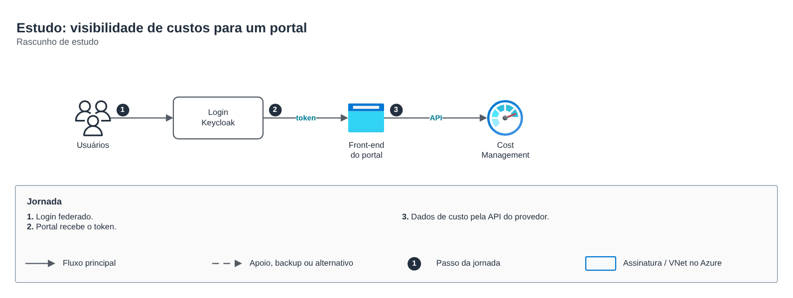

# Estudo: visibilidade de custos

**Português** · [English](README.en.md)

> Rascunhos e estudos pessoais

Rascunho de estudo sobre um portal de custos com login federado.

## Desenho

Fonte editável: [`desenho.drawio`](desenho.drawio), com páginas em português e em inglês. Abra no draw.io para navegar.

O desenho original, anonimizado, está em [`original/`](original) como referência.

### Estudo: visibilidade de custos para um portal

## Componentes identificados no desenho

- Azure Monitor → módulo [`azure/monitor-alerts`](../../../../azure/monitor-alerts)

## Automação

Este desenho descreve processo, governança ou rede fora do escopo dos módulos do catálogo; serve de referência para as decisões e não tem automação própria.

## FinOps desta arquitetura

O que mais pesa na conta desta solução e a alavanca para cada item:

| Componente | O que pesa | Alavanca |
|---|---|---|
| Ambiente | assinaturas sem dono e VMs ociosas | tags por política, orçamento no Cost Management e Advisor |

O ciclo de FinOps (informar, otimizar, operar) está no lab [Processo de FinOps](../../telecom/processo-finops).
