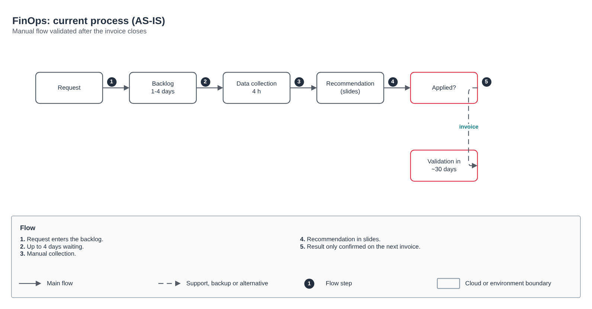
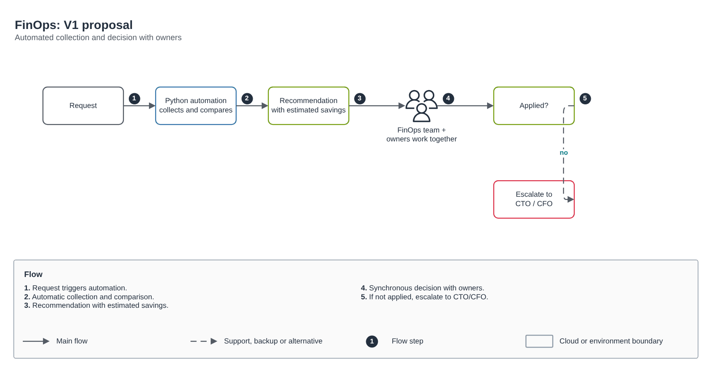

# FinOps: current and target process

[Português](README.md) · **English**

> FinOps assessment and process (2024)

Assessment of the manual flow and a V1 proposal with automated collection and owner decisions.

## Diagram

Editable source: [`desenho.drawio`](desenho.drawio), with pages in Portuguese and English. Open it in draw.io to browse.

The original drawing, anonymized, is kept in [`original/`](original) for reference.

### FinOps: current process (AS-IS)



### FinOps: V1 proposal



## Ready-made automation

The [`terraform/`](terraform) folder composes these catalog modules, in dependency order:

1. [`azure/storage-account`](../../../../azure/storage-account): Storage Account seguro com CMK
1. [`azure/monitor-alerts`](../../../../azure/monitor-alerts): Azure Monitor: action group e alertas de métrica

One module's outputs feed the next (for example `module.vpc.private_subnet_ids` and `module.kms_key.key_arn`), so there are no hard-coded IDs between layers.

### How to run

```bash
cd labs/arquiteturas/finops/finops-atual-x-alvo/terraform
# adjust locals.tf (prefix, region, tags) and backend.tf (state bucket/account)
terraform init
terraform plan -out tfplan
terraform apply tfplan
```

Sample values (accounts, IDs, domains) are fictitious; replace them with your own before applying.
