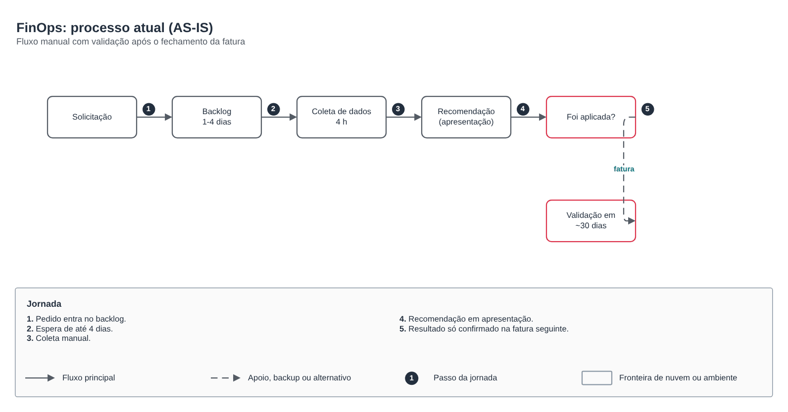
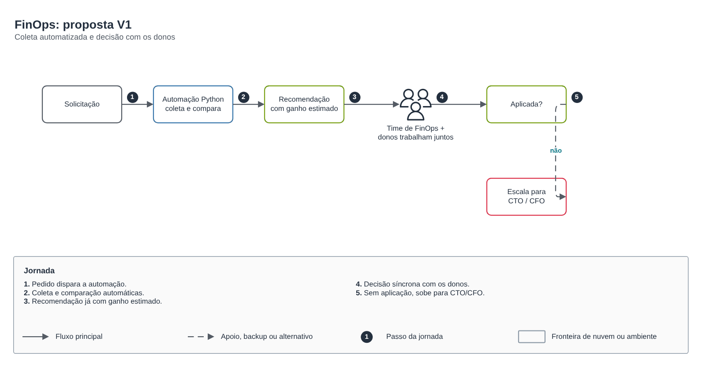

# FinOps: processo atual e alvo

**Português** · [English](README.en.md)

> Assessment e processo de FinOps (2024)

Assessment do fluxo manual e proposta V1 com coleta automatizada e decisão com os donos.

## Desenho

Fonte editável: [`desenho.drawio`](desenho.drawio), com páginas em português e em inglês. Abra no draw.io para navegar.

O desenho original, anonimizado, está em [`original/`](original) como referência.

### FinOps: processo atual (AS-IS)



### FinOps: proposta V1



## Automação pronta

A pasta [`terraform/`](terraform) compõe estes módulos do catálogo, na ordem de dependência:

1. [`azure/storage-account`](../../../../azure/storage-account): Storage Account seguro com CMK
1. [`azure/monitor-alerts`](../../../../azure/monitor-alerts): Azure Monitor: action group e alertas de métrica

As saídas de um módulo alimentam o próximo (por exemplo, `module.vpc.private_subnet_ids` e `module.kms_key.key_arn`), então não há IDs fixos entre camadas.

### Como executar

```bash
cd labs/arquiteturas/finops/finops-atual-x-alvo/terraform
# ajuste locals.tf (prefixo, região, tags) e backend.tf (bucket/conta de state)
terraform init
terraform plan -out tfplan
terraform apply tfplan
```

Valores de exemplo (contas, IDs, domínios) são fictícios; troque pelos do seu ambiente antes do apply.
