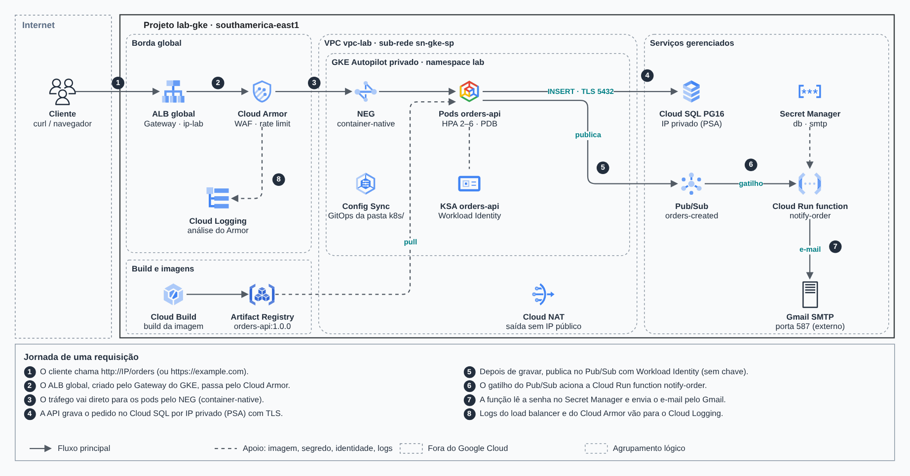
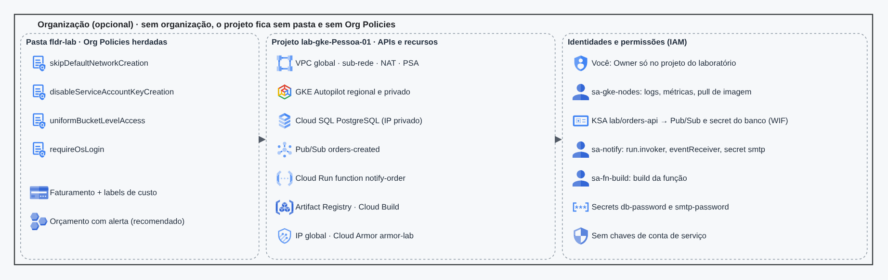
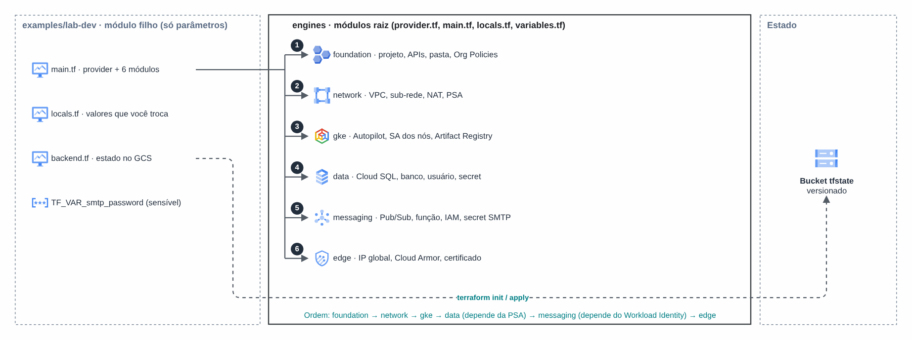

# GKE seguro de ponta a ponta

> Arquiteturas de referência no Google Cloud (2026)

Laboratório de GKE privado com Workload Identity, Cloud SQL privado, Pub/Sub e borda com Cloud Armor.

## Desenho

Fonte editável: [`desenho.drawio`](desenho.drawio). Abra no draw.io para navegar pelas páginas.

### 1. 1 · Arquitetura e jornada



### 2. 2 · Fundação e IAM



### 3. 3 · Estrutura Terraform



## Componentes identificados no desenho

- AWS WAF: o Web ACL é passado por ARN para o CloudFront (`web_acl_id`) ou associado ao ALB
- GKE → módulo [`gcp/gke-private`](../../../../gcp/gke-private)
- Cloud SQL → módulo [`gcp/cloud-sql`](../../../../gcp/cloud-sql)
- Pub/Sub → módulo [`gcp/pubsub`](../../../../gcp/pubsub)
- Cloud Load Balancing + Cloud Armor → módulo [`gcp/edge-load-balancer`](../../../../gcp/edge-load-balancer)
- VPC do Google Cloud → módulo [`gcp/vpc-network`](../../../../gcp/vpc-network)

## Automação pronta

A pasta [`terraform/`](terraform) compõe estes módulos do catálogo, na ordem de dependência:

1. [`gcp/project-foundation`](../../../../gcp/project-foundation): Projeto GCP com APIs e org policies
1. [`gcp/vpc-network`](../../../../gcp/vpc-network): VPC GCP com ranges secundários e PSA
1. [`gcp/gke-private`](../../../../gcp/gke-private): GKE privado com Workload Identity
1. [`gcp/cloud-sql`](../../../../gcp/cloud-sql): Cloud SQL privado
1. [`gcp/pubsub`](../../../../gcp/pubsub): Pub/Sub + Cloud Function (notificação)
1. [`gcp/edge-load-balancer`](../../../../gcp/edge-load-balancer): Load Balancer global + Cloud Armor

As saídas de um módulo alimentam o próximo (por exemplo, `module.vpc.private_subnet_ids` e `module.kms_key.key_arn`),
então não há IDs fixos entre camadas.

### Como executar

```bash
cd labs/arquiteturas/google-cloud/gke-seguro/terraform
# ajuste locals.tf (prefixo, região, tags) e backend.tf (bucket/conta de state)
terraform init
terraform plan -out tfplan
terraform apply tfplan
```

Valores de exemplo (contas, IDs, domínios) são fictícios; troque pelos do seu ambiente antes do apply.
