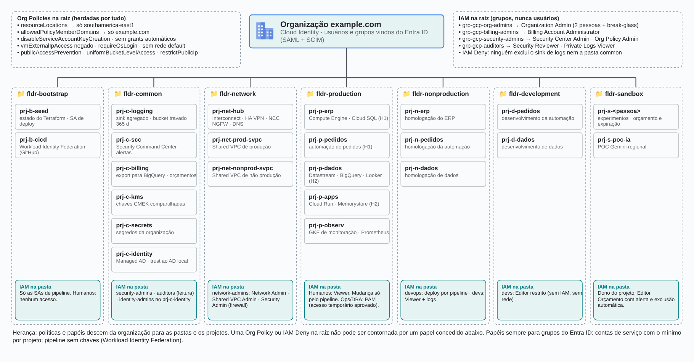
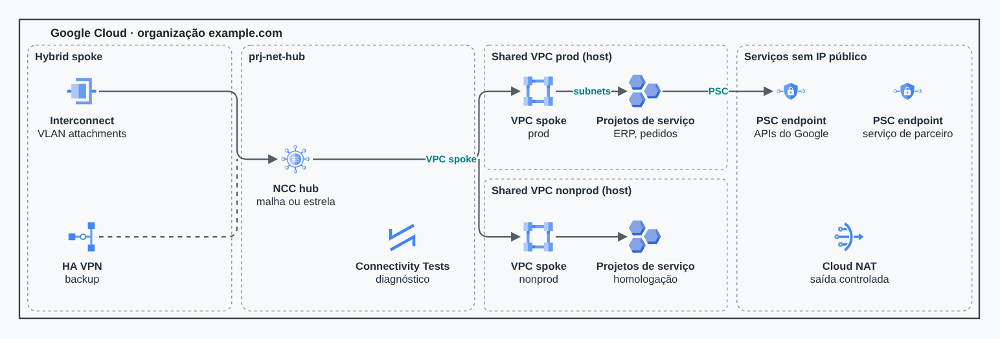
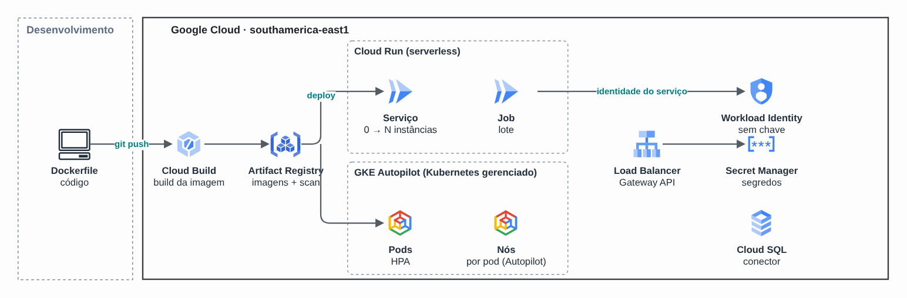
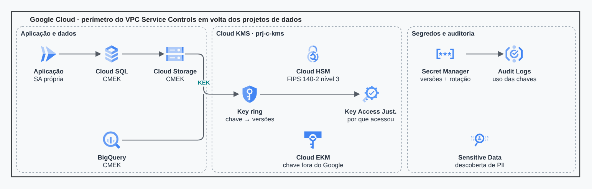
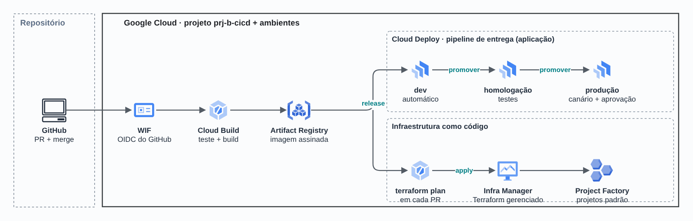
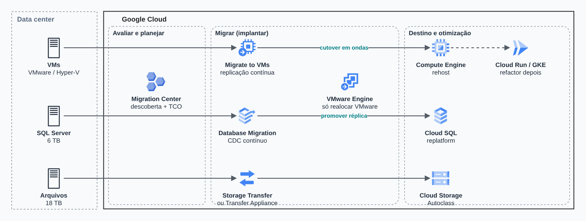
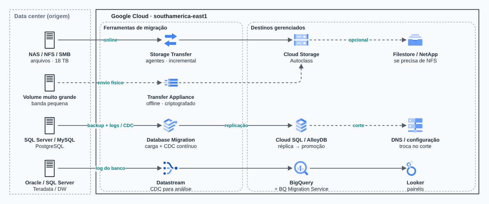
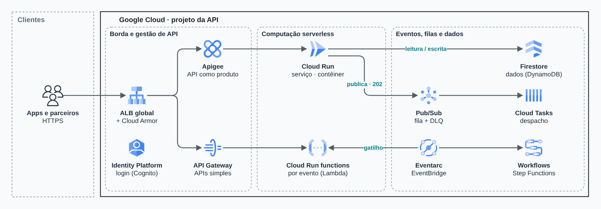
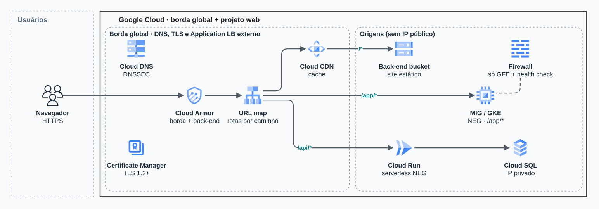
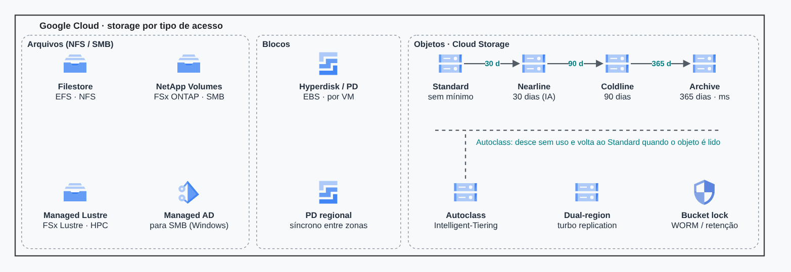

# Landing zone no Google Cloud

> Arquiteturas de referência no Google Cloud (2026)

Landing zone completa: hierarquia de recursos, conectividade, GKE e Cloud Run, segurança de dados, DevOps e observabilidade.

## Desenho

Fonte editável: [`desenho.drawio`](desenho.drawio). Abra no draw.io para navegar pelas páginas.

### 1. 1 · Landing zone (árvore de recursos)



### 2. 2 · Conectividade



### 3. 3 · GKE e Cloud Run



### 4. 4 · Segurança e dados



### 5. 5 · DevOps e GitOps



### 6. 6 · Migração de cargas



### 7. 7 · Migração de dados



### 8. 8 · APIs e serverless



### 9. 9 · Camada web



### 10. 10 · Storage



## Componentes identificados no desenho

- Amazon DynamoDB: tabelas de controle ficam junto do serviço que as usa
- GKE → módulo [`gcp/gke-private`](../../../../gcp/gke-private)
- Cloud SQL → módulo [`gcp/cloud-sql`](../../../../gcp/cloud-sql)
- Pub/Sub → módulo [`gcp/pubsub`](../../../../gcp/pubsub)
- Cloud Load Balancing + Cloud Armor → módulo [`gcp/edge-load-balancer`](../../../../gcp/edge-load-balancer)
- VPC do Google Cloud → módulo [`gcp/vpc-network`](../../../../gcp/vpc-network)
- Projetos e org policies → módulo [`gcp/project-foundation`](../../../../gcp/project-foundation)
- Cloud Storage → módulo [`gcp/static-site`](../../../../gcp/static-site)

## Automação pronta

A pasta [`terraform/`](terraform) compõe estes módulos do catálogo, na ordem de dependência:

1. [`gcp/project-foundation`](../../../../gcp/project-foundation): Projeto GCP com APIs e org policies
1. [`gcp/vpc-network`](../../../../gcp/vpc-network): VPC GCP com ranges secundários e PSA
1. [`gcp/gke-private`](../../../../gcp/gke-private): GKE privado com Workload Identity
1. [`gcp/cloud-sql`](../../../../gcp/cloud-sql): Cloud SQL privado
1. [`gcp/pubsub`](../../../../gcp/pubsub): Pub/Sub + Cloud Function (notificação)
1. [`gcp/edge-load-balancer`](../../../../gcp/edge-load-balancer): Load Balancer global + Cloud Armor

As saídas de um módulo alimentam o próximo (por exemplo, `module.vpc.private_subnet_ids` e `module.kms_key.key_arn`),
então não há IDs fixos entre camadas.

### Como executar

```bash
cd labs/arquiteturas/google-cloud/landing-zone-gcp/terraform
# ajuste locals.tf (prefixo, região, tags) e backend.tf (bucket/conta de state)
terraform init
terraform plan -out tfplan
terraform apply tfplan
```

Valores de exemplo (contas, IDs, domínios) são fictícios; troque pelos do seu ambiente antes do apply.
