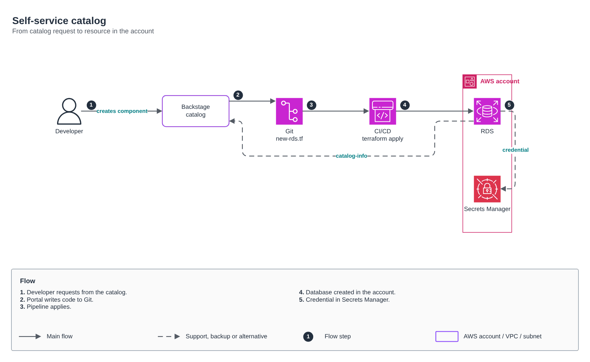

# Self-service catalog

[Português](README.md) · **English**

> Developer portal and infrastructure templates (2024)

From a Backstage request to a resource in the account, with the credential in Secrets Manager.

## Diagram

Editable source: [`desenho.drawio`](desenho.drawio), with pages in Portuguese and English. Open it in draw.io to browse.

The original drawing, anonymized, is kept in [`original/`](original) for reference.

### Self-service catalog



## Components found in the diagram

- Amazon RDS → module [`aws/rds-instance`](../../../../aws/rds-instance)
- Amazon VPC → module [`aws/vpc`](../../../../aws/vpc)
- AWS Secrets Manager: the RDS master password is already managed by RDS in Secrets Manager; application secrets come in through External Secrets

## Ready-made automation

The [`terraform/`](terraform) folder composes these catalog modules, in dependency order:

1. [`aws/tf-backend-bootstrap`](../../../../aws/tf-backend-bootstrap): Bootstrap do backend S3 do Terraform
1. [`aws/iam-github-oidc`](../../../../aws/iam-github-oidc): GitHub Actions -> AWS por OIDC
1. [`aws/s3-bucket`](../../../../aws/s3-bucket): Bucket S3 seguro por padrão

One module's outputs feed the next (for example `module.vpc.private_subnet_ids` and `module.kms_key.key_arn`), so there are no hard-coded IDs between layers.

### How to run

```bash
cd labs/arquiteturas/plataforma-iac/catalogo-de-servicos/terraform
# adjust locals.tf (prefix, region, tags) and backend.tf (state bucket/account)
terraform init
terraform plan -out tfplan
terraform apply tfplan
```

Sample values (accounts, IDs, domains) are fictitious; replace them with your own before applying.

## FinOps for this architecture

What weighs most on the bill for this solution and the lever for each item:

| Component | Cost driver | Lever |
|---|---|---|
| [`aws/s3-bucket`](../../../../aws/s3-bucket) | S3 storage and old object versions | lifecycle to IA/Glacier and expiration of noncurrent versions |

The FinOps cycle (inform, optimize, operate) is in the [FinOps process](../../telecom/processo-finops) lab.
To close the loop for this solution, also apply: [`aws/tag-compliance`](../../../../aws/tag-compliance), [`aws/finops-cost-report`](../../../../aws/finops-cost-report), [`aws/cur-focus-export`](../../../../aws/cur-focus-export), [`aws/instance-scheduler`](../../../../aws/instance-scheduler).
