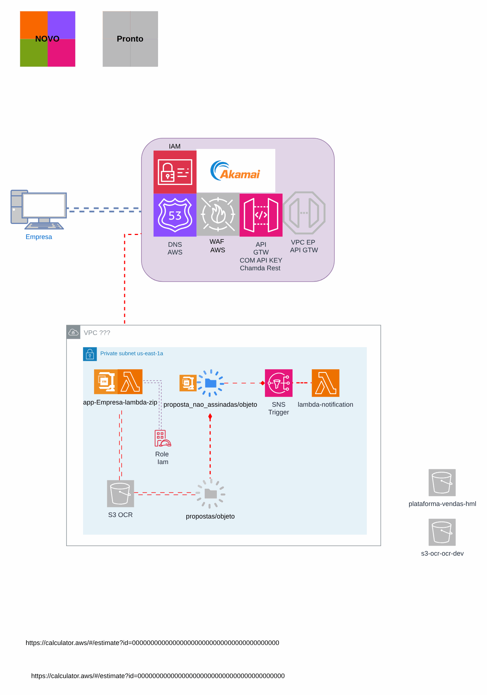
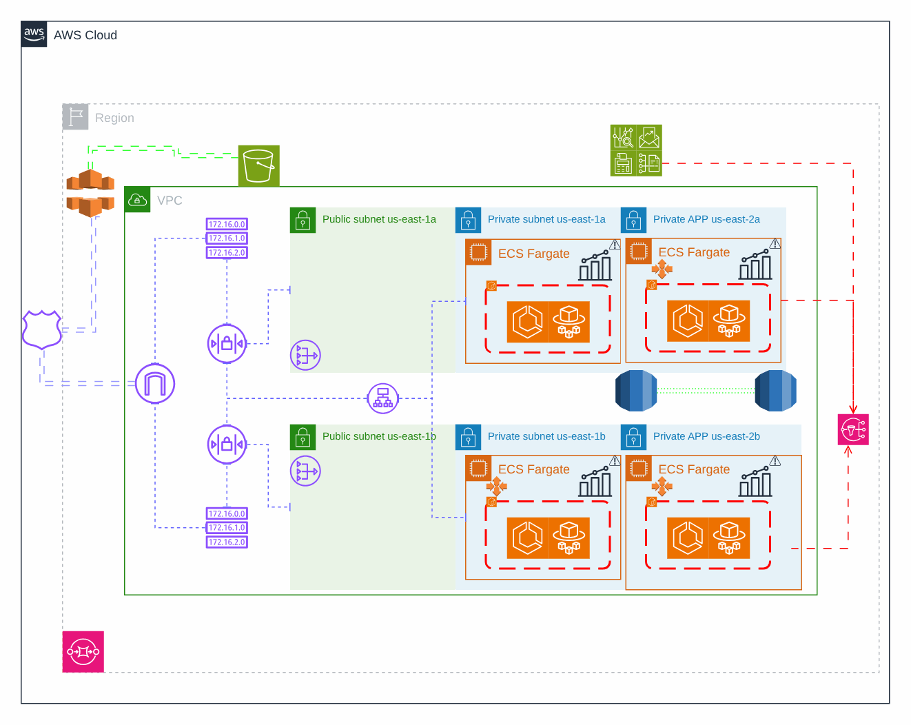

# API de download de arquivos

> Plataforma AWS de uma operadora de saúde (2024)

API serverless de download com Lambda e pipeline de deploy.

## Desenho

Fonte editável: [`desenho.drawio`](desenho.drawio). Abra no draw.io para navegar pelas páginas.

### 1. Lambda



### 2. Deploy



## Componentes identificados no desenho

- Amazon ECS/Fargate: serviços em ECS/Fargate ficam no repositório da aplicação (task definition + service); a rede, o ECR e o banco vêm daqui
- Amazon S3 → módulo [`aws/s3-bucket`](../../../../aws/s3-bucket)
- Amazon SQS → módulo [`aws/sqs-queue`](../../../../aws/sqs-queue)
- Amazon SNS → módulo [`aws/sns-topic`](../../../../aws/sns-topic)
- AWS Lambda → módulo [`aws/lambda-function`](../../../../aws/lambda-function)
- API Gateway → módulo [`aws/api-gateway-lambda`](../../../../aws/api-gateway-lambda)
- Amazon VPC → módulo [`aws/vpc`](../../../../aws/vpc)
- Route 53 → módulo [`aws/route53-private-zone`](../../../../aws/route53-private-zone)
- Amazon ECR → módulo [`aws/ecr`](../../../../aws/ecr)
- VPC Endpoints → módulo [`aws/vpc-endpoints`](../../../../aws/vpc-endpoints)
- AWS WAF: o Web ACL é passado por ARN para o CloudFront (`web_acl_id`) ou associado ao ALB

## Automação pronta

A pasta [`terraform/`](terraform) compõe estes módulos do catálogo, na ordem de dependência:

1. [`aws/s3-bucket`](../../../../aws/s3-bucket): Bucket S3 seguro por padrão
1. [`aws/lambda-function`](../../../../aws/lambda-function): Função Lambda empacotada
1. [`aws/api-gateway-lambda`](../../../../aws/api-gateway-lambda): HTTP API -> Lambda
1. [`aws/sns-topic`](../../../../aws/sns-topic): Tópicos SNS com assinaturas

As saídas de um módulo alimentam o próximo (por exemplo, `module.vpc.private_subnet_ids` e `module.kms_key.key_arn`),
então não há IDs fixos entre camadas.

### Como executar

```bash
cd labs/arquiteturas/saude/api-de-download/terraform
# ajuste locals.tf (prefixo, região, tags) e backend.tf (bucket/conta de state)
terraform init
terraform plan -out tfplan
terraform apply tfplan
```

Valores de exemplo (contas, IDs, domínios) são fictícios; troque pelos do seu ambiente antes do apply.
