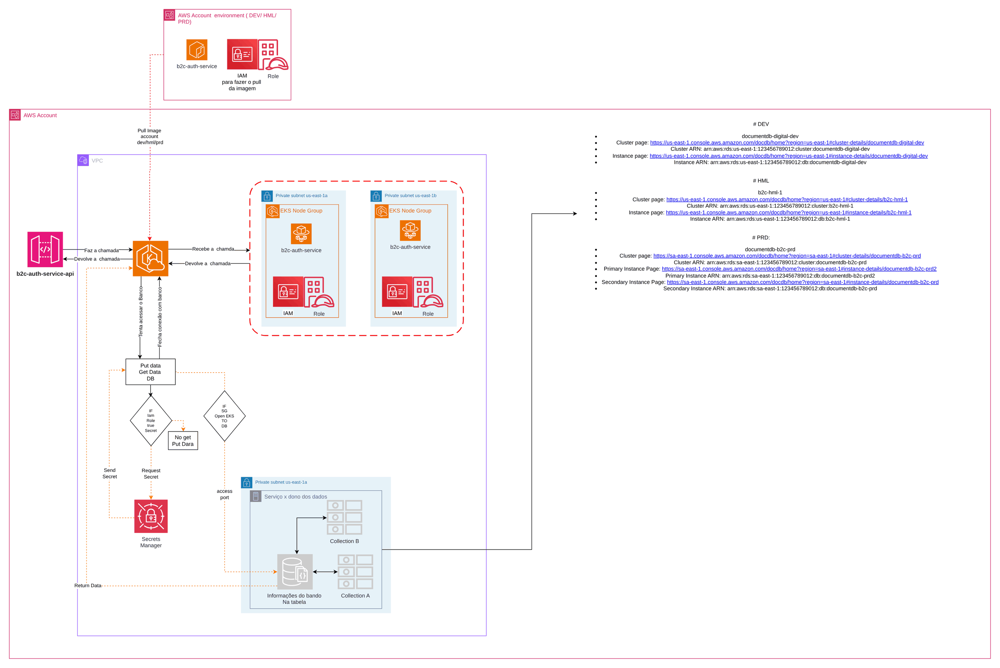

# Serviço de autenticação B2C — primeira versão

> Plataforma AWS de uma operadora de saúde (2024)

Primeira versão do serviço de autenticação B2C, antes da evolução para EKS.

## Desenho

Fonte editável: [`desenho.drawio`](desenho.drawio). Abra no draw.io para navegar pelas páginas.

### 1. Zoom-in



## Componentes identificados no desenho

- Amazon EKS → módulo [`aws/eks-cluster`](../../../../aws/eks-cluster)
- Amazon ECS/Fargate: serviços em ECS/Fargate ficam no repositório da aplicação (task definition + service); a rede, o ECR e o banco vêm daqui
- API Gateway → módulo [`aws/api-gateway-lambda`](../../../../aws/api-gateway-lambda)
- Amazon VPC → módulo [`aws/vpc`](../../../../aws/vpc)
- Amazon ECR → módulo [`aws/ecr`](../../../../aws/ecr)
- AWS Secrets Manager: a senha master do RDS já é gerenciada pelo próprio RDS no Secrets Manager; segredos de aplicação entram via External Secrets

## Automação pronta

A pasta [`terraform/`](terraform) compõe estes módulos do catálogo, na ordem de dependência:

1. [`aws/kms-key`](../../../../aws/kms-key): Chave KMS (CMK) da plataforma
1. [`aws/cognito-user-pool`](../../../../aws/cognito-user-pool): Cognito como IdP OAuth2/OIDC
1. [`aws/lambda-function`](../../../../aws/lambda-function): Função Lambda empacotada
1. [`aws/api-gateway-lambda`](../../../../aws/api-gateway-lambda): HTTP API -> Lambda

As saídas de um módulo alimentam o próximo (por exemplo, `module.vpc.private_subnet_ids` e `module.kms_key.key_arn`),
então não há IDs fixos entre camadas.

### Como executar

```bash
cd labs/arquiteturas/saude/autenticacao-b2c-v1/terraform
# ajuste locals.tf (prefixo, região, tags) e backend.tf (bucket/conta de state)
terraform init
terraform plan -out tfplan
terraform apply tfplan
```

Valores de exemplo (contas, IDs, domínios) são fictícios; troque pelos do seu ambiente antes do apply.
