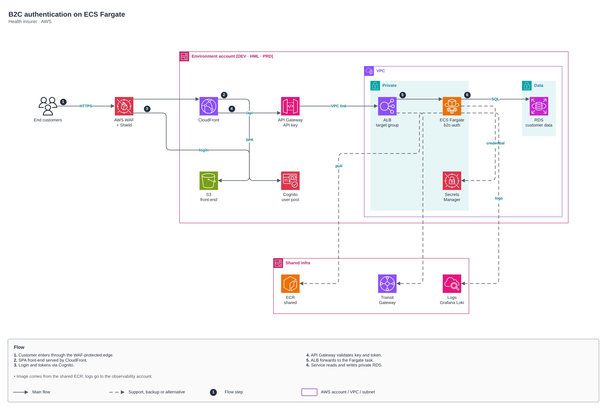

# B2C authentication on ECS Fargate

[Português](README.md) · **English**

> AWS platform of a health insurer (2024)

End-customer login with Cognito, API Gateway and a Fargate service with a private database.

## Diagram

Editable source: [`desenho.drawio`](desenho.drawio), with pages in Portuguese and English. Open it in draw.io to browse.

The original drawing, anonymized, is kept in [`original/`](original) for reference.

### B2C authentication on ECS Fargate



## Components found in the diagram

- Amazon ECS/Fargate: ECS/Fargate services live in the application repository (task definition + service); network, ECR and database come from here
- Amazon RDS → module [`aws/rds-instance`](../../../../aws/rds-instance)
- Amazon S3 → module [`aws/s3-bucket`](../../../../aws/s3-bucket)
- API Gateway → module [`aws/api-gateway-lambda`](../../../../aws/api-gateway-lambda)
- Amazon Cognito → module [`aws/cognito-user-pool`](../../../../aws/cognito-user-pool)
- Amazon CloudFront → module [`aws/cloudfront-spa`](../../../../aws/cloudfront-spa)
- Amazon VPC → module [`aws/vpc`](../../../../aws/vpc)
- Transit Gateway → module [`aws/transit-gateway-attachment`](../../../../aws/transit-gateway-attachment)
- Amazon ECR → module [`aws/ecr`](../../../../aws/ecr)
- AWS Secrets Manager: the RDS master password is already managed by RDS in Secrets Manager; application secrets come in through External Secrets
- AWS WAF: the Web ACL is passed by ARN to CloudFront (`web_acl_id`) or associated with the ALB
- Amazon CloudWatch → module [`aws/cloudwatch-logs`](../../../../aws/cloudwatch-logs)

## Ready-made automation

The [`terraform/`](terraform) folder composes these catalog modules, in dependency order:

1. [`aws/kms-key`](../../../../aws/kms-key): Chave KMS (CMK) da plataforma
1. [`aws/vpc`](../../../../aws/vpc): VPC em três camadas
1. [`aws/cognito-user-pool`](../../../../aws/cognito-user-pool): Cognito como IdP OAuth2/OIDC
1. [`aws/lambda-function`](../../../../aws/lambda-function): Função Lambda empacotada
1. [`aws/api-gateway-lambda`](../../../../aws/api-gateway-lambda): HTTP API -> Lambda
1. [`aws/rds-instance`](../../../../aws/rds-instance): RDS MySQL/PostgreSQL privado
1. [`aws/cloudfront-spa`](../../../../aws/cloudfront-spa): SPA em S3 + CloudFront

One module's outputs feed the next (for example `module.vpc.private_subnet_ids` and `module.kms_key.key_arn`), so there are no hard-coded IDs between layers.

### How to run

```bash
cd labs/arquiteturas/saude/autenticacao-b2c/terraform
# adjust locals.tf (prefix, region, tags) and backend.tf (state bucket/account)
terraform init
terraform plan -out tfplan
terraform apply tfplan
```

Sample values (accounts, IDs, domains) are fictitious; replace them with your own before applying.

## FinOps for this architecture

What weighs most on the bill for this solution and the lever for each item:

| Component | Cost driver | Lever |
|---|---|---|
| [`aws/rds-instance`](../../../../aws/rds-instance) | RDS instance class and Multi-AZ | right-size from real metrics, reserve PRD and stop HML/DEV after hours |
| [`aws/vpc`](../../../../aws/vpc) | NAT Gateway per AZ and the traffic it processes | a single NAT in DEV and VPC endpoints for S3/ECR to keep traffic off the NAT |
| [`aws/cloudfront-spa`](../../../../aws/cloudfront-spa) | CDN data transfer | good caching and compression; the CDN usually lowers origin egress cost |
| [`aws/lambda-function`](../../../../aws/lambda-function) | function duration × memory | tune memory with Power Tuning and use arm64 |
| [`aws/cognito-user-pool`](../../../../aws/cognito-user-pool) | Cognito monthly active users (MAU) | pick the right tier and clean up inactive accounts |
| [`aws/kms-key`](../../../../aws/kms-key) | KMS keys per month and API calls | S3 bucket keys reduce KMS calls |
| [`aws/api-gateway-lambda`](../../../../aws/api-gateway-lambda) | API Gateway requests | HTTP API instead of REST API when the extra features are not needed, plus edge caching |

The FinOps cycle (inform, optimize, operate) is in the [FinOps process](../../telecom/processo-finops) lab.
To close the loop for this solution, also apply: [`aws/tag-compliance`](../../../../aws/tag-compliance), [`aws/finops-cost-report`](../../../../aws/finops-cost-report), [`aws/cur-focus-export`](../../../../aws/cur-focus-export), [`aws/instance-scheduler`](../../../../aws/instance-scheduler).
