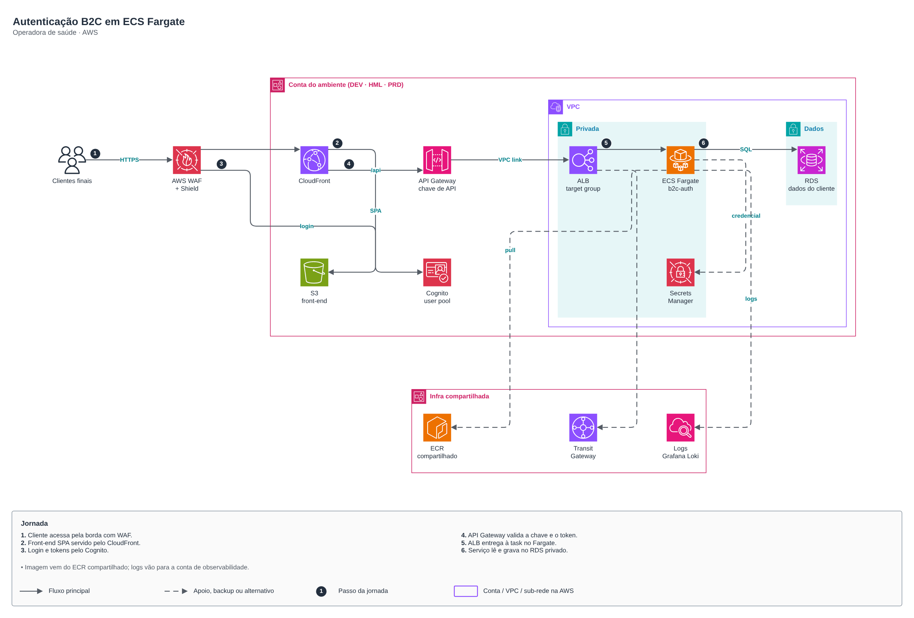

# Autenticação B2C em ECS Fargate

**Português** · [English](README.en.md)

> Plataforma AWS de uma operadora de saúde (2024)

Login de clientes finais com Cognito, API Gateway e serviço em Fargate com banco privado.

## Desenho

Fonte editável: [`desenho.drawio`](desenho.drawio), com páginas em português e em inglês. Abra no draw.io para navegar.

O desenho original, anonimizado, está em [`original/`](original) como referência.

### Autenticação B2C em ECS Fargate



## Componentes identificados no desenho

- Amazon ECS/Fargate: serviços em ECS/Fargate ficam no repositório da aplicação (task definition + service); a rede, o ECR e o banco vêm daqui
- Amazon RDS → módulo [`aws/rds-instance`](../../../../aws/rds-instance)
- Amazon S3 → módulo [`aws/s3-bucket`](../../../../aws/s3-bucket)
- API Gateway → módulo [`aws/api-gateway-lambda`](../../../../aws/api-gateway-lambda)
- Amazon Cognito → módulo [`aws/cognito-user-pool`](../../../../aws/cognito-user-pool)
- Amazon CloudFront → módulo [`aws/cloudfront-spa`](../../../../aws/cloudfront-spa)
- Amazon VPC → módulo [`aws/vpc`](../../../../aws/vpc)
- Transit Gateway → módulo [`aws/transit-gateway-attachment`](../../../../aws/transit-gateway-attachment)
- Amazon ECR → módulo [`aws/ecr`](../../../../aws/ecr)
- AWS Secrets Manager: a senha master do RDS já é gerenciada pelo próprio RDS no Secrets Manager; segredos de aplicação entram via External Secrets
- AWS WAF: o Web ACL é passado por ARN para o CloudFront (`web_acl_id`) ou associado ao ALB
- Amazon CloudWatch → módulo [`aws/cloudwatch-logs`](../../../../aws/cloudwatch-logs)

## Automação pronta

A pasta [`terraform/`](terraform) compõe estes módulos do catálogo, na ordem de dependência:

1. [`aws/kms-key`](../../../../aws/kms-key): Chave KMS (CMK) da plataforma
1. [`aws/vpc`](../../../../aws/vpc): VPC em três camadas
1. [`aws/cognito-user-pool`](../../../../aws/cognito-user-pool): Cognito como IdP OAuth2/OIDC
1. [`aws/lambda-function`](../../../../aws/lambda-function): Função Lambda empacotada
1. [`aws/api-gateway-lambda`](../../../../aws/api-gateway-lambda): HTTP API -> Lambda
1. [`aws/rds-instance`](../../../../aws/rds-instance): RDS MySQL/PostgreSQL privado
1. [`aws/cloudfront-spa`](../../../../aws/cloudfront-spa): SPA em S3 + CloudFront

As saídas de um módulo alimentam o próximo (por exemplo, `module.vpc.private_subnet_ids` e `module.kms_key.key_arn`), então não há IDs fixos entre camadas.

### Como executar

```bash
cd labs/arquiteturas/saude/autenticacao-b2c/terraform
# ajuste locals.tf (prefixo, região, tags) e backend.tf (bucket/conta de state)
terraform init
terraform plan -out tfplan
terraform apply tfplan
```

Valores de exemplo (contas, IDs, domínios) são fictícios; troque pelos do seu ambiente antes do apply.

## FinOps desta arquitetura

O que mais pesa na conta desta solução e a alavanca para cada item:

| Componente | O que pesa | Alavanca |
|---|---|---|
| [`aws/rds-instance`](../../../../aws/rds-instance) | classe da instância e Multi-AZ do RDS | dimensionar pela métrica real, reserva para PRD e parar HML/DEV fora do horário |
| [`aws/vpc`](../../../../aws/vpc) | NAT Gateway por AZ e tráfego que passa por ele | um NAT só em DEV e VPC endpoints para S3/ECR tirarem tráfego do NAT |
| [`aws/cloudfront-spa`](../../../../aws/cloudfront-spa) | transferência de dados da CDN | cache bem configurado e compressão; a CDN costuma reduzir o custo de saída da origem |
| [`aws/lambda-function`](../../../../aws/lambda-function) | duração x memória das funções | ajustar memória com Power Tuning e usar arm64 |
| [`aws/cognito-user-pool`](../../../../aws/cognito-user-pool) | usuários ativos por mês (MAU) no Cognito | escolher o tier certo e limpar contas inativas |
| [`aws/kms-key`](../../../../aws/kms-key) | chaves KMS por mês e chamadas de API | bucket keys no S3 reduzem chamadas ao KMS |
| [`aws/api-gateway-lambda`](../../../../aws/api-gateway-lambda) | requisições no API Gateway | HTTP API em vez de REST API quando não precisa dos recursos extras, e cache na borda |

O ciclo de FinOps (informar, otimizar, operar) está no lab [Processo de FinOps](../../telecom/processo-finops).
Para fechar o ciclo nesta solução, aplique também: [`aws/tag-compliance`](../../../../aws/tag-compliance), [`aws/finops-cost-report`](../../../../aws/finops-cost-report), [`aws/cur-focus-export`](../../../../aws/cur-focus-export), [`aws/instance-scheduler`](../../../../aws/instance-scheduler).
