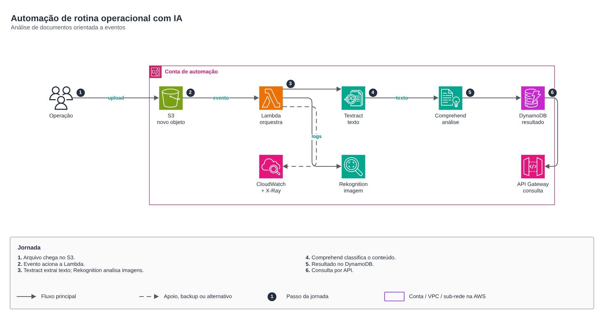

# Automação de rotina operacional com IA

**Português** · [English](README.en.md)

> Plataforma AWS de uma operadora de saúde (2024)

Evento no S3 aciona Lambda, Textract, Rekognition e Comprehend; resultado no DynamoDB com API.

## Desenho

Fonte editável: [`desenho.drawio`](desenho.drawio), com páginas em português e em inglês. Abra no draw.io para navegar.

O desenho original, anonimizado, está em [`original/`](original) como referência.

### Automação de rotina operacional com IA



## Componentes identificados no desenho

- Amazon S3 → módulo [`aws/s3-bucket`](../../../../aws/s3-bucket)
- AWS Lambda → módulo [`aws/lambda-function`](../../../../aws/lambda-function)
- API Gateway → módulo [`aws/api-gateway-lambda`](../../../../aws/api-gateway-lambda)
- Amazon Textract → módulo [`aws/textract-pipeline`](../../../../aws/textract-pipeline)
- Amazon VPC → módulo [`aws/vpc`](../../../../aws/vpc)
- Amazon DynamoDB: tabelas de controle ficam junto do serviço que as usa
- Amazon CloudWatch → módulo [`aws/cloudwatch-logs`](../../../../aws/cloudwatch-logs)

## Automação pronta

A pasta [`terraform/`](terraform) compõe estes módulos do catálogo, na ordem de dependência:

1. [`aws/s3-bucket`](../../../../aws/s3-bucket): Bucket S3 seguro por padrão
1. [`aws/lambda-function`](../../../../aws/lambda-function): Função Lambda empacotada
1. [`aws/textract-pipeline`](../../../../aws/textract-pipeline): Pipeline de extração com Textract

As saídas de um módulo alimentam o próximo (por exemplo, `module.vpc.private_subnet_ids` e `module.kms_key.key_arn`), então não há IDs fixos entre camadas.

### Como executar

```bash
cd labs/arquiteturas/saude/automacao-rgs/terraform
# ajuste locals.tf (prefixo, região, tags) e backend.tf (bucket/conta de state)
terraform init
terraform plan -out tfplan
terraform apply tfplan
```

Valores de exemplo (contas, IDs, domínios) são fictícios; troque pelos do seu ambiente antes do apply.

## FinOps desta arquitetura

O que mais pesa na conta desta solução e a alavanca para cada item:

| Componente | O que pesa | Alavanca |
|---|---|---|
| [`aws/textract-pipeline`](../../../../aws/textract-pipeline) | custo por página processada no Textract | filtrar e classificar antes de extrair e usar só as features necessárias (texto x formulário x tabela) |
| [`aws/s3-bucket`](../../../../aws/s3-bucket) | armazenamento e versões antigas no S3 | lifecycle para IA/Glacier e expiração de versões não atuais |
| [`aws/lambda-function`](../../../../aws/lambda-function) | duração x memória das funções | ajustar memória com Power Tuning e usar arm64 |

O ciclo de FinOps (informar, otimizar, operar) está no lab [Processo de FinOps](../../telecom/processo-finops).
Para fechar o ciclo nesta solução, aplique também: [`aws/tag-compliance`](../../../../aws/tag-compliance), [`aws/finops-cost-report`](../../../../aws/finops-cost-report), [`aws/cur-focus-export`](../../../../aws/cur-focus-export), [`aws/instance-scheduler`](../../../../aws/instance-scheduler).
