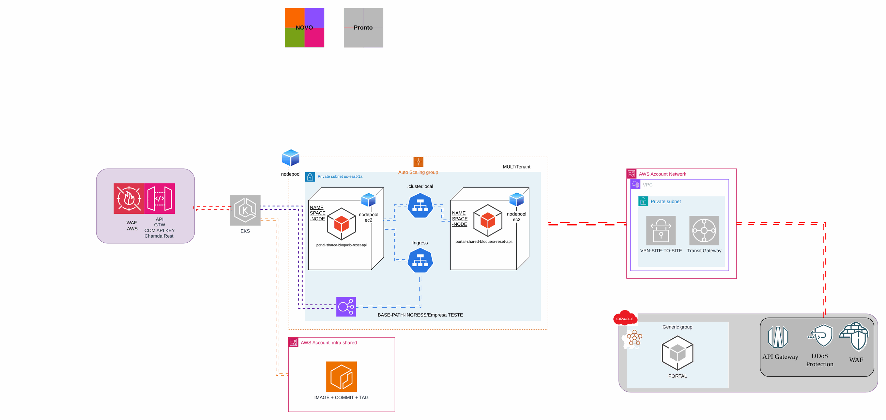
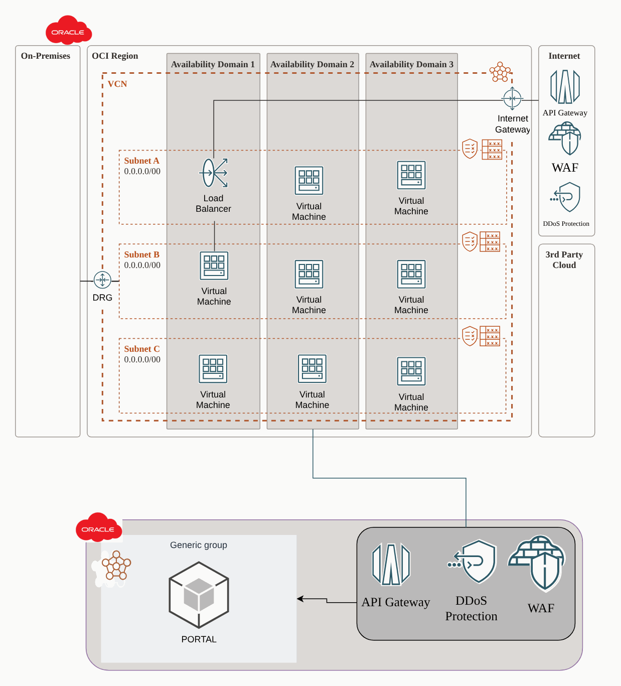
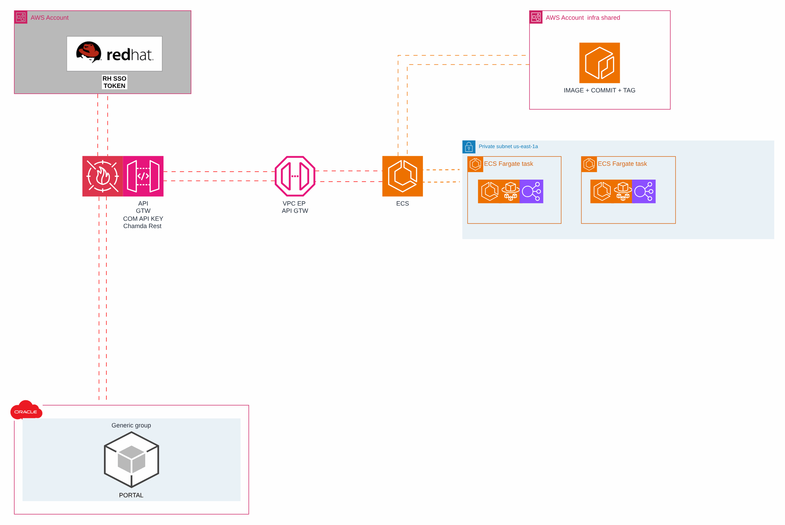

# Bloqueio e reset de acesso

> Plataforma AWS de uma operadora de saúde (2024)

Serviço compartilhado de bloqueio e reset de credenciais com componentes em EKS, ECS e OCI.

## Desenho

Fonte editável: [`desenho.drawio`](desenho.drawio). Abra no draw.io para navegar pelas páginas.

### 1. EKS



### 2. OCI



### 3. ECS



## Componentes identificados no desenho

- Amazon EKS → módulo [`aws/eks-cluster`](../../../../aws/eks-cluster)
- Amazon ECS/Fargate: serviços em ECS/Fargate ficam no repositório da aplicação (task definition + service); a rede, o ECR e o banco vêm daqui
- API Gateway → módulo [`aws/api-gateway-lambda`](../../../../aws/api-gateway-lambda)
- Amazon VPC → módulo [`aws/vpc`](../../../../aws/vpc)
- Transit Gateway → módulo [`aws/transit-gateway-attachment`](../../../../aws/transit-gateway-attachment)
- VPN Site-to-Site → módulo [`aws/vpn-site-to-site`](../../../../aws/vpn-site-to-site)
- Amazon ECR → módulo [`aws/ecr`](../../../../aws/ecr)
- VPC Endpoints → módulo [`aws/vpc-endpoints`](../../../../aws/vpc-endpoints)
- AWS WAF: o Web ACL é passado por ARN para o CloudFront (`web_acl_id`) ou associado ao ALB
- IAM Identity Center → módulo [`aws/identity-center-permission-set`](../../../../aws/identity-center-permission-set)

## Automação pronta

A pasta [`terraform/`](terraform) compõe estes módulos do catálogo, na ordem de dependência:

1. [`aws/kms-key`](../../../../aws/kms-key): Chave KMS (CMK) da plataforma
1. [`aws/vpc`](../../../../aws/vpc): VPC em três camadas
1. [`aws/eks-cluster`](../../../../aws/eks-cluster): Cluster EKS privado
1. [`aws/transit-gateway-attachment`](../../../../aws/transit-gateway-attachment): Attachment de VPC ao Transit Gateway
1. [`aws/vpn-site-to-site`](../../../../aws/vpn-site-to-site): VPN Site-to-Site (TGW/VGW) declarativa

As saídas de um módulo alimentam o próximo (por exemplo, `module.vpc.private_subnet_ids` e `module.kms_key.key_arn`),
então não há IDs fixos entre camadas.

### Como executar

```bash
cd labs/arquiteturas/saude/bloqueio-e-reset-de-acesso/terraform
# ajuste locals.tf (prefixo, região, tags) e backend.tf (bucket/conta de state)
terraform init
terraform plan -out tfplan
terraform apply tfplan
```

Valores de exemplo (contas, IDs, domínios) são fictícios; troque pelos do seu ambiente antes do apply.
