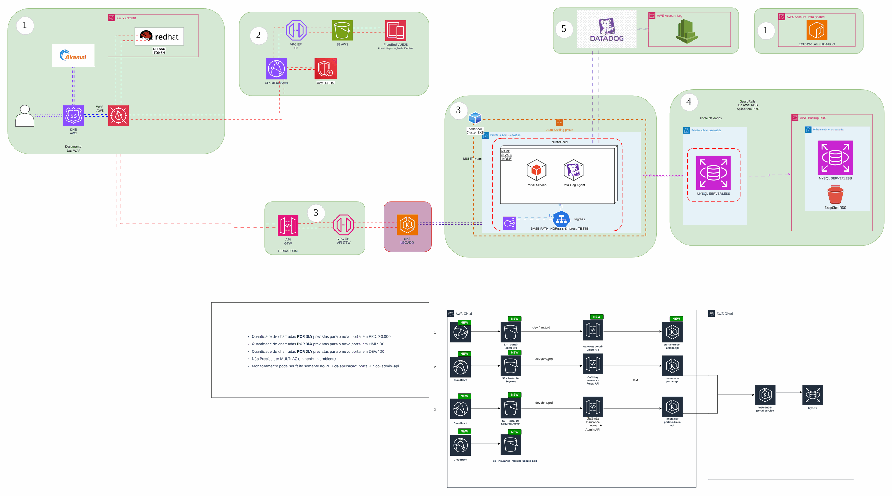
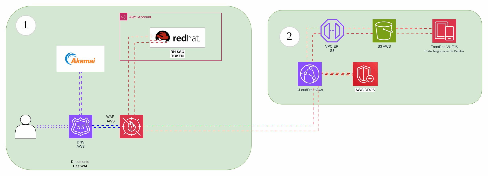

# Evolução do portal de seguros

> Plataforma AWS de uma operadora de saúde (2024)

APIs e portais (cliente, administração e cadastro) evoluídos para containers e serviços gerenciados.

## Desenho

Fonte editável: [`desenho.drawio`](desenho.drawio). Abra no draw.io para navegar pelas páginas.

### 1. portal-unico-api



### 2. Portal Seguros


### 3. Portal Da Seguros Admin


### 4. Insurance register update app



## Componentes identificados no desenho

- Amazon EKS → módulo [`aws/eks-cluster`](../../../../aws/eks-cluster)
- Amazon RDS → módulo [`aws/rds-instance`](../../../../aws/rds-instance)
- Amazon S3 → módulo [`aws/s3-bucket`](../../../../aws/s3-bucket)
- API Gateway → módulo [`aws/api-gateway-lambda`](../../../../aws/api-gateway-lambda)
- Amazon CloudFront → módulo [`aws/cloudfront-spa`](../../../../aws/cloudfront-spa)
- Amazon VPC → módulo [`aws/vpc`](../../../../aws/vpc)
- Route 53 → módulo [`aws/route53-private-zone`](../../../../aws/route53-private-zone)
- Amazon ECR → módulo [`aws/ecr`](../../../../aws/ecr)
- AWS Backup → módulo [`aws/backup-plan`](../../../../aws/backup-plan)
- VPC Endpoints → módulo [`aws/vpc-endpoints`](../../../../aws/vpc-endpoints)
- AWS WAF: o Web ACL é passado por ARN para o CloudFront (`web_acl_id`) ou associado ao ALB
- IAM Identity Center → módulo [`aws/identity-center-permission-set`](../../../../aws/identity-center-permission-set)

## Automação pronta

A pasta [`terraform/`](terraform) compõe estes módulos do catálogo, na ordem de dependência:

1. [`aws/kms-key`](../../../../aws/kms-key): Chave KMS (CMK) da plataforma
1. [`aws/vpc`](../../../../aws/vpc): VPC em três camadas
1. [`aws/eks-cluster`](../../../../aws/eks-cluster): Cluster EKS privado
1. [`aws/rds-instance`](../../../../aws/rds-instance): RDS MySQL/PostgreSQL privado
1. [`aws/ecr`](../../../../aws/ecr): Repositórios ECR com scan, KMS e retenção
1. [`aws/cloudfront-spa`](../../../../aws/cloudfront-spa): SPA em S3 + CloudFront

As saídas de um módulo alimentam o próximo (por exemplo, `module.vpc.private_subnet_ids` e `module.kms_key.key_arn`),
então não há IDs fixos entre camadas.

### Como executar

```bash
cd labs/arquiteturas/saude/evolucao-portal-de-seguros/terraform
# ajuste locals.tf (prefixo, região, tags) e backend.tf (bucket/conta de state)
terraform init
terraform plan -out tfplan
terraform apply tfplan
```

Valores de exemplo (contas, IDs, domínios) são fictícios; troque pelos do seu ambiente antes do apply.
