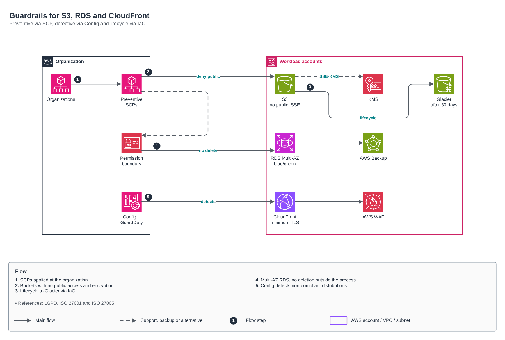

# Guardrails for S3, RDS and CloudFront

[Português](README.md) · **English**

> AWS platform of a health insurer (2024)

Preventive controls via SCP and boundaries, detective via Config and lifecycle via IaC.

## Diagram

Editable source: [`desenho.drawio`](desenho.drawio), with pages in Portuguese and English. Open it in draw.io to browse.

The original drawing, anonymized, is kept in [`original/`](original) for reference.

### Guardrails for S3, RDS and CloudFront



## Components found in the diagram

- Amazon RDS → module [`aws/rds-instance`](../../../../aws/rds-instance)
- Amazon S3 → module [`aws/s3-bucket`](../../../../aws/s3-bucket)
- Amazon CloudFront → module [`aws/cloudfront-spa`](../../../../aws/cloudfront-spa)
- AWS KMS → module [`aws/kms-key`](../../../../aws/kms-key)
- Amazon VPC → module [`aws/vpc`](../../../../aws/vpc)
- AWS Backup → module [`aws/backup-plan`](../../../../aws/backup-plan)
- AWS Organizations / SCP → module [`aws/organizations-scp`](../../../../aws/organizations-scp)
- AWS WAF: the Web ACL is passed by ARN to CloudFront (`web_acl_id`) or associated with the ALB
- GuardDuty / Security Hub → module [`aws/security-baseline`](../../../../aws/security-baseline)

## Ready-made automation

The [`terraform/`](terraform) folder composes these catalog modules, in dependency order:

1. [`aws/organizations-scp`](../../../../aws/organizations-scp): Organizations: OUs, SCPs e Tag Policy
1. [`aws/security-baseline`](../../../../aws/security-baseline): Baseline de segurança da organização
1. [`aws/kms-key`](../../../../aws/kms-key): Chave KMS (CMK) da plataforma
1. [`aws/s3-bucket`](../../../../aws/s3-bucket): Bucket S3 seguro por padrão
1. [`aws/vpc`](../../../../aws/vpc): VPC em três camadas
1. [`aws/rds-instance`](../../../../aws/rds-instance): RDS MySQL/PostgreSQL privado

One module's outputs feed the next (for example `module.vpc.private_subnet_ids` and `module.kms_key.key_arn`), so there are no hard-coded IDs between layers.

### How to run

```bash
cd labs/arquiteturas/saude/guardrails-s3-rds-cloudfront/terraform
# adjust locals.tf (prefix, region, tags) and backend.tf (state bucket/account)
terraform init
terraform plan -out tfplan
terraform apply tfplan
```

Sample values (accounts, IDs, domains) are fictitious; replace them with your own before applying.

## FinOps for this architecture

What weighs most on the bill for this solution and the lever for each item:

| Component | Cost driver | Lever |
|---|---|---|
| [`aws/rds-instance`](../../../../aws/rds-instance) | RDS instance class and Multi-AZ | right-size from real metrics, reserve PRD and stop HML/DEV after hours |
| [`aws/vpc`](../../../../aws/vpc) | NAT Gateway per AZ and the traffic it processes | a single NAT in DEV and VPC endpoints for S3/ECR to keep traffic off the NAT |
| [`aws/s3-bucket`](../../../../aws/s3-bucket) | S3 storage and old object versions | lifecycle to IA/Glacier and expiration of noncurrent versions |
| [`aws/security-baseline`](../../../../aws/security-baseline) | Config, GuardDuty and Security Hub in every account | record only the relevant resource types in Config |
| [`aws/kms-key`](../../../../aws/kms-key) | KMS keys per month and API calls | S3 bucket keys reduce KMS calls |

The FinOps cycle (inform, optimize, operate) is in the [FinOps process](../../telecom/processo-finops) lab.
To close the loop for this solution, also apply: [`aws/tag-compliance`](../../../../aws/tag-compliance), [`aws/finops-cost-report`](../../../../aws/finops-cost-report), [`aws/cur-focus-export`](../../../../aws/cur-focus-export), [`aws/instance-scheduler`](../../../../aws/instance-scheduler).
