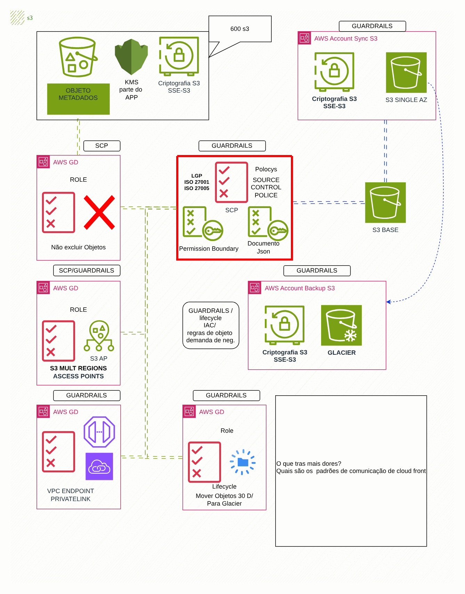
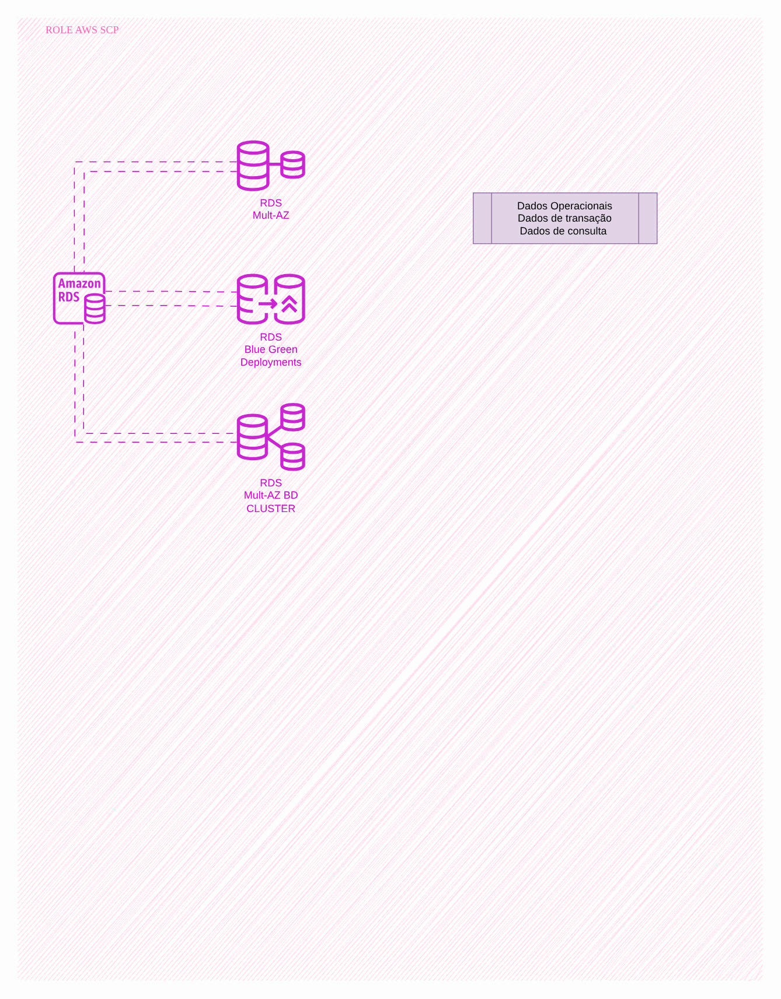
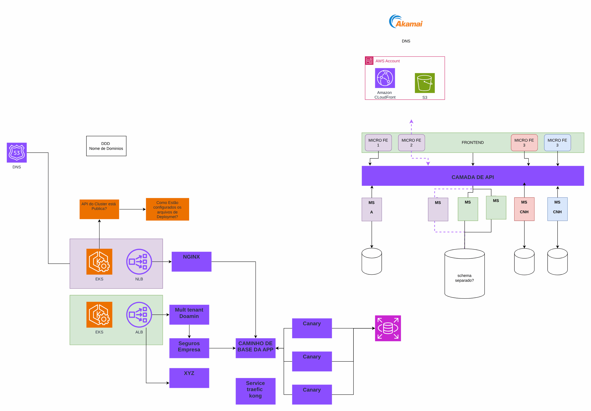

# Guardrails para S3, RDS e CloudFront

> Plataforma AWS de uma operadora de saúde (2024)

Controles preventivos e detectivos para buckets, bancos e distribuições.

## Desenho

Fonte editável: [`desenho.drawio`](desenho.drawio). Abra no draw.io para navegar pelas páginas.

### 1. S3



### 2. RDS



### 3. Cloud Front



## Componentes identificados no desenho

- Amazon EKS → módulo [`aws/eks-cluster`](../../../../aws/eks-cluster)
- Amazon RDS → módulo [`aws/rds-instance`](../../../../aws/rds-instance)
- Amazon S3 → módulo [`aws/s3-bucket`](../../../../aws/s3-bucket)
- Amazon CloudFront → módulo [`aws/cloudfront-spa`](../../../../aws/cloudfront-spa)
- AWS KMS → módulo [`aws/kms-key`](../../../../aws/kms-key)
- Amazon VPC → módulo [`aws/vpc`](../../../../aws/vpc)
- Route 53 → módulo [`aws/route53-private-zone`](../../../../aws/route53-private-zone)
- AWS Organizations / SCP → módulo [`aws/organizations-scp`](../../../../aws/organizations-scp)
- VPC Endpoints → módulo [`aws/vpc-endpoints`](../../../../aws/vpc-endpoints)

## Automação pronta

A pasta [`terraform/`](terraform) compõe estes módulos do catálogo, na ordem de dependência:

1. [`aws/organizations-scp`](../../../../aws/organizations-scp): Organizations: OUs, SCPs e Tag Policy
1. [`aws/security-baseline`](../../../../aws/security-baseline): Baseline de segurança da organização
1. [`aws/kms-key`](../../../../aws/kms-key): Chave KMS (CMK) da plataforma
1. [`aws/s3-bucket`](../../../../aws/s3-bucket): Bucket S3 seguro por padrão
1. [`aws/vpc`](../../../../aws/vpc): VPC em três camadas
1. [`aws/rds-instance`](../../../../aws/rds-instance): RDS MySQL/PostgreSQL privado

As saídas de um módulo alimentam o próximo (por exemplo, `module.vpc.private_subnet_ids` e `module.kms_key.key_arn`),
então não há IDs fixos entre camadas.

### Como executar

```bash
cd labs/arquiteturas/saude/guardrails-s3-rds-cloudfront/terraform
# ajuste locals.tf (prefixo, região, tags) e backend.tf (bucket/conta de state)
terraform init
terraform plan -out tfplan
terraform apply tfplan
```

Valores de exemplo (contas, IDs, domínios) são fictícios; troque pelos do seu ambiente antes do apply.

## FinOps desta arquitetura

O que mais pesa na conta desta solução e a alavanca para cada item:

| Componente | O que pesa | Alavanca |
|---|---|---|
| [`aws/rds-instance`](../../../../aws/rds-instance) | classe da instância e Multi-AZ do RDS | dimensionar pela métrica real, reserva para PRD e parar HML/DEV fora do horário |
| [`aws/vpc`](../../../../aws/vpc) | NAT Gateway por AZ e tráfego que passa por ele | um NAT só em DEV e VPC endpoints para S3/ECR tirarem tráfego do NAT |
| [`aws/s3-bucket`](../../../../aws/s3-bucket) | armazenamento e versões antigas no S3 | lifecycle para IA/Glacier e expiração de versões não atuais |
| [`aws/security-baseline`](../../../../aws/security-baseline) | Config, GuardDuty e Security Hub em todas as contas | gravar no Config só os tipos de recurso relevantes |
| [`aws/kms-key`](../../../../aws/kms-key) | chaves KMS por mês e chamadas de API | bucket keys no S3 reduzem chamadas ao KMS |

O ciclo de FinOps (informar, otimizar, operar) está no lab [Processo de FinOps](../../telecom/processo-finops).
Para fechar o ciclo nesta solução, aplique também: [`aws/tag-compliance`](../../../../aws/tag-compliance), [`aws/finops-cost-report`](../../../../aws/finops-cost-report), [`aws/cur-focus-export`](../../../../aws/cur-focus-export), [`aws/instance-scheduler`](../../../../aws/instance-scheduler).
