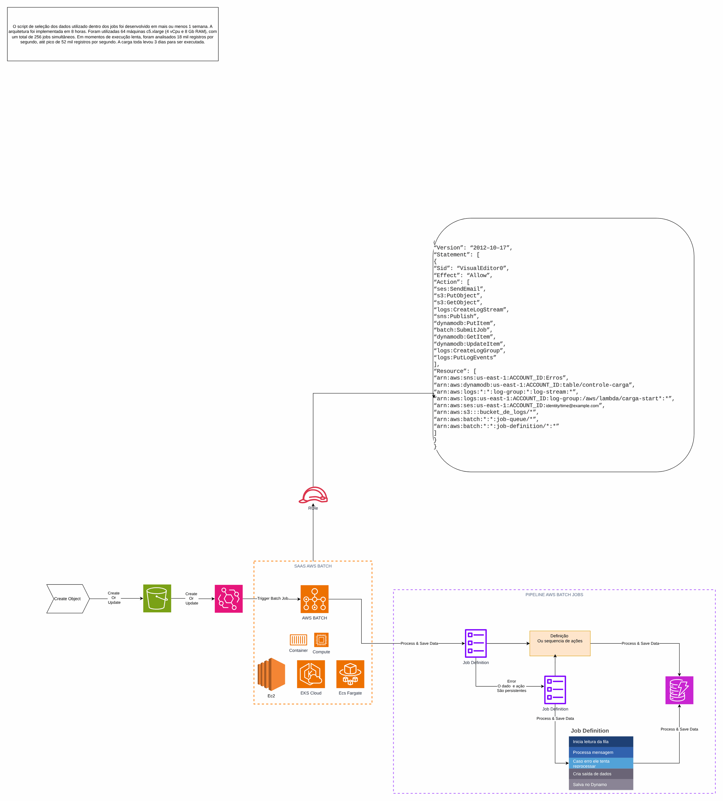

# Processamento em lote com AWS Batch

> Plataforma AWS de uma operadora de saúde (2024)

Prova de conceito de jobs em lote com AWS Batch.

## Desenho

Fonte editável: [`desenho.drawio`](desenho.drawio). Abra no draw.io para navegar pelas páginas.

### 1. Page-1



## Componentes identificados no desenho

- Amazon EKS → módulo [`aws/eks-cluster`](../../../../aws/eks-cluster)
- Amazon ECS/Fargate: serviços em ECS/Fargate ficam no repositório da aplicação (task definition + service); a rede, o ECR e o banco vêm daqui
- Amazon S3 → módulo [`aws/s3-bucket`](../../../../aws/s3-bucket)
- Amazon EventBridge → módulo [`aws/eventbridge-bus-sqs`](../../../../aws/eventbridge-bus-sqs)
- AWS Batch: os jobs em lote podem ser acionados pela regra do EventBridge criada aqui
- Amazon DynamoDB: tabelas de controle ficam junto do serviço que as usa

## Automação pronta

A pasta [`terraform/`](terraform) compõe estes módulos do catálogo, na ordem de dependência:

1. [`aws/s3-bucket`](../../../../aws/s3-bucket): Bucket S3 seguro por padrão
1. [`aws/eventbridge-bus-sqs`](../../../../aws/eventbridge-bus-sqs): Barramento de eventos entre contas -> SQS
1. [`aws/lambda-function`](../../../../aws/lambda-function): Função Lambda empacotada

As saídas de um módulo alimentam o próximo (por exemplo, `module.vpc.private_subnet_ids` e `module.kms_key.key_arn`),
então não há IDs fixos entre camadas.

### Como executar

```bash
cd labs/arquiteturas/saude/processamento-em-lote/terraform
# ajuste locals.tf (prefixo, região, tags) e backend.tf (bucket/conta de state)
terraform init
terraform plan -out tfplan
terraform apply tfplan
```

Valores de exemplo (contas, IDs, domínios) são fictícios; troque pelos do seu ambiente antes do apply.

## FinOps desta arquitetura

O que mais pesa na conta desta solução e a alavanca para cada item:

| Componente | O que pesa | Alavanca |
|---|---|---|
| [`aws/s3-bucket`](../../../../aws/s3-bucket) | armazenamento e versões antigas no S3 | lifecycle para IA/Glacier e expiração de versões não atuais |
| [`aws/lambda-function`](../../../../aws/lambda-function) | duração x memória das funções | ajustar memória com Power Tuning e usar arm64 |
| [`aws/eventbridge-bus-sqs`](../../../../aws/eventbridge-bus-sqs) | eventos customizados publicados | agrupar eventos e filtrar na regra |

O ciclo de FinOps (informar, otimizar, operar) está no lab [Processo de FinOps](../../telecom/processo-finops).
Para fechar o ciclo nesta solução, aplique também: [`aws/tag-compliance`](../../../../aws/tag-compliance), [`aws/finops-cost-report`](../../../../aws/finops-cost-report), [`aws/cur-focus-export`](../../../../aws/cur-focus-export), [`aws/instance-scheduler`](../../../../aws/instance-scheduler).
