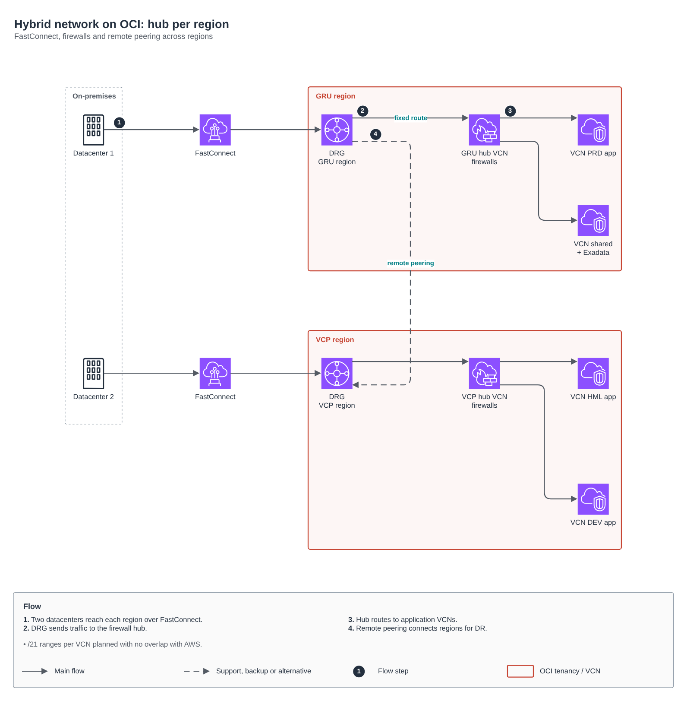

# Hybrid network on OCI

[Português](README.md) · **English**

> AWS platform of a health insurer (2024)

Firewall hub per region, FastConnect to two datacenters and remote peering for DR.

## Diagram

Editable source: [`desenho.drawio`](desenho.drawio), with pages in Portuguese and English. Open it in draw.io to browse.

The original drawing, anonymized, is kept in [`original/`](original) for reference.

### Hybrid network on OCI: hub per region

## Components found in the diagram

- Amazon VPC → module [`aws/vpc`](../../../../aws/vpc)
- Transit Gateway → module [`aws/transit-gateway-attachment`](../../../../aws/transit-gateway-attachment)

## Automation

This drawing describes process, governance or network outside the scope of the catalog modules; it is a reference for decisions and has no automation of its own.

## FinOps for this architecture

What weighs most on the bill for this solution and the lever for each item:

| Component | Cost driver | Lever |
|---|---|---|
| Environment | cross-cloud traffic and idle instances | cost tags and a monthly interconnect review |

The FinOps cycle (inform, optimize, operate) is in the [FinOps process](../../telecom/processo-finops) lab.
