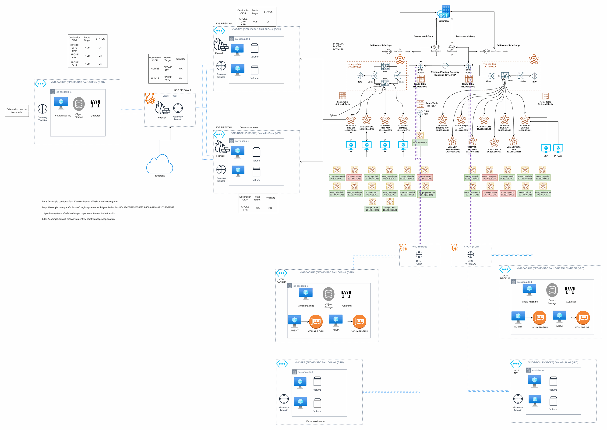

# Rede híbrida com OCI

> Plataforma AWS de uma operadora de saúde (2024)

Rede na Oracle Cloud integrada ao ambiente AWS.

## Desenho

Fonte editável: [`desenho.drawio`](desenho.drawio). Abra no draw.io para navegar pelas páginas.

### 1. Page-1

## Componentes identificados no desenho

- Amazon VPC → módulo [`aws/vpc`](../../../../aws/vpc)

## Automação

Este desenho descreve processo, governança ou rede fora do escopo dos módulos do catálogo; serve de referência para as decisões e não tem automação própria.

## FinOps desta arquitetura

O que mais pesa na conta desta solução e a alavanca para cada item:

| Componente | O que pesa | Alavanca |
|---|---|---|
| Ambiente | tráfego entre nuvens e instâncias ociosas | tags de custo e revisão mensal de interconexão |

O ciclo de FinOps (informar, otimizar, operar) está no lab [Processo de FinOps](../../telecom/processo-finops).
