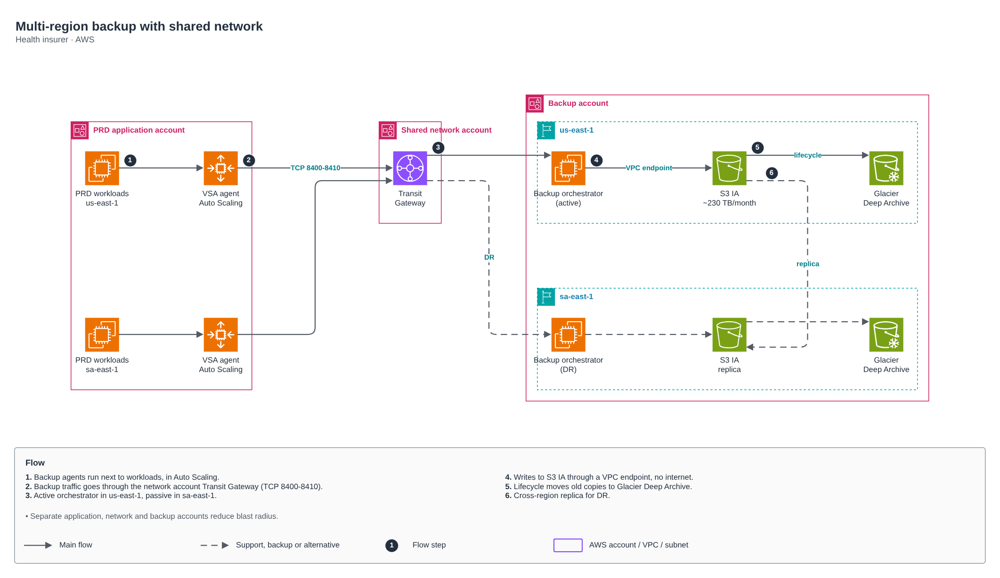
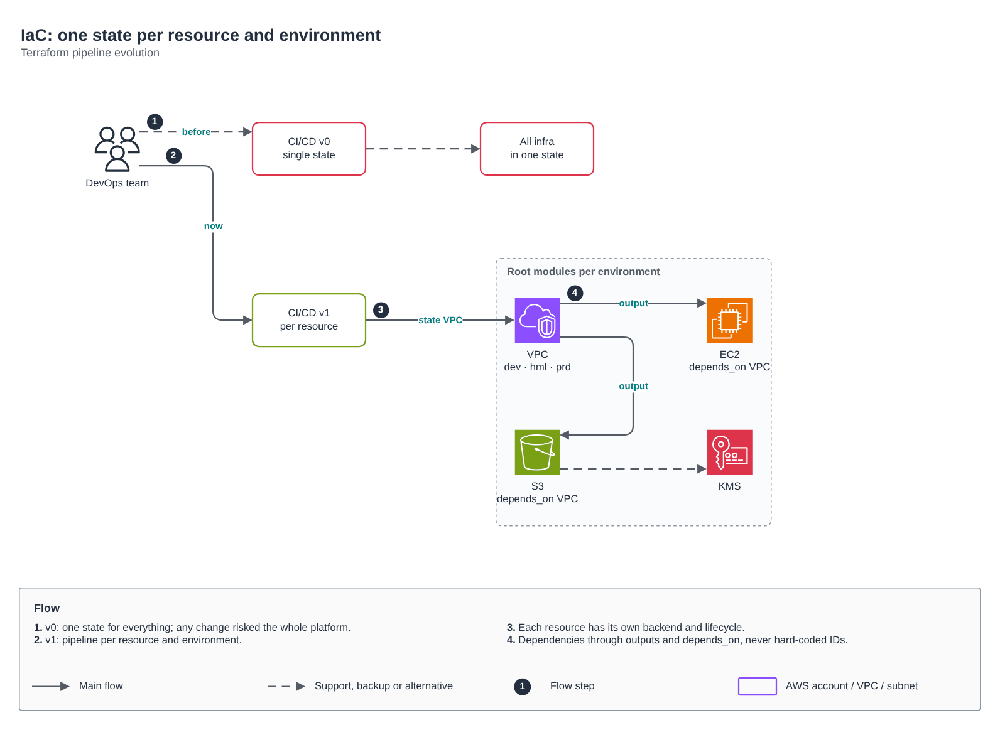

# AWS platform of a health insurer

[Português](README.md) · **English**

> AWS platform of a health insurer (2024)

Multi-region backup over a shared network and the IaC evolution to one state per resource and environment.

## Diagram

Editable source: [`desenho.drawio`](desenho.drawio), with pages in Portuguese and English. Open it in draw.io to browse.

The original drawing, anonymized, is kept in [`original/`](original) for reference.

### Multi-region backup with shared network



### IaC: one state per resource and environment



## Components found in the diagram

- Amazon S3 → module [`aws/s3-bucket`](../../../../aws/s3-bucket)
- AWS KMS → module [`aws/kms-key`](../../../../aws/kms-key)
- Amazon VPC → module [`aws/vpc`](../../../../aws/vpc)
- Transit Gateway → module [`aws/transit-gateway-attachment`](../../../../aws/transit-gateway-attachment)

## Ready-made automation

The [`terraform/`](terraform) folder composes these catalog modules, in dependency order:

1. [`aws/kms-key`](../../../../aws/kms-key): Chave KMS (CMK) da plataforma
1. [`aws/vpc`](../../../../aws/vpc): VPC em três camadas
1. [`aws/vpc-endpoints`](../../../../aws/vpc-endpoints): VPC Endpoints Interface/Gateway
1. [`aws/transit-gateway-attachment`](../../../../aws/transit-gateway-attachment): Attachment de VPC ao Transit Gateway
1. [`aws/ecr`](../../../../aws/ecr): Repositórios ECR com scan, KMS e retenção
1. [`aws/backup-plan`](../../../../aws/backup-plan): AWS Backup centralizado

One module's outputs feed the next (for example `module.vpc.private_subnet_ids` and `module.kms_key.key_arn`), so there are no hard-coded IDs between layers.

### How to run

```bash
cd labs/arquiteturas/saude/visao-geral-plataforma/terraform
# adjust locals.tf (prefix, region, tags) and backend.tf (state bucket/account)
terraform init
terraform plan -out tfplan
terraform apply tfplan
```

Sample values (accounts, IDs, domains) are fictitious; replace them with your own before applying.

## FinOps for this architecture

What weighs most on the bill for this solution and the lever for each item:

| Component | Cost driver | Lever |
|---|---|---|
| [`aws/vpc`](../../../../aws/vpc) | NAT Gateway per AZ and the traffic it processes | a single NAT in DEV and VPC endpoints for S3/ECR to keep traffic off the NAT |
| [`aws/transit-gateway-attachment`](../../../../aws/transit-gateway-attachment) | Transit Gateway attachments and processed GB | consolidate attachments and keep high-volume traffic off the TGW |
| [`aws/ecr`](../../../../aws/ecr) | old images piling up in ECR | lifecycle policy keeping only the last N images per repository |
| [`aws/backup-plan`](../../../../aws/backup-plan) | recovery point retention | retention by criticality and cold storage for long-term copies |
| [`aws/kms-key`](../../../../aws/kms-key) | KMS keys per month and API calls | S3 bucket keys reduce KMS calls |
| [`aws/vpc-endpoints`](../../../../aws/vpc-endpoints) | interface endpoints billed per hour and per AZ | create only the endpoints the workload uses and prefer gateway endpoints for S3/DynamoDB |

The FinOps cycle (inform, optimize, operate) is in the [FinOps process](../../telecom/processo-finops) lab.
To close the loop for this solution, also apply: [`aws/tag-compliance`](../../../../aws/tag-compliance), [`aws/finops-cost-report`](../../../../aws/finops-cost-report), [`aws/cur-focus-export`](../../../../aws/cur-focus-export), [`aws/instance-scheduler`](../../../../aws/instance-scheduler).
