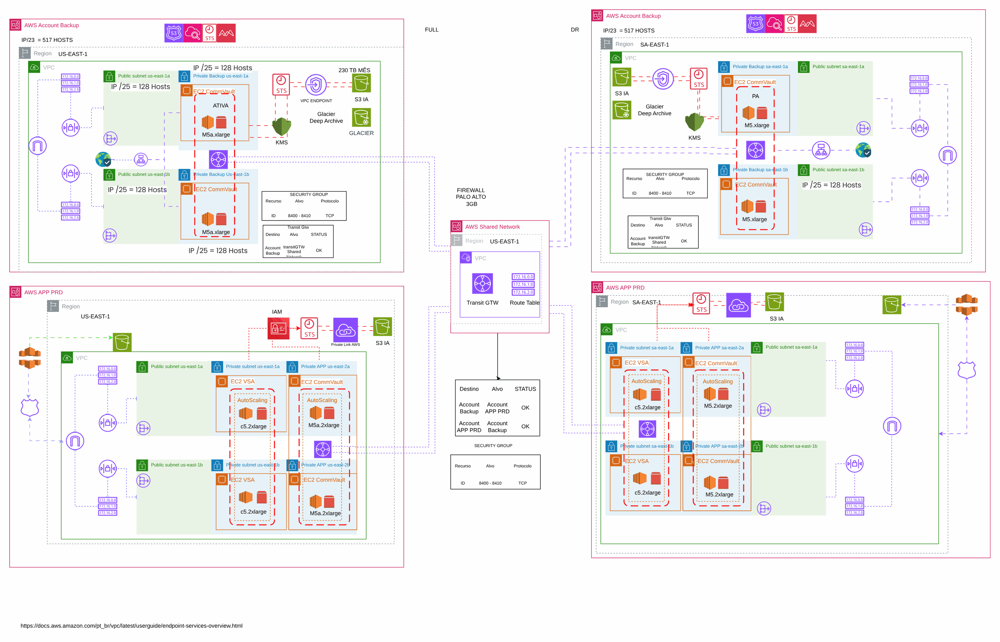
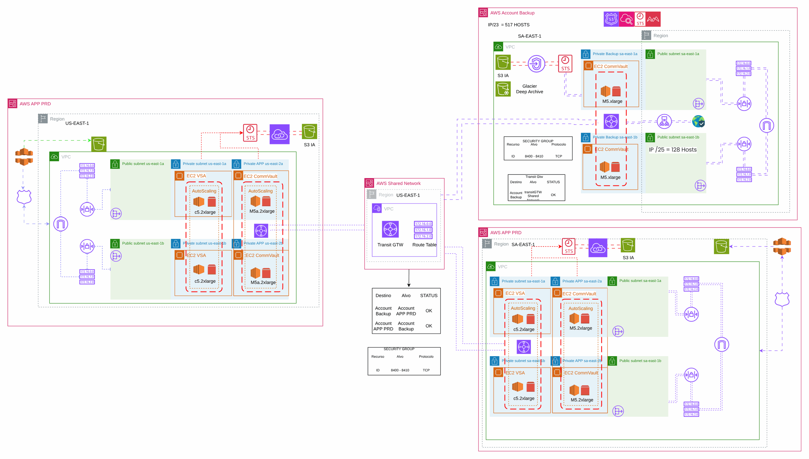
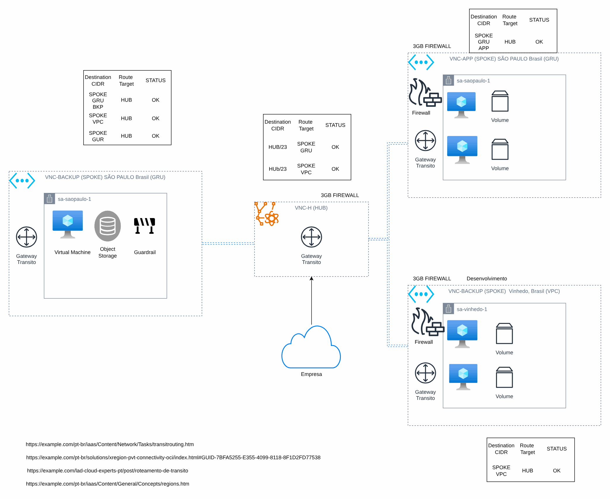
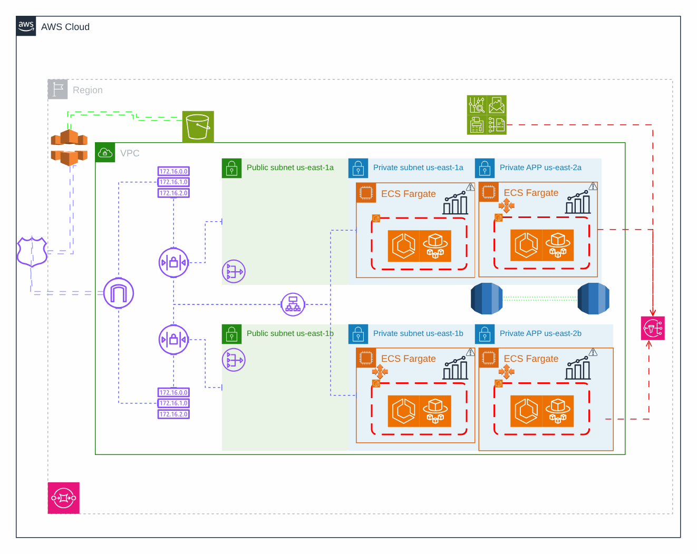
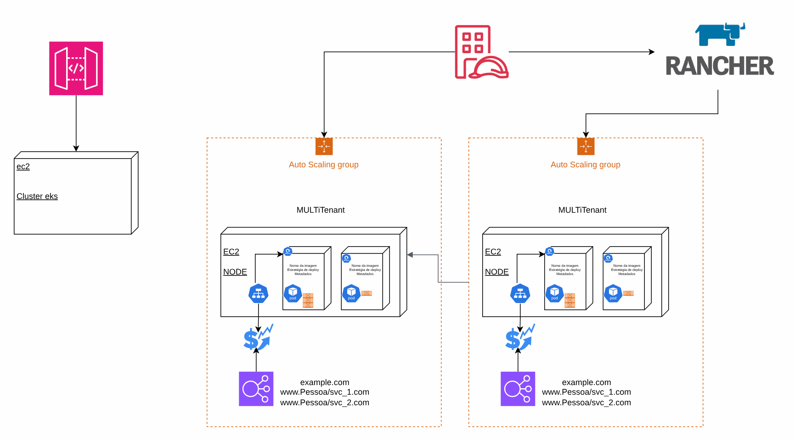
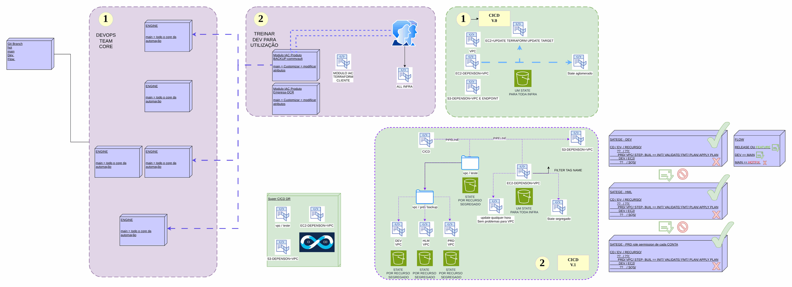
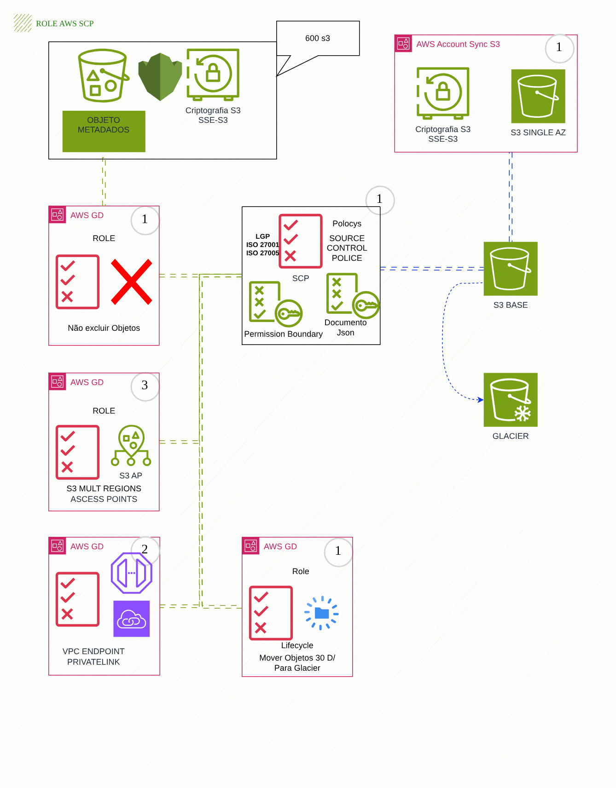
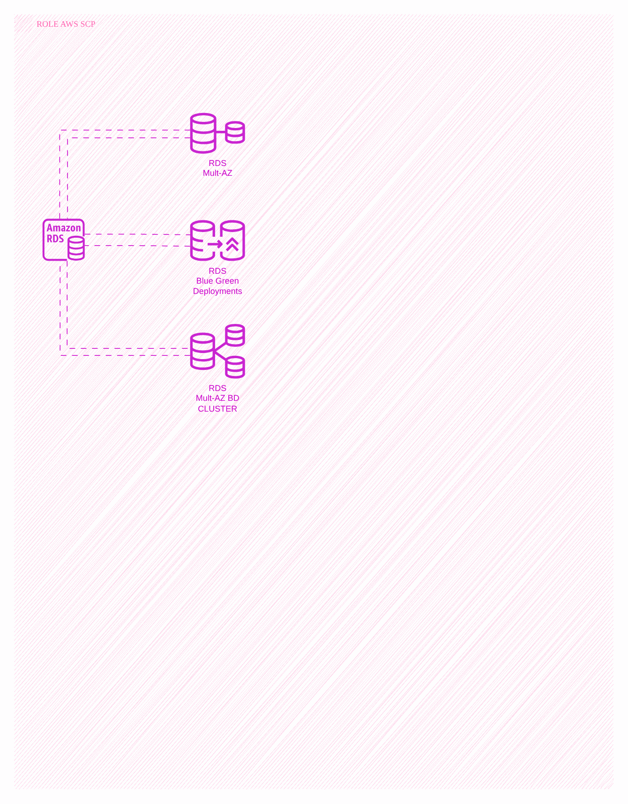
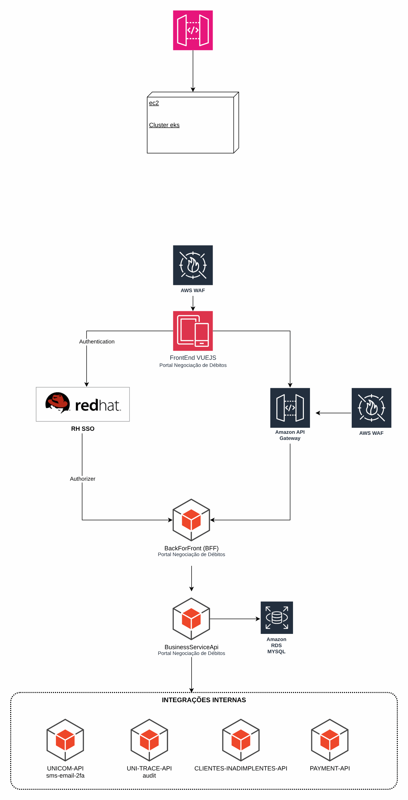

# Visão geral da plataforma AWS de uma operadora de saúde

> Plataforma AWS de uma operadora de saúde (2024)

Doze visões da plataforma: backup, orquestradores por região, rede híbrida, ECS, Kubernetes, IaC e guardrails.

## Desenho

Fonte editável: [`desenho.drawio`](desenho.drawio). Abra no draw.io para navegar pelas páginas.

### 1. Backup AWS



### 2. Orquestrador US-EAST-1


### 3. ORQUESTRADOR-SA-EAST-1



### 4. OCI



### 5. ECS-FARGATE



### 6. K8S



### 7. IAC-TERRAFORM



### 8. S3-GUARDRAILS



### 9. RDS-GUARDRAILS



### 10. Portal-de-debtos



## Componentes identificados no desenho

- Amazon ECS/Fargate: serviços em ECS/Fargate ficam no repositório da aplicação (task definition + service); a rede, o ECR e o banco vêm daqui
- Amazon RDS → módulo [`aws/rds-instance`](../../../../aws/rds-instance)
- Amazon S3 → módulo [`aws/s3-bucket`](../../../../aws/s3-bucket)
- Amazon SQS → módulo [`aws/sqs-queue`](../../../../aws/sqs-queue)
- Amazon SNS → módulo [`aws/sns-topic`](../../../../aws/sns-topic)
- API Gateway → módulo [`aws/api-gateway-lambda`](../../../../aws/api-gateway-lambda)
- AWS KMS → módulo [`aws/kms-key`](../../../../aws/kms-key)
- Amazon VPC → módulo [`aws/vpc`](../../../../aws/vpc)
- Transit Gateway → módulo [`aws/transit-gateway-attachment`](../../../../aws/transit-gateway-attachment)
- Route 53 → módulo [`aws/route53-private-zone`](../../../../aws/route53-private-zone)
- Amazon ECR → módulo [`aws/ecr`](../../../../aws/ecr)
- AWS Organizations / SCP → módulo [`aws/organizations-scp`](../../../../aws/organizations-scp)
- VPC Endpoints → módulo [`aws/vpc-endpoints`](../../../../aws/vpc-endpoints)
- AWS WAF: o Web ACL é passado por ARN para o CloudFront (`web_acl_id`) ou associado ao ALB
- Amazon CloudWatch → módulo [`aws/cloudwatch-logs`](../../../../aws/cloudwatch-logs)
- IAM Identity Center → módulo [`aws/identity-center-permission-set`](../../../../aws/identity-center-permission-set)

## Automação pronta

A pasta [`terraform/`](terraform) compõe estes módulos do catálogo, na ordem de dependência:

1. [`aws/kms-key`](../../../../aws/kms-key): Chave KMS (CMK) da plataforma
1. [`aws/vpc`](../../../../aws/vpc): VPC em três camadas
1. [`aws/vpc-endpoints`](../../../../aws/vpc-endpoints): VPC Endpoints Interface/Gateway
1. [`aws/transit-gateway-attachment`](../../../../aws/transit-gateway-attachment): Attachment de VPC ao Transit Gateway
1. [`aws/ecr`](../../../../aws/ecr): Repositórios ECR com scan, KMS e retenção
1. [`aws/backup-plan`](../../../../aws/backup-plan): AWS Backup centralizado

As saídas de um módulo alimentam o próximo (por exemplo, `module.vpc.private_subnet_ids` e `module.kms_key.key_arn`),
então não há IDs fixos entre camadas.

### Como executar

```bash
cd labs/arquiteturas/saude/visao-geral-plataforma/terraform
# ajuste locals.tf (prefixo, região, tags) e backend.tf (bucket/conta de state)
terraform init
terraform plan -out tfplan
terraform apply tfplan
```

Valores de exemplo (contas, IDs, domínios) são fictícios; troque pelos do seu ambiente antes do apply.
