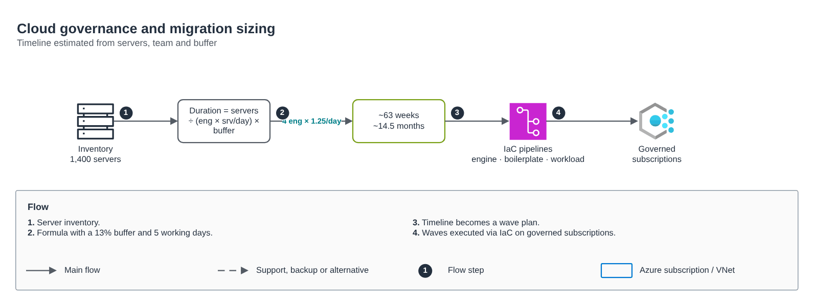
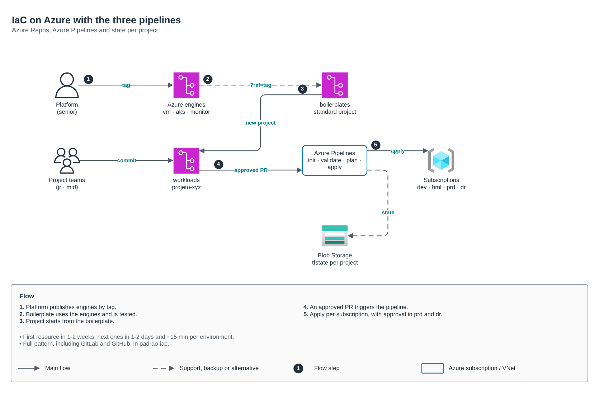

# Cloud governance and migration sizing

[Português](README.md) · **English**

> Azure governance and modernization for an insurer (2024-2025)

Migration timeline formula from servers, team and buffer, executed through IaC.

## Diagram

Editable source: [`desenho.drawio`](desenho.drawio), with pages in Portuguese and English. Open it in draw.io to browse.

The original drawing, anonymized, is kept in [`original/`](original) for reference.

### Cloud governance and migration sizing



### IaC on Azure with the three pipelines



## Components found in the diagram

- Azure Storage → module [`azure/storage-account`](../../../../azure/storage-account)

## Ready-made automation

The [`terraform/`](terraform) folder composes these catalog modules, in dependency order:

1. [`azure/storage-account`](../../../../azure/storage-account): Secure Storage Account with CMK
1. [`azure/monitor-alerts`](../../../../azure/monitor-alerts): Azure Monitor: action group and metric alerts
1. [`azure/monitor-diagnostic-setting`](../../../../azure/monitor-diagnostic-setting): Diagnostic settings in bulk

One module's outputs feed the next (for example `module.vpc.private_subnet_ids` and `module.kms_key.key_arn`), so there are no hard-coded IDs between layers.

### How to run

```bash
cd labs/arquiteturas/seguradora/governanca-de-nuvem/terraform
# adjust locals.tf (prefix, region, tags) and backend.tf (state bucket/account)
terraform init
terraform plan -out tfplan
terraform apply tfplan
```

Sample values (accounts, IDs, domains) are fictitious; replace them with your own before applying.

## FinOps for this architecture

What weighs most on the bill for this solution and the lever for each item:

| Component | Cost driver | Lever |
|---|---|---|
| [`azure/storage-account`](../../../../azure/storage-account) | Storage capacity and transactions | Cool/Archive tiers through lifecycle policies |
| [`azure/monitor-alerts`](../../../../azure/monitor-alerts) | alerts and Log Analytics ingestion | per-table retention and budget alerts (Cost Management) |
| [`azure/monitor-diagnostic-setting`](../../../../azure/monitor-diagnostic-setting) | diagnostic log ingestion | send only the needed categories and archive to Storage |

The FinOps cycle (inform, optimize, operate) is in the [FinOps process](../../telecom/processo-finops) lab.
