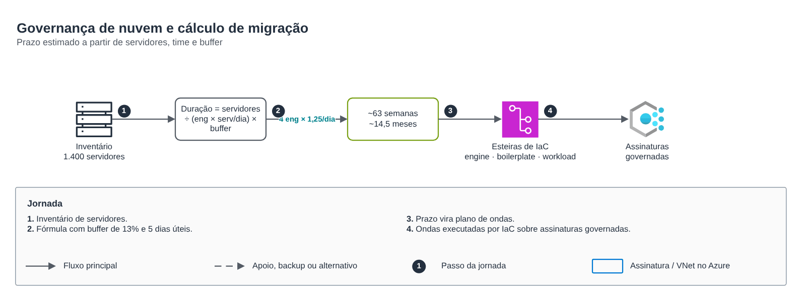
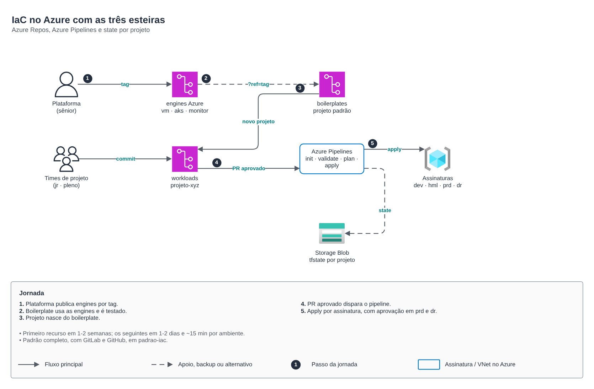

# Governança de nuvem e cálculo de migração

**Português** · [English](README.en.md)

> Governança e modernização em Azure para uma seguradora (2024-2025)

Fórmula de prazo de migração a partir de servidores, time e buffer, executada por IaC.

## Desenho

Fonte editável: [`desenho.drawio`](desenho.drawio), com páginas em português e em inglês. Abra no draw.io para navegar.

O desenho original, anonimizado, está em [`original/`](original) como referência.

### Governança de nuvem e cálculo de migração



### IaC no Azure com as três esteiras



## Componentes identificados no desenho

- Azure Storage → módulo [`azure/storage-account`](../../../../azure/storage-account)

## Automação pronta

A pasta [`terraform/`](terraform) compõe estes módulos do catálogo, na ordem de dependência:

1. [`azure/storage-account`](../../../../azure/storage-account): Storage Account seguro com CMK
1. [`azure/monitor-alerts`](../../../../azure/monitor-alerts): Azure Monitor: action group e alertas de métrica
1. [`azure/monitor-diagnostic-setting`](../../../../azure/monitor-diagnostic-setting): Diagnostic settings em lote

As saídas de um módulo alimentam o próximo (por exemplo, `module.vpc.private_subnet_ids` e `module.kms_key.key_arn`), então não há IDs fixos entre camadas.

### Como executar

```bash
cd labs/arquiteturas/seguradora/governanca-de-nuvem/terraform
# ajuste locals.tf (prefixo, região, tags) e backend.tf (bucket/conta de state)
terraform init
terraform plan -out tfplan
terraform apply tfplan
```

Valores de exemplo (contas, IDs, domínios) são fictícios; troque pelos do seu ambiente antes do apply.

## FinOps desta arquitetura

O que mais pesa na conta desta solução e a alavanca para cada item:

| Componente | O que pesa | Alavanca |
|---|---|---|
| [`azure/storage-account`](../../../../azure/storage-account) | capacidade e transações no Storage | tiers Cool/Archive por política de ciclo de vida |
| [`azure/monitor-alerts`](../../../../azure/monitor-alerts) | alertas e ingestão no Log Analytics | retenção por tabela e alertas de orçamento (Cost Management) |
| [`azure/monitor-diagnostic-setting`](../../../../azure/monitor-diagnostic-setting) | ingestão de logs de diagnóstico | enviar só as categorias necessárias e arquivar no Storage |

O ciclo de FinOps (informar, otimizar, operar) está no lab [Processo de FinOps](../../telecom/processo-finops).
