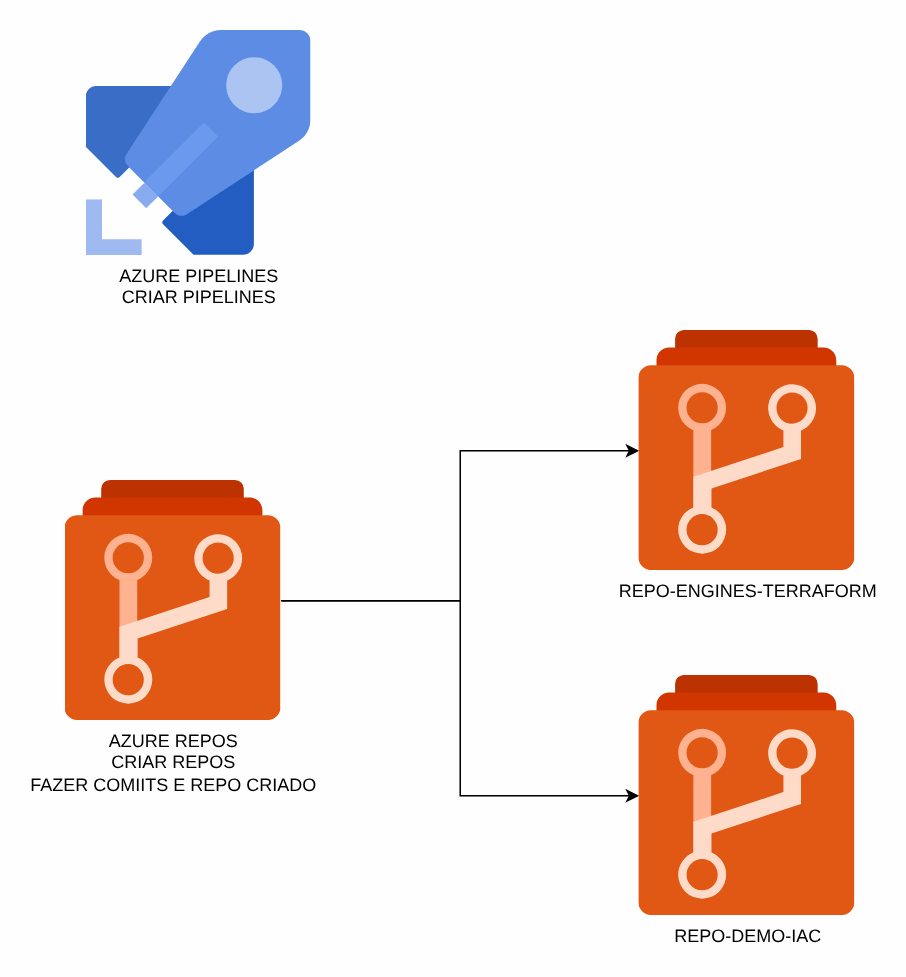
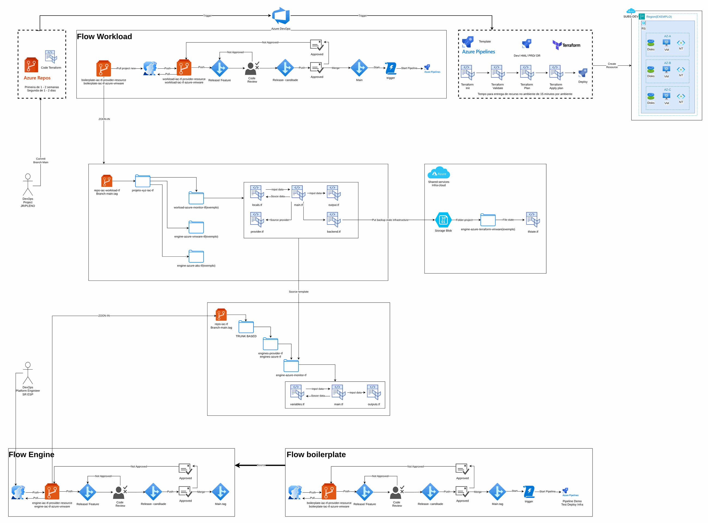
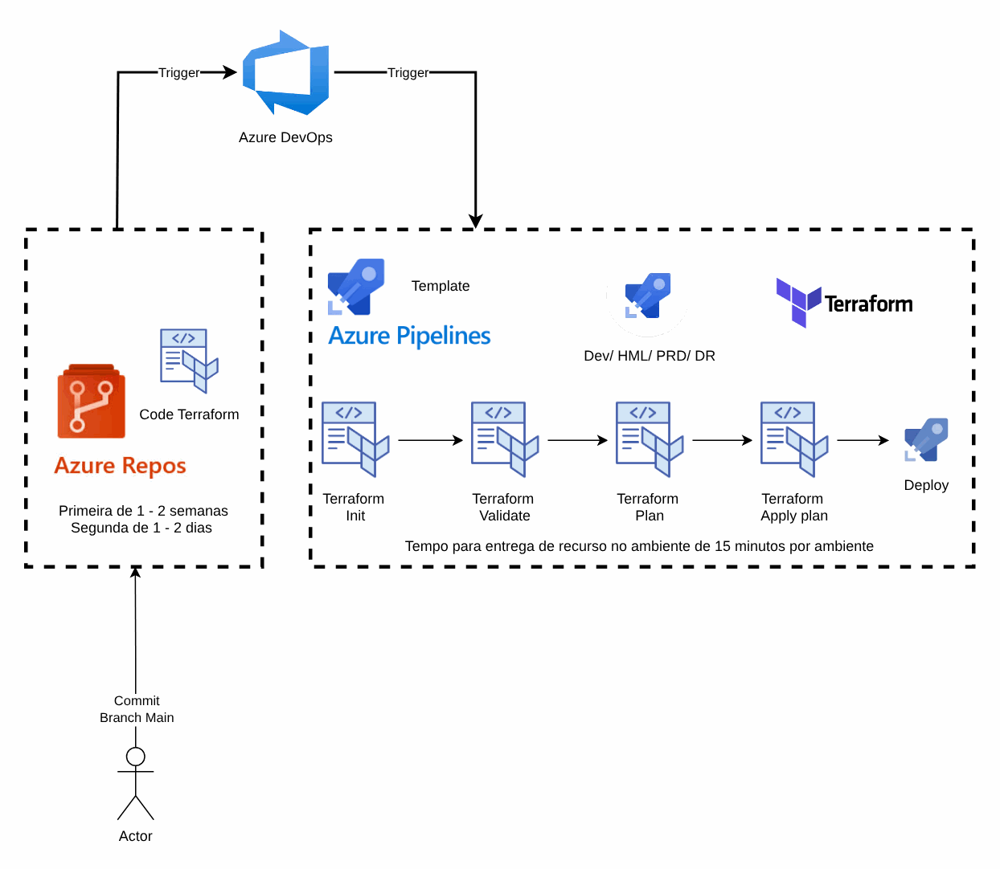
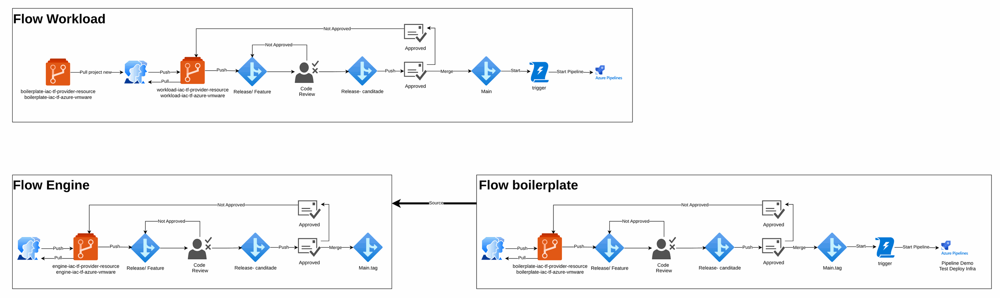
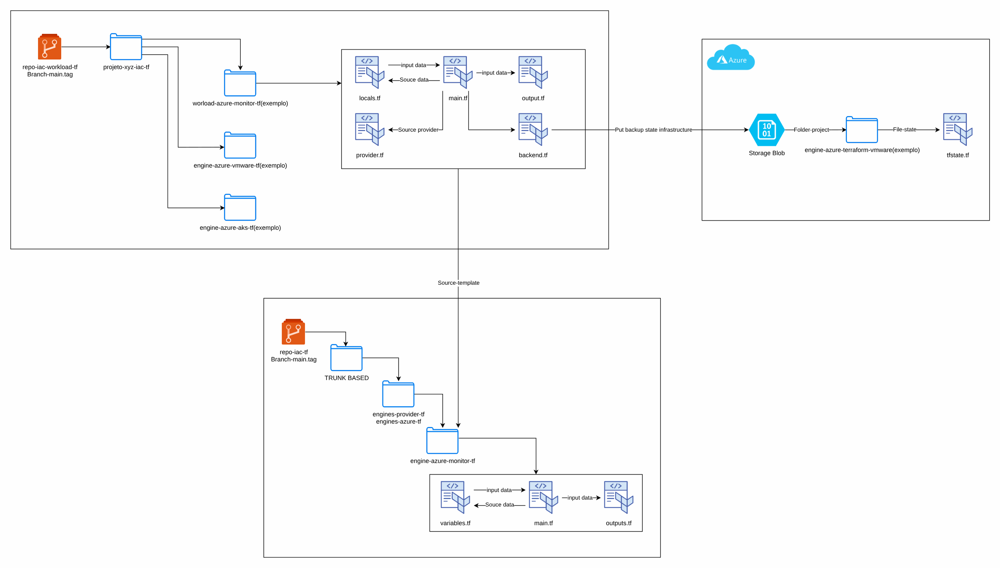
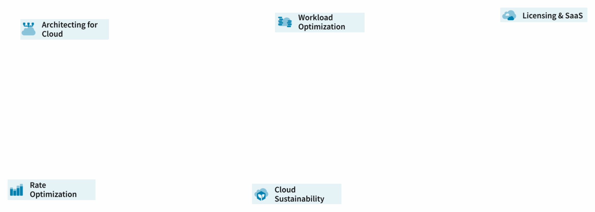
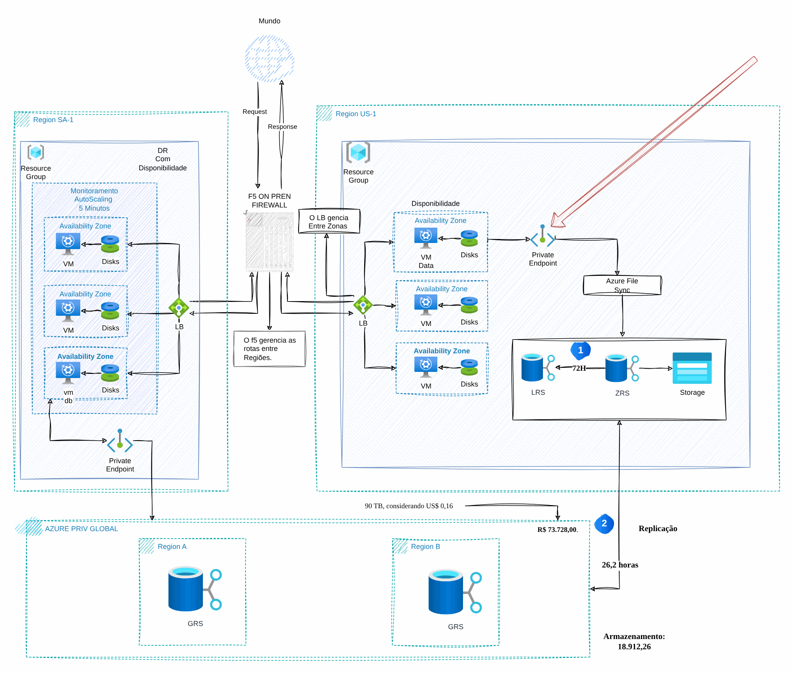

# Governança, IaC e DevOps

> Governança e modernização em Azure para uma seguradora (2024-2025)

Ferramentas, pipeline de IaC, estratégia de branches e estrutura de diretórios para Azure.

## Desenho

Fonte editável: [`desenho.drawio`](desenho.drawio). Abra no draw.io para navegar pelas páginas.

### 1. Página-1


### 2. ferramentas



### 3. iac-zoom-out



### 4. iac-pipeline-zoom-in



### 5. estrutura-azure-branch-zoom-in



### 6. estrutura-diretorio-zoom-in



### 7. PPT



### 8. File-system



## Componentes identificados no desenho

- Azure Storage → módulo [`azure/storage-account`](../../../../azure/storage-account)

## Automação pronta

A pasta [`terraform/`](terraform) compõe estes módulos do catálogo, na ordem de dependência:

1. [`azure/storage-account`](../../../../azure/storage-account): Storage Account seguro com CMK
1. [`azure/monitor-diagnostic-setting`](../../../../azure/monitor-diagnostic-setting): Diagnostic settings em lote

As saídas de um módulo alimentam o próximo (por exemplo, `module.vpc.private_subnet_ids` e `module.kms_key.key_arn`),
então não há IDs fixos entre camadas.

### Como executar

```bash
cd labs/arquiteturas/seguradora/governanca-iac-devops/terraform
# ajuste locals.tf (prefixo, região, tags) e backend.tf (bucket/conta de state)
terraform init
terraform plan -out tfplan
terraform apply tfplan
```

Valores de exemplo (contas, IDs, domínios) são fictícios; troque pelos do seu ambiente antes do apply.
