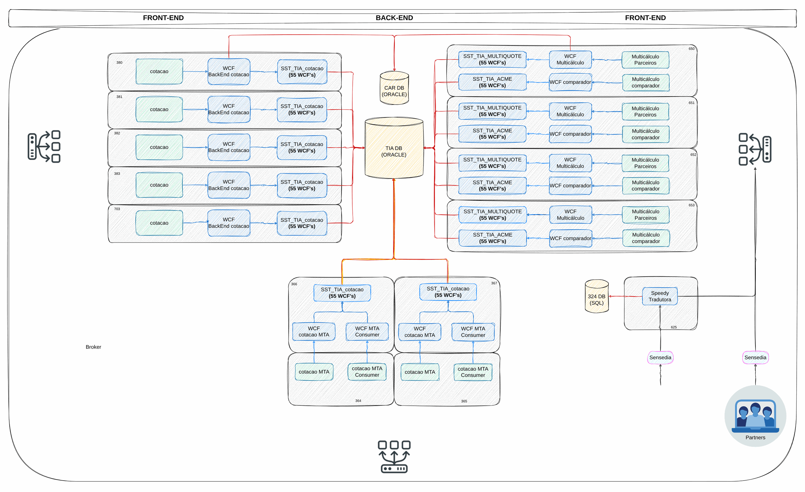
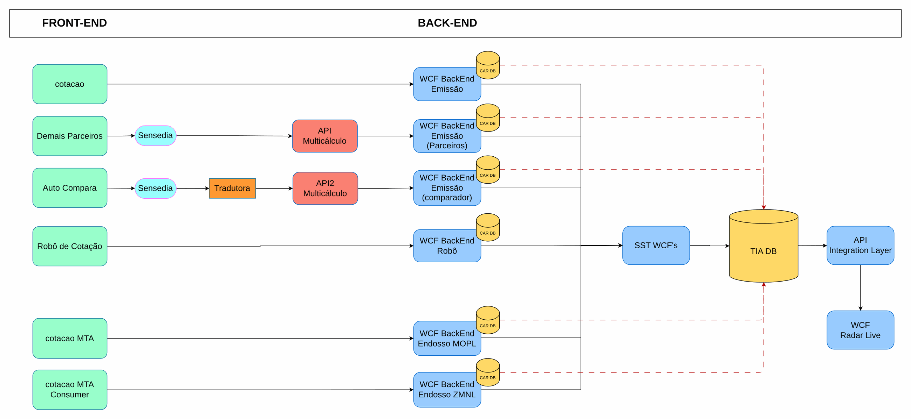

# Modernização de load balancers

> Governança e modernização em Azure para uma seguradora (2024-2025)

Situação atual e alvo dos balanceadores de carga e da infraestrutura associada.

## Desenho

Fonte editável: [`desenho.drawio`](desenho.drawio). Abra no draw.io para navegar pelas páginas.

### 1. LB-ARCH-IS

### 2. INFRA_AS-IS

### 3. ARCH_AS-IS

## Automação

Este desenho descreve processo, governança ou rede fora do escopo dos módulos do catálogo; serve de referência para as decisões e não tem automação própria.

## FinOps desta arquitetura

O que mais pesa na conta desta solução e a alavanca para cada item:

| Componente | O que pesa | Alavanca |
|---|---|---|
| Ambiente | assinaturas sem dono e VMs ociosas | tags por política, orçamento no Cost Management e Advisor |

O ciclo de FinOps (informar, otimizar, operar) está no lab [Processo de FinOps](../../telecom/processo-finops).
