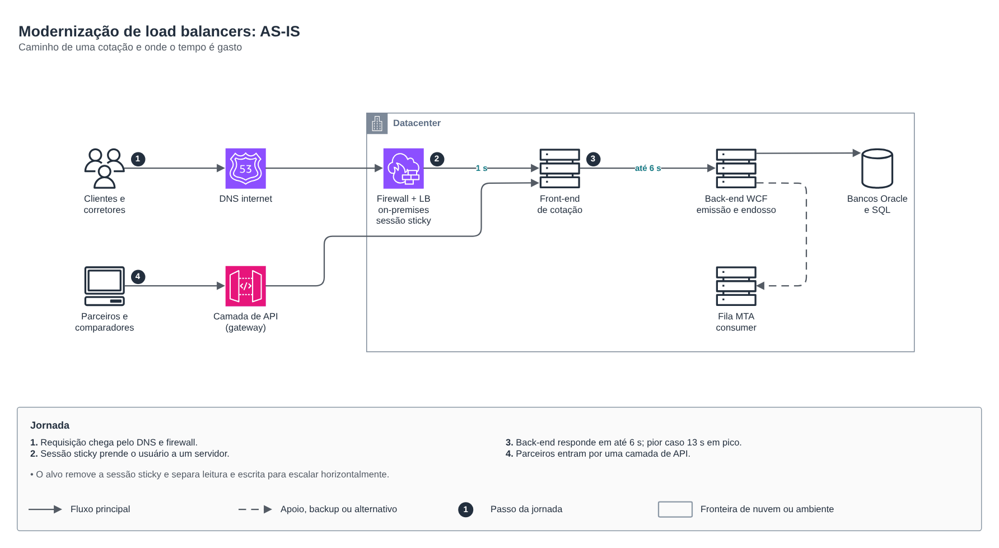

# Modernização de load balancers

**Português** · [English](README.en.md)

> Governança e modernização em Azure para uma seguradora (2024-2025)

AS-IS do caminho de uma cotação, onde o tempo é gasto e o que muda no alvo.

## Desenho

Fonte editável: [`desenho.drawio`](desenho.drawio), com páginas em português e em inglês. Abra no draw.io para navegar.

O desenho original, anonimizado, está em [`original/`](original) como referência.

### Modernização de load balancers: AS-IS

## Automação

Este desenho descreve processo, governança ou rede fora do escopo dos módulos do catálogo; serve de referência para as decisões e não tem automação própria.

## FinOps desta arquitetura

O que mais pesa na conta desta solução e a alavanca para cada item:

| Componente | O que pesa | Alavanca |
|---|---|---|
| Ambiente | assinaturas sem dono e VMs ociosas | tags por política, orçamento no Cost Management e Advisor |

O ciclo de FinOps (informar, otimizar, operar) está no lab [Processo de FinOps](../../telecom/processo-finops).
