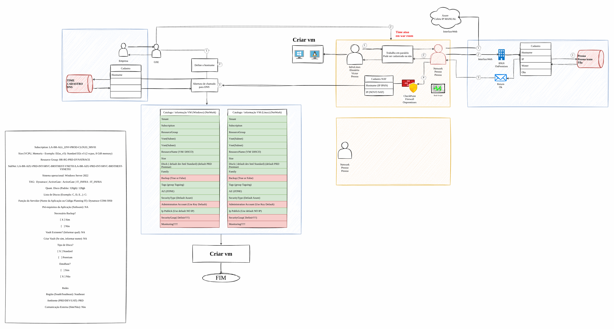
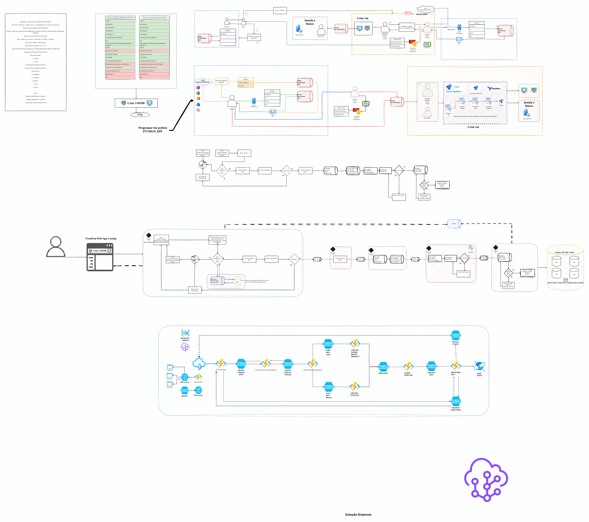
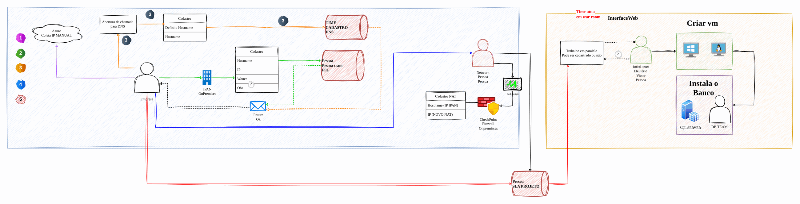
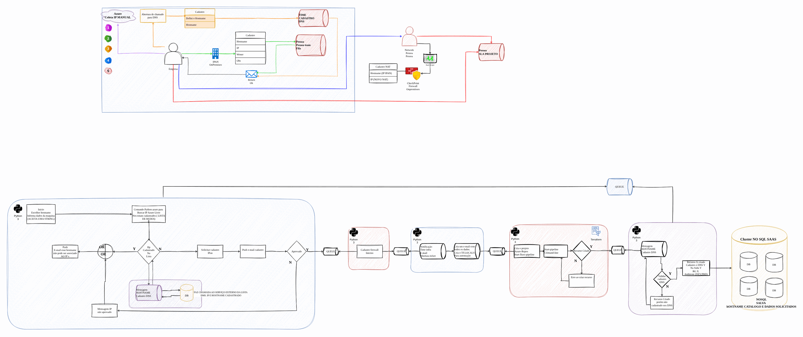

# Processo de provisionamento de VMs

> Governança e modernização em Azure para uma seguradora (2024-2025)

Fluxo de criação de VMs Linux e bancos (PaaS x IaaS) com automação.

## Desenho

Fonte editável: [`desenho.drawio`](desenho.drawio). Abra no draw.io para navegar pelas páginas.

### 1. FLuxo-criacao-vm-linux



### 2. VM-DBPAAS-DBIAAS



### 3. Proposta-processo



### 4. APP-PYTHON



## Componentes identificados no desenho

- Azure Storage → módulo [`azure/storage-account`](../../../../azure/storage-account)

## Automação pronta

A pasta [`terraform/`](terraform) compõe estes módulos do catálogo, na ordem de dependência:

1. [`azure/sql-database`](../../../../azure/sql-database): Azure SQL com Entra ID e auditoria
1. [`azure/monitor-alerts`](../../../../azure/monitor-alerts): Azure Monitor: action group e alertas de métrica

As saídas de um módulo alimentam o próximo (por exemplo, `module.vpc.private_subnet_ids` e `module.kms_key.key_arn`),
então não há IDs fixos entre camadas.

### Como executar

```bash
cd labs/arquiteturas/seguradora/provisionamento-de-vms/terraform
# ajuste locals.tf (prefixo, região, tags) e backend.tf (bucket/conta de state)
terraform init
terraform plan -out tfplan
terraform apply tfplan
```

Valores de exemplo (contas, IDs, domínios) são fictícios; troque pelos do seu ambiente antes do apply.
