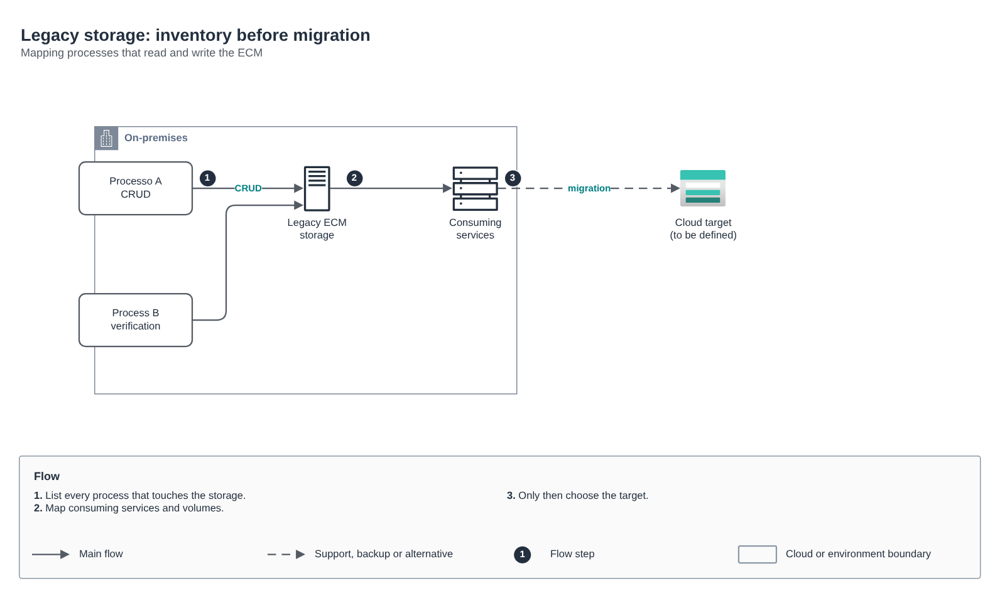

# Legacy storage: inventory before migration

[Português](README.md) · **English**

> Azure governance and modernization for an insurer (2024-2025)

Mapping storage processes and consumers before choosing the target.

## Diagram

Editable source: [`desenho.drawio`](desenho.drawio), with pages in Portuguese and English. Open it in draw.io to browse.

The original drawing, anonymized, is kept in [`original/`](original) for reference.

### Legacy storage: inventory before migration

## Components found in the diagram

- Azure Storage → module [`azure/storage-account`](../../../../azure/storage-account)

## Automation

This drawing describes process, governance or network outside the scope of the catalog modules; it is a reference for decisions and has no automation of its own.

## FinOps for this architecture

What weighs most on the bill for this solution and the lever for each item:

| Component | Cost driver | Lever |
|---|---|---|
| Environment | subscriptions without an owner and idle VMs | tags by policy, Cost Management budgets and Advisor |

The FinOps cycle (inform, optimize, operate) is in the [FinOps process](../../telecom/processo-finops) lab.
