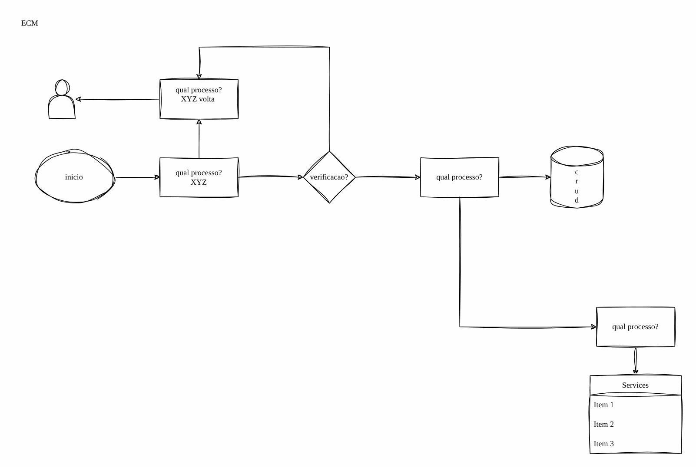

# Storage legado e migração

> Governança e modernização em Azure para uma seguradora (2024-2025)

Arquitetura do storage legado como insumo da migração.

## Desenho

Fonte editável: [`desenho.drawio`](desenho.drawio). Abra no draw.io para navegar pelas páginas.

### 1. Página-1

## Automação

Este desenho descreve processo, governança ou rede fora do escopo dos módulos do catálogo; serve de referência para as decisões e não tem automação própria.
