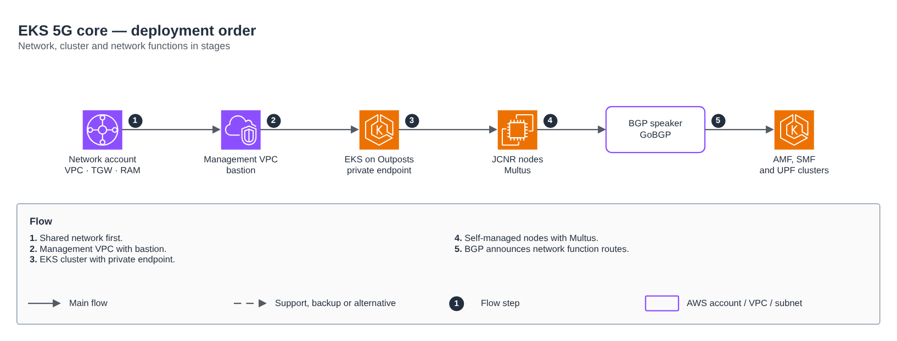

# EKS 5G core — deployment order

[Português](README.md) · **English**

> CCoE, landing zone and platform of a telecom operator (2025-2026)

Network, cluster, nodes, BGP and network functions in stages.

## Diagram

Editable source: [`desenho.drawio`](desenho.drawio), with pages in Portuguese and English. Open it in draw.io to browse.

The original drawing, anonymized, is kept in [`original/`](original) for reference.

### EKS 5G core — deployment order

## Components found in the diagram

- Amazon EKS → module [`aws/eks-cluster`](../../../../aws/eks-cluster)
- Amazon VPC → module [`aws/vpc`](../../../../aws/vpc)
- Transit Gateway → module [`aws/transit-gateway-attachment`](../../../../aws/transit-gateway-attachment)

## Automation

This drawing details the [`eks-core-5g`](../eks-core-5g) lab, where the Terraform automation lives.

## FinOps for this architecture

What weighs most on the bill for this solution and the lever for each item:

| Component | Cost driver | Lever |
|---|---|---|
| Environment | resources without an owner and non-production environments running 24/7 | mandatory tags and after-hours shutdown |

The FinOps cycle (inform, optimize, operate) is in the [FinOps process](../../telecom/processo-finops) lab.
To close the loop for this solution, also apply: [`aws/tag-compliance`](../../../../aws/tag-compliance), [`aws/finops-cost-report`](../../../../aws/finops-cost-report), [`aws/cur-focus-export`](../../../../aws/cur-focus-export), [`aws/instance-scheduler`](../../../../aws/instance-scheduler).
